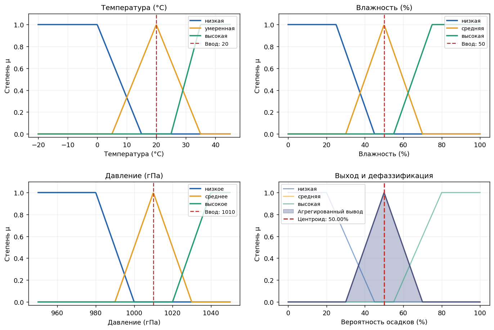
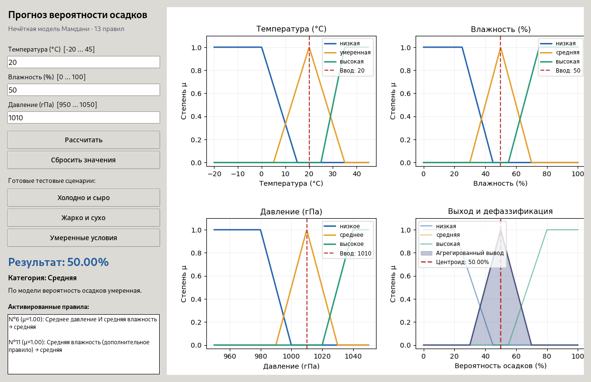
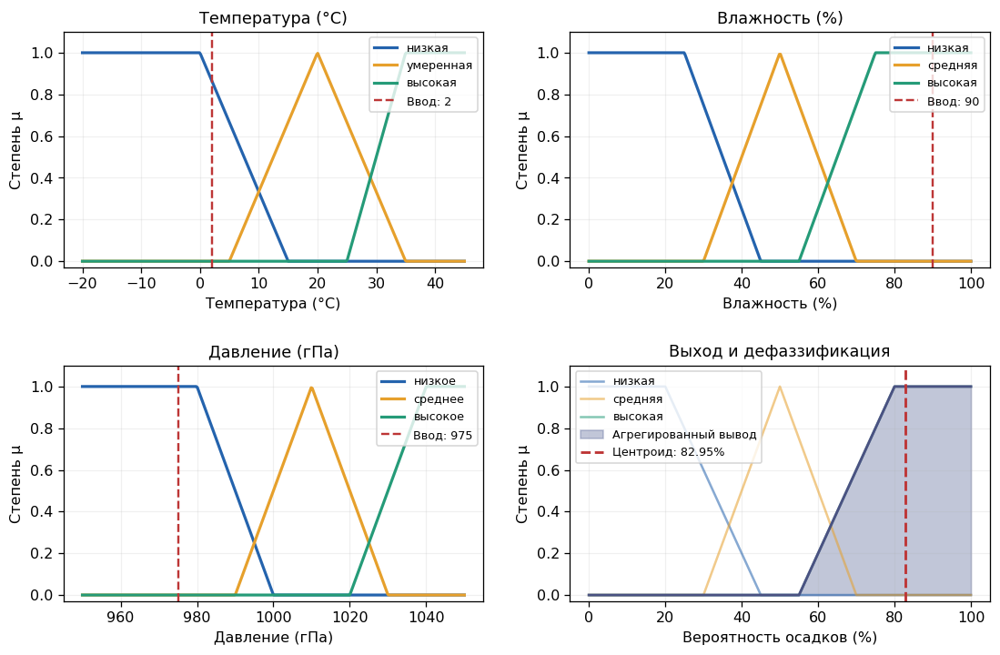
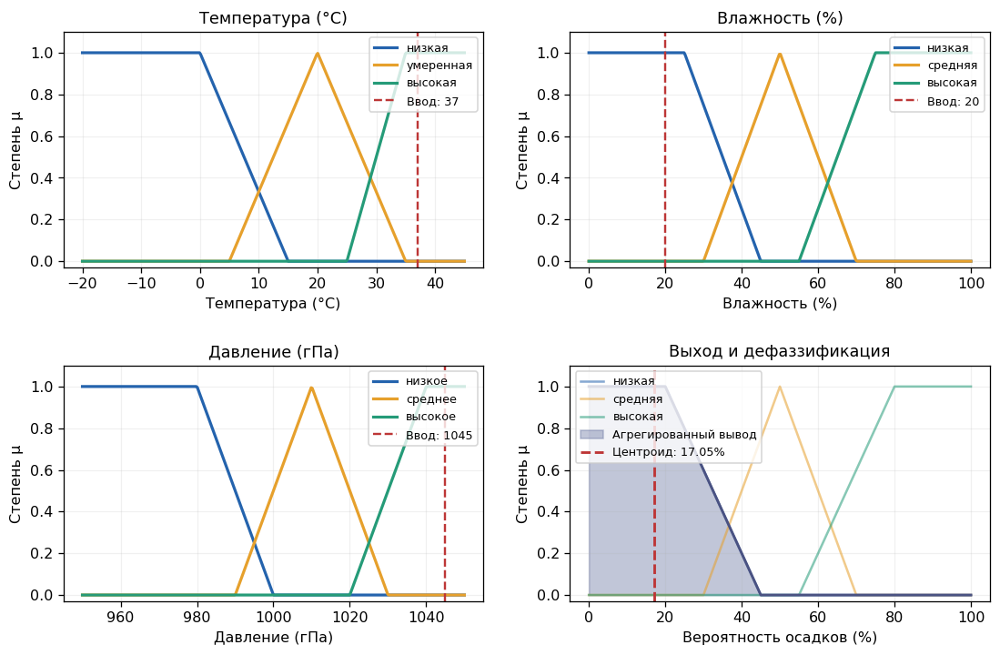
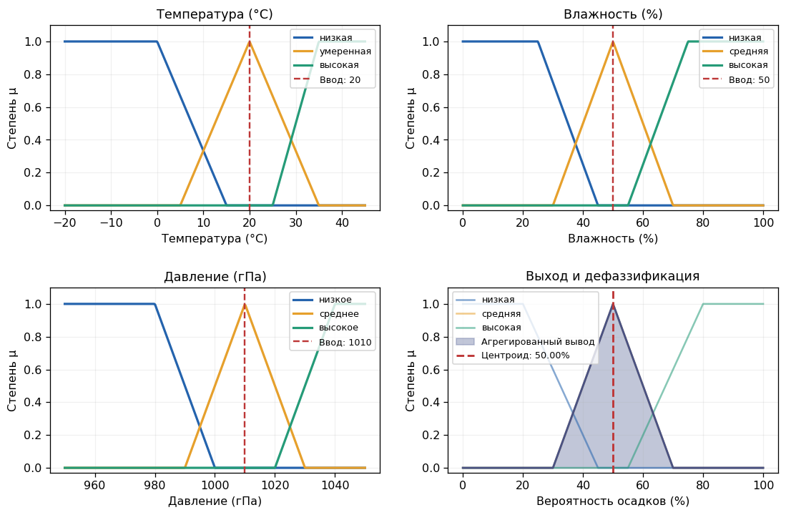

# Лабораторная работа №4 — нечёткая логика и алгоритм Мамдани

<div align="center">

**Государственный университет Молдовы**  
**Факультет математики и информатики**  

**ОТЧЁТ ПО ЛАБОРАТОРНОЙ РАБОТЕ №4**

**Тема:** Реализация нечёткой системы на основе алгоритма Мамдани  
**Вариант №1:** «Прогнозирование погодных условий»  

**Выполнила:** Скрипник Ксения  
**Группа:** IA2404  

</div>

---

## 2. Цель лабораторной работы

Разработать и исследовать нечёткую систему **оценки вероятности осадков** на основе температуры воздуха, относительной влажности и атмосферного давления с применением алгоритма Мамдани.

Задачи: определить лингвистические переменные и функции принадлежности; составить не менее девяти правил `IF–THEN`; реализовать фаззификацию, применение правил, агрегацию и дефаззификацию методом центроида; создать интерактивный интерфейс с графиками; проверить работу минимум в трёх сценариях и обработать некорректный ввод.

## 3. Описание предметной области

Изменение погодных условий зависит от множества взаимосвязанных факторов. Например, высокая влажность часто сопровождается повышенной возможностью осадков, а высокое атмосферное давление нередко связано с устойчивой погодой. Точные зависимости сложны, поэтому в учебной модели используется **нечёткая логика**, позволяющая оперировать понятиями «низкая», «умеренная» и «высокая».

В отличие от жёсткого деления по порогам, одно значение может одновременно частично принадлежать нескольким множествам. Например, некоторая температура может быть одновременно «низкой» и «умеренной» с разными степенями принадлежности.

**Допущение:** это демонстрационная экспертная модель, а не проверенный метеорологический прогноз. Её численный результат следует понимать как условную оценку вероятности осадков внутри модели, а не как калиброванную вероятность по историческим погодным наблюдениям.

## 4. Входные и выходные переменные

| Переменная | Тип | Диапазон | Лингвистические значения |
|---|---|---|---|
| Температура | Вход | −20…45 °C | низкая, умеренная, высокая |
| Влажность | Вход | 0…100 % | низкая, средняя, высокая |
| Давление | Вход | 950…1050 гПа | низкое, среднее, высокое |
| Вероятность осадков | Выход | 0…100 % | низкая, средняя, высокая |

Все четыре переменные представлены трапециевидными функциями принадлежности, частным случаем которых является треугольная функция.

Параметры функций задаются четырьмя точками `(a, b, c, d)`: принадлежность возрастает от `a` к `b`, равна единице на интервале `b…c`, затем убывает от `c` к `d`. При совпадении `b = c` функция треугольная; при `a = b` или `c = d` образуется крайнее («плечевое») множество.

### Параметры функций принадлежности

| Переменная | Термы и параметры `(a, b, c, d)` |
|---|---|
| Температура | низкая `(-20,-20,0,15)`; умеренная `(5,20,20,35)`; высокая `(25,35,45,45)` |
| Влажность | низкая `(0,0,25,45)`; средняя `(30,50,50,70)`; высокая `(55,75,100,100)` |
| Давление | низкое `(950,950,980,1000)`; среднее `(990,1010,1010,1030)`; высокое `(1020,1040,1050,1050)` |
| Осадки | низкая `(0,0,20,45)`; средняя `(30,50,50,70)`; высокая `(55,80,100,100)` |

Пересечение соседних множеств обеспечивает плавное изменение результата при небольших изменениях входных данных.

## 5. Выбранный язык, технологии и библиотеки

- **Python 3** — язык программирования.
- **Tkinter / ttk** — графическое окно с полями ввода, кнопками и результатами.
- **NumPy** — вычисления с массивами и численное интегрирование.
- **Matplotlib** — построение графиков принадлежности, агрегированного вывода и визуализация центроида.
- **`csv`, `argparse`, `dataclasses`, `pathlib`** — стандартные модули Python для тестирования, структуры программы и сохранения результатов.

Функции принадлежности и этапы вывода Мамдани **реализованы непосредственно в исходном коде**, без готового пакета нечёткой логики; это упрощает объяснение алгоритма на защите.

## 6. Графики функций принадлежности

На рисунке показаны функции для трёх входных переменных и выхода на примере условий `20 °C`, `50 %` влажности, `1010 гПа`. Вертикальные пунктирные линии отмечают введённые значения; на выходном графике отображаются агрегированная функция и численный центроид.



**Интерпретация:** для указанного сценария все три входа имеют максимальную принадлежность к средним термам, поэтому наиболее активны правила средней вероятности осадков. Полученный центроид равен **50,00 %**.

## 7. Таблица нечётких правил

Реализовано **13 правил** `IF–THEN`. Первые девять повторяют приведённые в задании примеры варианта №1. Правила 10–12 добавлены, чтобы обеспечить результат для всего допустимого диапазона влажности; правило 13 демонстрирует логическое **ИЛИ (`OR`)**.

| № | Условие `IF` | Результат `THEN` |
|---:|---|---|
| 1 | Температура низкая **И** влажность высокая | Осадки высокие |
| 2 | Температура умеренная **И** влажность высокая | Осадки высокие |
| 3 | Температура высокая **И** давление высокое | Осадки низкие |
| 4 | Температура высокая **И** влажность низкая | Осадки низкие |
| 5 | Давление низкое **И** влажность высокая | Осадки высокие |
| 6 | Давление среднее **И** влажность средняя | Осадки средние |
| 7 | Температура низкая **И** давление низкое | Осадки высокие |
| 8 | Температура умеренная **И** давление высокое | Осадки низкие |
| 9 | Температура высокая **И** влажность средняя | Осадки средние |
| 10 | Влажность низкая | Осадки низкие |
| 11 | Влажность средняя | Осадки средние |
| 12 | Влажность высокая | Осадки высокие |
| 13 | Температура низкая **ИЛИ** влажность высокая **ИЛИ** давление низкое | Осадки высокие |

Вспомогательные правила 10–12 задают базовую оценку по влажности. Это проектное допущение, необходимое для непрерывной работы модели даже тогда, когда первые девять комбинаций не активируются.

## 8. Описание алгоритма Мамдани

Алгоритм реализован в функции `calculate()` и состоит из четырёх основных этапов.

### 7.1. Фаззификация

Числовые входы преобразуются в степени принадлежности лингвистическим множествам:

\[
\mu_A(x) \in [0,1].
\]

Например, `temperature = 20 °C` имеет степень принадлежности `1` к терму «умеренная» и `0` к термам «низкая» и «высокая» при выбранных функциях.

### 7.2. Активация нечётких правил

Для правил с **И (`AND`)** используется минимум степеней принадлежности:

\[
\alpha_i = \min(\mu_{A_i}(x),\mu_{B_i}(y)).
\]

Для правил с **ИЛИ (`OR`)** применяется максимум:

\[
\alpha_i = \max(\mu_{A_i}(x),\mu_{B_i}(y),\ldots).
\]

Полученная величина `αᵢ` — сила срабатывания правила.

### 7.3. Импликация и агрегация

Каждая выходная функция принадлежности обрезается на уровне силы правила (импликация Мамдани):

\[
\mu_i(z) = \min(\alpha_i, \mu_{B_i}(z)).
\]

Результаты всех 13 правил объединяются операцией максимума:

\[
\mu_{\mathrm{agg}}(z) = \max_i\mu_i(z).
\]

### 7.4. Дефаззификация методом центроида

Для получения числового результата используется центр тяжести агрегированной функции принадлежности:

\[
z^* = \frac{\int_0^{100} z\,\mu_{\mathrm{agg}}(z)\,dz}
{\int_0^{100} \mu_{\mathrm{agg}}(z)\,dz}.
\]

В программе интегралы численно вычисляются с помощью `numpy.trapezoid()` по сетке из **1001 точки** с шагом `0.1` на отрезке 0…100.

Полученное число дополнительно переводится в понятную категорию:

- **ниже 35 %** — низкая вероятность;
- **от 35 % до менее 65 %** — средняя;
- **65 % и выше** — высокая.

Пороговая текстовая интерпретация применяется **после** расчёта центроида и не заменяет нечёткий вывод.

## 9. Описание интерфейса пользователя

Программа реализована как **оконное приложение Tkinter**.

В левой части окна находятся три поля для ввода температуры, влажности и давления, кнопка **«Рассчитать»**, кнопка **«Сбросить значения»** и три кнопки готовых тестовых сценариев. Ниже отображаются числовой результат, категория, пояснение и список активированных правил с их степенями срабатывания.

В правой части размещены четыре графика: функции принадлежности температуры, влажности, давления и итоговое нечёткое множество с центроидом.

**Рисунок — интерфейс программы при начальных значениях:**



**Интерактивность и обработка ошибок:**

1. Пользователь может менять значения и нажимать «Рассчитать» неограниченное число раз без перезапуска.
2. Пустые, текстовые, бесконечные и нечисловые значения (`NaN`) не допускаются.
3. Проверяются границы: температура −20…45 °C, влажность 0…100 %, давление 950…1050 гПа.
4. При некорректном вводе выводится понятное окно с ошибкой, приложение не закрывается.
5. Поддерживается ввод десятичной дроби с точкой или запятой, а также запуск расчёта клавишей **Enter**.

> Скриншот работающего интерфейса уже добавлен выше. При необходимости можно сделать ещё один скриншот на своём компьютере после изменения значений.

## 10. Примеры тестовых сценариев

После запуска `python mamdani_weather.py --tests` выполнены следующие проверки:

| № | Сценарий | Температура | Влажность | Давление | Вывод Мамдани | Категория |
|---:|---|---:|---:|---:|---:|---|
| 1 | Холодно и сыро | 2 °C | 90 % | 975 гПа | **82,95 %** | Высокая |
| 2 | Жарко и сухо | 37 °C | 20 % | 1045 гПа | **17,05 %** | Низкая |
| 3 | Умеренные условия | 20 °C | 50 % | 1010 гПа | **50,00 %** | Средняя |

### Сценарий №1 — холодная влажная погода



При высокой влажности и низком давлении активируются правила, предполагающие высокую вероятность осадков. Результат — **82,95 %**.

### Сценарий №2 — жаркая сухая погода



При низкой влажности и высоком давлении преобладает выходное множество с низкой вероятностью осадков. Результат — **17,05 %**.

### Сценарий №3 — умеренные условия



При средних температуре, влажности и давлении преобладают правила средней вероятности осадков. Результат — **50,00 %**.

### Проверка некорректного ввода

Помимо трёх сценариев программа автоматически тестирует крайние допустимые значения и отклоняет следующие ошибки: пустая температура, `NaN`, температура `50 °C`, влажность `101 %` и отсутствие давления. Сообщение об ошибке не приводит к закрытию окна, и значения можно исправить.

## 11. Результаты работы программы

Реализована система, которая:

- принимает **три числовых входа**;
- вычисляет степени принадлежности по **трём нечётким множествам** для каждой входной переменной;
- обрабатывает **13 правил** и показывает, какие из них сработали;
- агрегирует выход и выполняет **дефаззификацию методом центроида**;
- выводит **численную оценку в процентах**, её текстовую категорию и пояснение;
- обновляет **четыре графика** при каждом новом расчёте;
- позволяет повторять вычисления без закрытия приложения.

При выполнении `--tests` в папке проекта автоматически появляются файлы `test_scenarios.csv`, `membership_functions.png` и `scenario_1.png` — `scenario_3.png`.

## 12. Анализ полученных результатов

Проверочные сценарии дали ожидаемую для выбранной базы правил последовательность оценок: **17,05 %** в жаркую сухую погоду, **50,00 %** при средних условиях и **82,95 %** в холодную влажную погоду.

Это демонстрирует, что система учитывает заданные экспертные правила и позволяет получать разные численные оценки. Перекрывающиеся множества обеспечивают плавный переход между категориями: небольшое изменение входного значения может постепенно менять силы сразу нескольких правил.

Дополнительные правила по влажности обеспечивают определённый результат во всём допустимом диапазоне входов. При этом физическая точность прогнозирования погоды не оценивалась: без исторических данных, обучения параметров и проверки на реальных наблюдениях результаты нельзя рассматривать как точный метеорологический прогноз.

## 13. Вывод

В лабораторной работе создана нечёткая модель оценки вероятности осадков на основе **алгоритма Мамдани**. Реализованы фаззификация, применение правил `IF–THEN` с операторами `AND` и `OR`, импликация, агрегация и дефаззификация методом центроида.

Разработан интерактивный графический интерфейс на Python, который отображает функции принадлежности, численный результат, текстовую интерпретацию и активированные правила. Проведены три тестовых сценария и проверки ошибочных данных.

### Структура папки

```text
lab4_mamdani_variant1/
├── README.md                    # Отчёт
├── mamdani_weather.py           # Исходная программа + GUI + тесты
├── requirements.txt             # Список внешних библиотек
├── test_scenarios.csv           # Таблица результатов тестирования
├── membership_functions.png     # Функции принадлежности и центроид
├── gui_screenshot.png           # Скриншот интерфейса программы
├── scenario_1.png               # Холодно и сыро
├── scenario_2.png               # Жарко и сухо
└── scenario_3.png               # Умеренные условия
```
