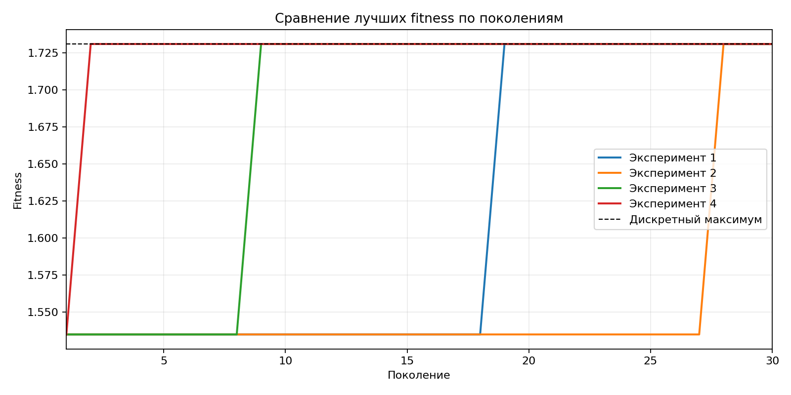
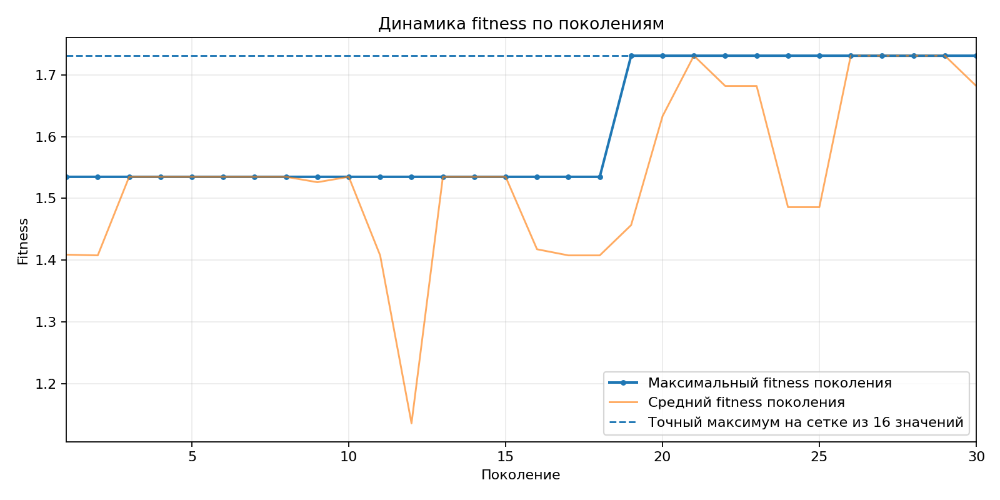
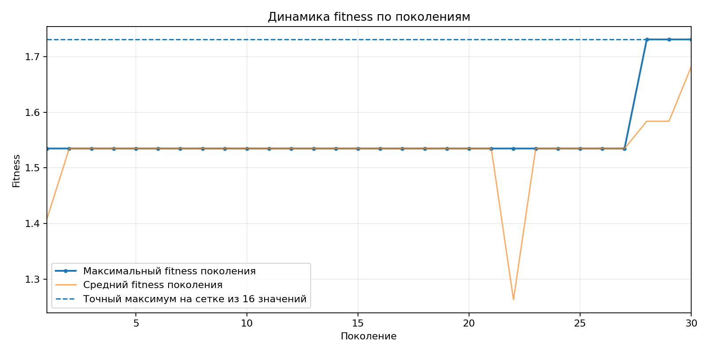
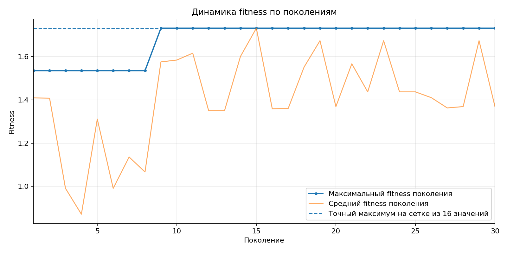
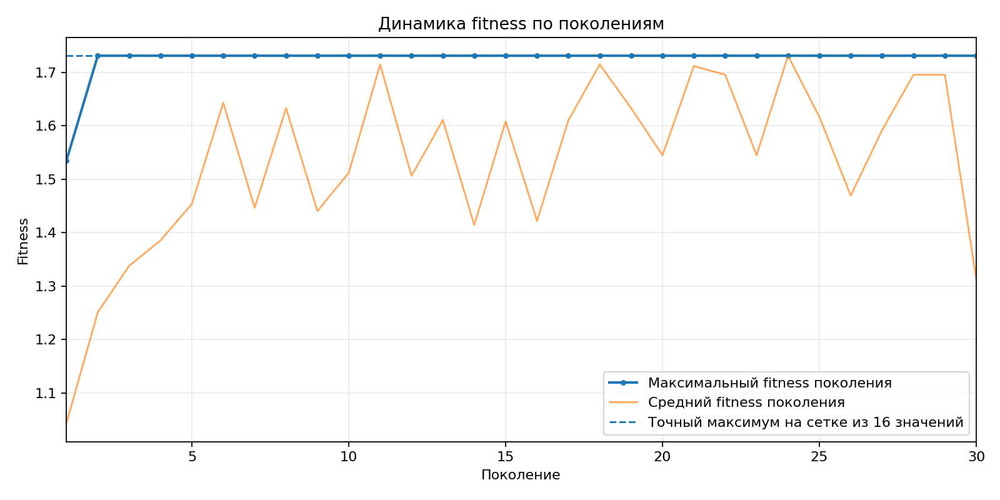

# Лабораторная работа №5

**Тема:** Реализация и исследование параметров генетического алгоритма  
**Вариант целевой функции:** №1  
**Студентка:**Scripnic Xenia 
**Группа:**IA2404

## 1. Цель работы

Реализовать генетический алгоритм для поиска максимума функции одной переменной на отрезке [0, 1], изучить операторы селекции, кроссовера и мутации, а также исследовать влияние вероятностей `pc`, `pm` и размера популяции `N` на скорость и качество поиска.

## 2. Постановка задачи и целевая функция

Для варианта №1 необходимо максимизировать функцию

$$
f(x) = x\sin(6\pi x) + 0.5\cos(4\pi x) + 1, \qquad x\in[0,1].
$$

Алгоритм работает с **четырёхбитными** хромосомами (`L=4`). Поэтому он исследует только 16 допустимых точек: `0/15, 1/15, ..., 15/15`. Лучшее решение на этой сетке не обязательно совпадает с максимумом непрерывной функции на всём отрезке. Это ограничение точности кодирования, а не ошибка алгоритма.

**Контрольный точный перебор 16 хромосом** (независимая проверка результата ГА) даёт: хромосома **`0111`**, десятичный код **7**, `x = 0.466667`, `f(x) = 1.731073`. Эта величина является *точным глобальным максимумом на заданной 4-битной сетке*.

## 3. Язык и технологии

- **Python 3.10+** — реализация алгоритма, случайная инициализация, вычисления, статистика и экспорт CSV.
- Модули стандартной библиотеки: `random` (генератор случайных чисел), `math` (целевая функция), `csv` (таблицы), `statistics` (средние значения), `argparse` (параметры запуска).
- **Matplotlib** — построение и сохранение графиков в PNG.
- Результаты: `README.md`, файлы подробных логов `full_log.txt`, таблицы `evolution.csv`, `statistics.csv`, графики `fitness.png` и сравнительный график `comparison.png`.

## 4. Представление решения и операторы

### 4.1. Кодирование и декодирование

Четыре бита кодируют целое число `b` от 0 до 15. Преобразование в вещественное значение:

$$
x = \frac{b}{2^L-1} = \frac{b}{15},\qquad L=4.
$$

Например, `0101` → `b=5` → `x=5/15=0.333333`. Приспособленность (fitness) конкретной хромосомы равна значению целевой функции `f(x)`; **чем выше fitness, тем лучше**.

### 4.2. Основные этапы алгоритма

1. **Инициализация:** создаётся случайная популяция из `N` четырёхбитных хромосом. Повторяющиеся хромосомы допустимы.
2. **Оценка:** для каждой хромосомы вычисляются `b`, `x=b/15` и `fitness=f(x)`.
3. **Селекция:** *турнир размером 2* — случайно выбираются две особи; родителем становится особь с большим fitness. Подходит в том числе для функций с отрицательными значениями.
4. **Одноточечный кроссовер:** с вероятностью `pc` выбирается точка после 1-го, 2-го либо 3-го бита; родители обмениваются правыми частями. Иначе потомки являются копиями родителей.
5. **Побитовая мутация:** каждый бит каждого нового потомка независимо меняется `0 ↔ 1` с вероятностью `pm`. В логе указаны номер новой особи, позиция бита, старое и новое значения.
6. **Элитизм:** одна лучшая особь текущего поколения копируется в следующее **без мутации**. Это предохраняет найденный максимум от потери.
7. **Новое поколение:** элита плюс потомки заполняют ровно `N` мест. На последнем поколении создавать следующее не требуется.
8. **Остановка:** после заданных `G` поколений (`G ≥ 30`). Записываются наименьший, средний и наибольший fitness каждого поколения, а также лучшие найденные `x*`, `f(x*)`.

**Замечание:** из-за элитизма максимальный fitness поколения не уменьшается. Высокая мутация может увеличивать разнообразие, но разрушать хорошие комбинации у потомков; элита при этом сохраняется. Случайность может приводить к различным результатам даже при одинаковых параметрах.

## 5. Параметры проведённых экспериментов

Длина `L=4` фиксирована. Во всех основных опытах использован `G=30`, фиксированное начальное значение генератора `seed=154` для воспроизводимости. При одинаковом `seed` первые четыре случайные хромосомы в стартовых популяциях совпадают.

| № | N | L | pc | pm | G | Что проверяем |
| --- | --- | --- | --- | --- | --- | --- |
| 1 | 4 | 4 | 0.8 | 0.05 | 30 | Базовые параметры |
| 2 | 4 | 4 | 0.4 | 0.01 | 30 | Меньше скрещиваний и мутаций |
| 3 | 4 | 4 | 0.9 | 0.15 | 30 | Больше скрещиваний и мутаций |
| 4 | 12 | 4 | 0.8 | 0.05 | 30 | Влияние размера популяции (сравнение с №1) |


Первое сравнение (№1–3) показывает влияние `pc` и `pm` при постоянном `N=4`. Сравнение №1 и №4 показывает влияние `N` при одинаковых `pc`, `pm` и `G`. Поскольку параметры `pc` и `pm` в №2–3 изменяются одновременно, по одиночным сравнениям нельзя строго отделить эффект одного от другого.

## 6. Результаты основных экспериментов

В итоговых таблицах указано лучшее решение, найденное **за все поколения**. Поколение первого обнаружения точного дискретного оптимума показывает скорость поиска; знак `—` означает, что оптимум за 30 поколений не встретился.

| Эксп. | Лучшая хромосома | x* | f(x*) | Первое достижение оптимума | Оптимум найден? |
| --- | --- | --- | --- | --- | --- |
| 1 | `0111` | 0.466667 | 1.731073 | 19 | Да |
| 2 | `0111` | 0.466667 | 1.731073 | 28 | Да |
| 3 | `0111` | 0.466667 | 1.731073 | 9 | Да |
| 4 | `0111` | 0.466667 | 1.731073 | 2 | Да |




### 6.1. Эксперимент №1

Параметры: `N=4`, `L=4`, `pc=0.8`, `pm=0.05`, `G=30`, `seed=154`. Найденная хромосома: **`0111`**; `x*=0.466667`; `f(x*)=1.731073`. Первое обнаружение дискретного оптимума: **поколение 19**.



**Таблица статистики поколений:**

| Поколение | Минимальный fitness | Средний fitness | Максимальный fitness | Разных хромосом |
| --- | --- | --- | --- | --- |
| 1 | 1.065720 | 1.408895 | 1.534931 | 3 |
| 2 | 1.026107 | 1.407725 | 1.534931 | 2 |
| 3 | 1.534931 | 1.534931 | 1.534931 | 1 |
| 4 | 1.534931 | 1.534931 | 1.534931 | 1 |
| 5 | 1.534931 | 1.534931 | 1.534931 | 1 |
| 6 | 1.534931 | 1.534931 | 1.534931 | 1 |
| 7 | 1.534931 | 1.534931 | 1.534931 | 1 |
| 8 | 1.534931 | 1.534931 | 1.534931 | 1 |
| 9 | 1.500000 | 1.526198 | 1.534931 | 2 |
| 10 | 1.534931 | 1.534931 | 1.534931 | 1 |
| 11 | 1.026107 | 1.407725 | 1.534931 | 2 |
| 12 | 0.446913 | 1.135720 | 1.534931 | 3 |
| 13 | 1.534931 | 1.534931 | 1.534931 | 1 |
| 14 | 1.534931 | 1.534931 | 1.534931 | 1 |
| 15 | 1.534931 | 1.534931 | 1.534931 | 1 |
| 16 | 1.065720 | 1.417628 | 1.534931 | 2 |
| 17 | 1.026107 | 1.407725 | 1.534931 | 2 |
| 18 | 1.026107 | 1.407725 | 1.534931 | 2 |
| 19 | 1.026107 | 1.456760 | 1.731073 | 3 |
| 20 | 1.534931 | 1.633002 | 1.731073 | 2 |
| 21 | 1.731073 | 1.731073 | 1.731073 | 1 |
| 22 | 1.534931 | 1.682037 | 1.731073 | 2 |
| 23 | 1.534931 | 1.682037 | 1.731073 | 2 |
| 24 | 0.750000 | 1.485804 | 1.731073 | 2 |
| 25 | 0.750000 | 1.485804 | 1.731073 | 2 |
| 26 | 1.731073 | 1.731073 | 1.731073 | 1 |
| 27 | 1.731073 | 1.731073 | 1.731073 | 1 |
| 28 | 1.731073 | 1.731073 | 1.731073 | 1 |
| 29 | 1.731073 | 1.731073 | 1.731073 | 1 |
| 30 | 1.534931 | 1.682037 | 1.731073 | 2 |

**Таблица эволюции популяции** — все 120 записей; также сохранена в [`evolution.csv`](results/experiment_1/evolution.csv).

<details>
<summary>Показать полную таблицу особей по поколениям</summary>

| Поколение | № особи | Хромосома | Код b | x | f(x) |
| --- | --- | --- | --- | --- | --- |
| 1 | 1 | `0110` | 6 | 0.400000 | 1.534931 |
| 1 | 2 | `1100` | 12 | 0.800000 | 1.065720 |
| 1 | 3 | `1111` | 15 | 1.000000 | 1.500000 |
| 1 | 4 | `0110` | 6 | 0.400000 | 1.534931 |
| 2 | 1 | `0110` | 6 | 0.400000 | 1.534931 |
| 2 | 2 | `0110` | 6 | 0.400000 | 1.534931 |
| 2 | 3 | `0110` | 6 | 0.400000 | 1.534931 |
| 2 | 4 | `0010` | 2 | 0.133333 | 1.026107 |
| 3 | 1 | `0110` | 6 | 0.400000 | 1.534931 |
| 3 | 2 | `0110` | 6 | 0.400000 | 1.534931 |
| 3 | 3 | `0110` | 6 | 0.400000 | 1.534931 |
| 3 | 4 | `0110` | 6 | 0.400000 | 1.534931 |
| 4 | 1 | `0110` | 6 | 0.400000 | 1.534931 |
| 4 | 2 | `0110` | 6 | 0.400000 | 1.534931 |
| 4 | 3 | `0110` | 6 | 0.400000 | 1.534931 |
| 4 | 4 | `0110` | 6 | 0.400000 | 1.534931 |
| 5 | 1 | `0110` | 6 | 0.400000 | 1.534931 |
| 5 | 2 | `0110` | 6 | 0.400000 | 1.534931 |
| 5 | 3 | `0110` | 6 | 0.400000 | 1.534931 |
| 5 | 4 | `0110` | 6 | 0.400000 | 1.534931 |
| 6 | 1 | `0110` | 6 | 0.400000 | 1.534931 |
| 6 | 2 | `0110` | 6 | 0.400000 | 1.534931 |
| 6 | 3 | `0110` | 6 | 0.400000 | 1.534931 |
| 6 | 4 | `0110` | 6 | 0.400000 | 1.534931 |
| 7 | 1 | `0110` | 6 | 0.400000 | 1.534931 |
| 7 | 2 | `0110` | 6 | 0.400000 | 1.534931 |
| 7 | 3 | `0110` | 6 | 0.400000 | 1.534931 |
| 7 | 4 | `0110` | 6 | 0.400000 | 1.534931 |
| 8 | 1 | `0110` | 6 | 0.400000 | 1.534931 |
| 8 | 2 | `0110` | 6 | 0.400000 | 1.534931 |
| 8 | 3 | `0110` | 6 | 0.400000 | 1.534931 |
| 8 | 4 | `0110` | 6 | 0.400000 | 1.534931 |
| 9 | 1 | `0110` | 6 | 0.400000 | 1.534931 |
| 9 | 2 | `1111` | 15 | 1.000000 | 1.500000 |
| 9 | 3 | `0110` | 6 | 0.400000 | 1.534931 |
| 9 | 4 | `0110` | 6 | 0.400000 | 1.534931 |
| 10 | 1 | `0110` | 6 | 0.400000 | 1.534931 |
| 10 | 2 | `0110` | 6 | 0.400000 | 1.534931 |
| 10 | 3 | `0110` | 6 | 0.400000 | 1.534931 |
| 10 | 4 | `0110` | 6 | 0.400000 | 1.534931 |
| 11 | 1 | `0110` | 6 | 0.400000 | 1.534931 |
| 11 | 2 | `0110` | 6 | 0.400000 | 1.534931 |
| 11 | 3 | `0010` | 2 | 0.133333 | 1.026107 |
| 11 | 4 | `0110` | 6 | 0.400000 | 1.534931 |
| 12 | 1 | `0110` | 6 | 0.400000 | 1.534931 |
| 12 | 2 | `0110` | 6 | 0.400000 | 1.534931 |
| 12 | 3 | `0010` | 2 | 0.133333 | 1.026107 |
| 12 | 4 | `1110` | 14 | 0.933333 | 0.446913 |
| 13 | 1 | `0110` | 6 | 0.400000 | 1.534931 |
| 13 | 2 | `0110` | 6 | 0.400000 | 1.534931 |
| 13 | 3 | `0110` | 6 | 0.400000 | 1.534931 |
| 13 | 4 | `0110` | 6 | 0.400000 | 1.534931 |
| 14 | 1 | `0110` | 6 | 0.400000 | 1.534931 |
| 14 | 2 | `0110` | 6 | 0.400000 | 1.534931 |
| 14 | 3 | `0110` | 6 | 0.400000 | 1.534931 |
| 14 | 4 | `0110` | 6 | 0.400000 | 1.534931 |
| 15 | 1 | `0110` | 6 | 0.400000 | 1.534931 |
| 15 | 2 | `0110` | 6 | 0.400000 | 1.534931 |
| 15 | 3 | `0110` | 6 | 0.400000 | 1.534931 |
| 15 | 4 | `0110` | 6 | 0.400000 | 1.534931 |
| 16 | 1 | `0110` | 6 | 0.400000 | 1.534931 |
| 16 | 2 | `0110` | 6 | 0.400000 | 1.534931 |
| 16 | 3 | `1100` | 12 | 0.800000 | 1.065720 |
| 16 | 4 | `0110` | 6 | 0.400000 | 1.534931 |
| 17 | 1 | `0110` | 6 | 0.400000 | 1.534931 |
| 17 | 2 | `0110` | 6 | 0.400000 | 1.534931 |
| 17 | 3 | `0110` | 6 | 0.400000 | 1.534931 |
| 17 | 4 | `0010` | 2 | 0.133333 | 1.026107 |
| 18 | 1 | `0110` | 6 | 0.400000 | 1.534931 |
| 18 | 2 | `0010` | 2 | 0.133333 | 1.026107 |
| 18 | 3 | `0110` | 6 | 0.400000 | 1.534931 |
| 18 | 4 | `0110` | 6 | 0.400000 | 1.534931 |
| 19 | 1 | `0110` | 6 | 0.400000 | 1.534931 |
| 19 | 2 | `0110` | 6 | 0.400000 | 1.534931 |
| 19 | 3 | `0111` | 7 | 0.466667 | 1.731073 |
| 19 | 4 | `0010` | 2 | 0.133333 | 1.026107 |
| 20 | 1 | `0111` | 7 | 0.466667 | 1.731073 |
| 20 | 2 | `0110` | 6 | 0.400000 | 1.534931 |
| 20 | 3 | `0111` | 7 | 0.466667 | 1.731073 |
| 20 | 4 | `0110` | 6 | 0.400000 | 1.534931 |
| 21 | 1 | `0111` | 7 | 0.466667 | 1.731073 |
| 21 | 2 | `0111` | 7 | 0.466667 | 1.731073 |
| 21 | 3 | `0111` | 7 | 0.466667 | 1.731073 |
| 21 | 4 | `0111` | 7 | 0.466667 | 1.731073 |
| 22 | 1 | `0111` | 7 | 0.466667 | 1.731073 |
| 22 | 2 | `0111` | 7 | 0.466667 | 1.731073 |
| 22 | 3 | `0111` | 7 | 0.466667 | 1.731073 |
| 22 | 4 | `0110` | 6 | 0.400000 | 1.534931 |
| 23 | 1 | `0111` | 7 | 0.466667 | 1.731073 |
| 23 | 2 | `0110` | 6 | 0.400000 | 1.534931 |
| 23 | 3 | `0111` | 7 | 0.466667 | 1.731073 |
| 23 | 4 | `0111` | 7 | 0.466667 | 1.731073 |
| 24 | 1 | `0111` | 7 | 0.466667 | 1.731073 |
| 24 | 2 | `0111` | 7 | 0.466667 | 1.731073 |
| 24 | 3 | `0101` | 5 | 0.333333 | 0.750000 |
| 24 | 4 | `0111` | 7 | 0.466667 | 1.731073 |
| 25 | 1 | `0111` | 7 | 0.466667 | 1.731073 |
| 25 | 2 | `0111` | 7 | 0.466667 | 1.731073 |
| 25 | 3 | `0101` | 5 | 0.333333 | 0.750000 |
| 25 | 4 | `0111` | 7 | 0.466667 | 1.731073 |
| 26 | 1 | `0111` | 7 | 0.466667 | 1.731073 |
| 26 | 2 | `0111` | 7 | 0.466667 | 1.731073 |
| 26 | 3 | `0111` | 7 | 0.466667 | 1.731073 |
| 26 | 4 | `0111` | 7 | 0.466667 | 1.731073 |
| 27 | 1 | `0111` | 7 | 0.466667 | 1.731073 |
| 27 | 2 | `0111` | 7 | 0.466667 | 1.731073 |
| 27 | 3 | `0111` | 7 | 0.466667 | 1.731073 |
| 27 | 4 | `0111` | 7 | 0.466667 | 1.731073 |
| 28 | 1 | `0111` | 7 | 0.466667 | 1.731073 |
| 28 | 2 | `0111` | 7 | 0.466667 | 1.731073 |
| 28 | 3 | `0111` | 7 | 0.466667 | 1.731073 |
| 28 | 4 | `0111` | 7 | 0.466667 | 1.731073 |
| 29 | 1 | `0111` | 7 | 0.466667 | 1.731073 |
| 29 | 2 | `0111` | 7 | 0.466667 | 1.731073 |
| 29 | 3 | `0111` | 7 | 0.466667 | 1.731073 |
| 29 | 4 | `0111` | 7 | 0.466667 | 1.731073 |
| 30 | 1 | `0111` | 7 | 0.466667 | 1.731073 |
| 30 | 2 | `0111` | 7 | 0.466667 | 1.731073 |
| 30 | 3 | `0110` | 6 | 0.400000 | 1.534931 |
| 30 | 4 | `0111` | 7 | 0.466667 | 1.731073 |

</details>

**Подробный автоматически сформированный лог всех 30 поколений:** [`full_log.txt`](results/experiment_1/full_log.txt). Лог содержит все особи и fitness, пары родителей, точки кроссовера, каждую мутацию, статистику и новые популяции.

<details>
<summary>Показать полный лог (включён в README для выполнения требований отчёта)</summary>

```text
Поколение: 1
Популяция:
  1. Хромосома: 0110 | Десятичное значение:  6 | x: 0.400000 | fitness: 1.534931
  2. Хромосома: 1100 | Десятичное значение: 12 | x: 0.800000 | fitness: 1.065720
  3. Хромосома: 1111 | Десятичное значение: 15 | x: 1.000000 | fitness: 1.500000
  4. Хромосома: 0110 | Десятичное значение:  6 | x: 0.400000 | fitness: 1.534931
Статистика поколения:
  Минимальный fitness: 1.065720
  Средний fitness:   1.408895
  Максимальный fitness: 1.534931
  Уникальных хромосом: 3 из 4
  Лучшая особь поколения: №1 (0110)
Формирование следующего поколения:
  Элитизм: особь №1 (0110) перенесена без изменений.
  Пара родителей №1 (турнирная селекция):
    Родитель 1: особь №4, 0110, fitness=1.534931
    Родитель 2: особь №4, 0110, fitness=1.534931
    Кроссовер: ДА; точка после бита 2; потомки до мутации: 0110 и 0110
    Мутация в новой особи №2: НЕТ; итог: 0110
    Мутация в новой особи №3: НЕТ; итог: 0110
  Пара родителей №2 (турнирная селекция):
    Родитель 1: особь №4, 0110, fitness=1.534931
    Родитель 2: особь №4, 0110, fitness=1.534931
    Кроссовер: ДА; точка после бита 2; потомки до мутации: 0110 и 0110
    Мутация в новой особи №4, бит 2 изменён с 1 на 0
    Итог после мутации, новая особь №4: 0010
Следующее поколение: 0110, 0110, 0110, 0010
------------------------------------------------------------

Поколение: 2
Популяция:
  1. Хромосома: 0110 | Десятичное значение:  6 | x: 0.400000 | fitness: 1.534931
  2. Хромосома: 0110 | Десятичное значение:  6 | x: 0.400000 | fitness: 1.534931
  3. Хромосома: 0110 | Десятичное значение:  6 | x: 0.400000 | fitness: 1.534931
  4. Хромосома: 0010 | Десятичное значение:  2 | x: 0.133333 | fitness: 1.026107
Статистика поколения:
  Минимальный fitness: 1.026107
  Средний fitness:   1.407725
  Максимальный fitness: 1.534931
  Уникальных хромосом: 2 из 4
  Лучшая особь поколения: №1 (0110)
Формирование следующего поколения:
  Элитизм: особь №1 (0110) перенесена без изменений.
  Пара родителей №1 (турнирная селекция):
    Родитель 1: особь №2, 0110, fitness=1.534931
    Родитель 2: особь №1, 0110, fitness=1.534931
    Кроссовер: ДА; точка после бита 1; потомки до мутации: 0110 и 0110
    Мутация в новой особи №2: НЕТ; итог: 0110
    Мутация в новой особи №3: НЕТ; итог: 0110
  Пара родителей №2 (турнирная селекция):
    Родитель 1: особь №1, 0110, fitness=1.534931
    Родитель 2: особь №2, 0110, fitness=1.534931
    Кроссовер: ДА; точка после бита 3; потомки до мутации: 0110 и 0110
    Мутация в новой особи №4: НЕТ; итог: 0110
Следующее поколение: 0110, 0110, 0110, 0110
------------------------------------------------------------

Поколение: 3
Популяция:
  1. Хромосома: 0110 | Десятичное значение:  6 | x: 0.400000 | fitness: 1.534931
  2. Хромосома: 0110 | Десятичное значение:  6 | x: 0.400000 | fitness: 1.534931
  3. Хромосома: 0110 | Десятичное значение:  6 | x: 0.400000 | fitness: 1.534931
  4. Хромосома: 0110 | Десятичное значение:  6 | x: 0.400000 | fitness: 1.534931
Статистика поколения:
  Минимальный fitness: 1.534931
  Средний fitness:   1.534931
  Максимальный fitness: 1.534931
  Уникальных хромосом: 1 из 4
  Лучшая особь поколения: №1 (0110)
Формирование следующего поколения:
  Элитизм: особь №1 (0110) перенесена без изменений.
  Пара родителей №1 (турнирная селекция):
    Родитель 1: особь №2, 0110, fitness=1.534931
    Родитель 2: особь №2, 0110, fitness=1.534931
    Кроссовер: ДА; точка после бита 3; потомки до мутации: 0110 и 0110
    Мутация в новой особи №2: НЕТ; итог: 0110
    Мутация в новой особи №3: НЕТ; итог: 0110
  Пара родителей №2 (турнирная селекция):
    Родитель 1: особь №3, 0110, fitness=1.534931
    Родитель 2: особь №3, 0110, fitness=1.534931
    Кроссовер: ДА; точка после бита 1; потомки до мутации: 0110 и 0110
    Мутация в новой особи №4: НЕТ; итог: 0110
Следующее поколение: 0110, 0110, 0110, 0110
------------------------------------------------------------

Поколение: 4
Популяция:
  1. Хромосома: 0110 | Десятичное значение:  6 | x: 0.400000 | fitness: 1.534931
  2. Хромосома: 0110 | Десятичное значение:  6 | x: 0.400000 | fitness: 1.534931
  3. Хромосома: 0110 | Десятичное значение:  6 | x: 0.400000 | fitness: 1.534931
  4. Хромосома: 0110 | Десятичное значение:  6 | x: 0.400000 | fitness: 1.534931
Статистика поколения:
  Минимальный fitness: 1.534931
  Средний fitness:   1.534931
  Максимальный fitness: 1.534931
  Уникальных хромосом: 1 из 4
  Лучшая особь поколения: №1 (0110)
Формирование следующего поколения:
  Элитизм: особь №1 (0110) перенесена без изменений.
  Пара родителей №1 (турнирная селекция):
    Родитель 1: особь №3, 0110, fitness=1.534931
    Родитель 2: особь №4, 0110, fitness=1.534931
    Кроссовер: ДА; точка после бита 1; потомки до мутации: 0110 и 0110
    Мутация в новой особи №2: НЕТ; итог: 0110
    Мутация в новой особи №3: НЕТ; итог: 0110
  Пара родителей №2 (турнирная селекция):
    Родитель 1: особь №4, 0110, fitness=1.534931
    Родитель 2: особь №4, 0110, fitness=1.534931
    Кроссовер: ДА; точка после бита 3; потомки до мутации: 0110 и 0110
    Мутация в новой особи №4: НЕТ; итог: 0110
Следующее поколение: 0110, 0110, 0110, 0110
------------------------------------------------------------

Поколение: 5
Популяция:
  1. Хромосома: 0110 | Десятичное значение:  6 | x: 0.400000 | fitness: 1.534931
  2. Хромосома: 0110 | Десятичное значение:  6 | x: 0.400000 | fitness: 1.534931
  3. Хромосома: 0110 | Десятичное значение:  6 | x: 0.400000 | fitness: 1.534931
  4. Хромосома: 0110 | Десятичное значение:  6 | x: 0.400000 | fitness: 1.534931
Статистика поколения:
  Минимальный fitness: 1.534931
  Средний fitness:   1.534931
  Максимальный fitness: 1.534931
  Уникальных хромосом: 1 из 4
  Лучшая особь поколения: №1 (0110)
Формирование следующего поколения:
  Элитизм: особь №1 (0110) перенесена без изменений.
  Пара родителей №1 (турнирная селекция):
    Родитель 1: особь №1, 0110, fitness=1.534931
    Родитель 2: особь №1, 0110, fitness=1.534931
    Кроссовер: ДА; точка после бита 1; потомки до мутации: 0110 и 0110
    Мутация в новой особи №2: НЕТ; итог: 0110
    Мутация в новой особи №3: НЕТ; итог: 0110
  Пара родителей №2 (турнирная селекция):
    Родитель 1: особь №2, 0110, fitness=1.534931
    Родитель 2: особь №1, 0110, fitness=1.534931
    Кроссовер: НЕТ; потомки-копии: 0110 и 0110; точка: —
    Мутация в новой особи №4: НЕТ; итог: 0110
Следующее поколение: 0110, 0110, 0110, 0110
------------------------------------------------------------

Поколение: 6
Популяция:
  1. Хромосома: 0110 | Десятичное значение:  6 | x: 0.400000 | fitness: 1.534931
  2. Хромосома: 0110 | Десятичное значение:  6 | x: 0.400000 | fitness: 1.534931
  3. Хромосома: 0110 | Десятичное значение:  6 | x: 0.400000 | fitness: 1.534931
  4. Хромосома: 0110 | Десятичное значение:  6 | x: 0.400000 | fitness: 1.534931
Статистика поколения:
  Минимальный fitness: 1.534931
  Средний fitness:   1.534931
  Максимальный fitness: 1.534931
  Уникальных хромосом: 1 из 4
  Лучшая особь поколения: №1 (0110)
Формирование следующего поколения:
  Элитизм: особь №1 (0110) перенесена без изменений.
  Пара родителей №1 (турнирная селекция):
    Родитель 1: особь №4, 0110, fitness=1.534931
    Родитель 2: особь №1, 0110, fitness=1.534931
    Кроссовер: ДА; точка после бита 1; потомки до мутации: 0110 и 0110
    Мутация в новой особи №2: НЕТ; итог: 0110
    Мутация в новой особи №3: НЕТ; итог: 0110
  Пара родителей №2 (турнирная селекция):
    Родитель 1: особь №2, 0110, fitness=1.534931
    Родитель 2: особь №3, 0110, fitness=1.534931
    Кроссовер: НЕТ; потомки-копии: 0110 и 0110; точка: —
    Мутация в новой особи №4: НЕТ; итог: 0110
Следующее поколение: 0110, 0110, 0110, 0110
------------------------------------------------------------

Поколение: 7
Популяция:
  1. Хромосома: 0110 | Десятичное значение:  6 | x: 0.400000 | fitness: 1.534931
  2. Хромосома: 0110 | Десятичное значение:  6 | x: 0.400000 | fitness: 1.534931
  3. Хромосома: 0110 | Десятичное значение:  6 | x: 0.400000 | fitness: 1.534931
  4. Хромосома: 0110 | Десятичное значение:  6 | x: 0.400000 | fitness: 1.534931
Статистика поколения:
  Минимальный fitness: 1.534931
  Средний fitness:   1.534931
  Максимальный fitness: 1.534931
  Уникальных хромосом: 1 из 4
  Лучшая особь поколения: №1 (0110)
Формирование следующего поколения:
  Элитизм: особь №1 (0110) перенесена без изменений.
  Пара родителей №1 (турнирная селекция):
    Родитель 1: особь №2, 0110, fitness=1.534931
    Родитель 2: особь №2, 0110, fitness=1.534931
    Кроссовер: ДА; точка после бита 1; потомки до мутации: 0110 и 0110
    Мутация в новой особи №2: НЕТ; итог: 0110
    Мутация в новой особи №3: НЕТ; итог: 0110
  Пара родителей №2 (турнирная селекция):
    Родитель 1: особь №2, 0110, fitness=1.534931
    Родитель 2: особь №1, 0110, fitness=1.534931
    Кроссовер: ДА; точка после бита 1; потомки до мутации: 0110 и 0110
    Мутация в новой особи №4: НЕТ; итог: 0110
Следующее поколение: 0110, 0110, 0110, 0110
------------------------------------------------------------

Поколение: 8
Популяция:
  1. Хромосома: 0110 | Десятичное значение:  6 | x: 0.400000 | fitness: 1.534931
  2. Хромосома: 0110 | Десятичное значение:  6 | x: 0.400000 | fitness: 1.534931
  3. Хромосома: 0110 | Десятичное значение:  6 | x: 0.400000 | fitness: 1.534931
  4. Хромосома: 0110 | Десятичное значение:  6 | x: 0.400000 | fitness: 1.534931
Статистика поколения:
  Минимальный fitness: 1.534931
  Средний fitness:   1.534931
  Максимальный fitness: 1.534931
  Уникальных хромосом: 1 из 4
  Лучшая особь поколения: №1 (0110)
Формирование следующего поколения:
  Элитизм: особь №1 (0110) перенесена без изменений.
  Пара родителей №1 (турнирная селекция):
    Родитель 1: особь №1, 0110, fitness=1.534931
    Родитель 2: особь №1, 0110, fitness=1.534931
    Кроссовер: ДА; точка после бита 2; потомки до мутации: 0110 и 0110
    Мутация в новой особи №2, бит 1 изменён с 0 на 1
    Мутация в новой особи №2, бит 4 изменён с 0 на 1
    Итог после мутации, новая особь №2: 1111
    Мутация в новой особи №3: НЕТ; итог: 0110
  Пара родителей №2 (турнирная селекция):
    Родитель 1: особь №4, 0110, fitness=1.534931
    Родитель 2: особь №2, 0110, fitness=1.534931
    Кроссовер: НЕТ; потомки-копии: 0110 и 0110; точка: —
    Мутация в новой особи №4: НЕТ; итог: 0110
Следующее поколение: 0110, 1111, 0110, 0110
------------------------------------------------------------

Поколение: 9
Популяция:
  1. Хромосома: 0110 | Десятичное значение:  6 | x: 0.400000 | fitness: 1.534931
  2. Хромосома: 1111 | Десятичное значение: 15 | x: 1.000000 | fitness: 1.500000
  3. Хромосома: 0110 | Десятичное значение:  6 | x: 0.400000 | fitness: 1.534931
  4. Хромосома: 0110 | Десятичное значение:  6 | x: 0.400000 | fitness: 1.534931
Статистика поколения:
  Минимальный fitness: 1.500000
  Средний fitness:   1.526198
  Максимальный fitness: 1.534931
  Уникальных хромосом: 2 из 4
  Лучшая особь поколения: №1 (0110)
Формирование следующего поколения:
  Элитизм: особь №1 (0110) перенесена без изменений.
  Пара родителей №1 (турнирная селекция):
    Родитель 1: особь №1, 0110, fitness=1.534931
    Родитель 2: особь №1, 0110, fitness=1.534931
    Кроссовер: ДА; точка после бита 3; потомки до мутации: 0110 и 0110
    Мутация в новой особи №2: НЕТ; итог: 0110
    Мутация в новой особи №3: НЕТ; итог: 0110
  Пара родителей №2 (турнирная селекция):
    Родитель 1: особь №4, 0110, fitness=1.534931
    Родитель 2: особь №1, 0110, fitness=1.534931
    Кроссовер: НЕТ; потомки-копии: 0110 и 0110; точка: —
    Мутация в новой особи №4: НЕТ; итог: 0110
Следующее поколение: 0110, 0110, 0110, 0110
------------------------------------------------------------

Поколение: 10
Популяция:
  1. Хромосома: 0110 | Десятичное значение:  6 | x: 0.400000 | fitness: 1.534931
  2. Хромосома: 0110 | Десятичное значение:  6 | x: 0.400000 | fitness: 1.534931
  3. Хромосома: 0110 | Десятичное значение:  6 | x: 0.400000 | fitness: 1.534931
  4. Хромосома: 0110 | Десятичное значение:  6 | x: 0.400000 | fitness: 1.534931
Статистика поколения:
  Минимальный fitness: 1.534931
  Средний fitness:   1.534931
  Максимальный fitness: 1.534931
  Уникальных хромосом: 1 из 4
  Лучшая особь поколения: №1 (0110)
Формирование следующего поколения:
  Элитизм: особь №1 (0110) перенесена без изменений.
  Пара родителей №1 (турнирная селекция):
    Родитель 1: особь №2, 0110, fitness=1.534931
    Родитель 2: особь №1, 0110, fitness=1.534931
    Кроссовер: НЕТ; потомки-копии: 0110 и 0110; точка: —
    Мутация в новой особи №2: НЕТ; итог: 0110
    Мутация в новой особи №3, бит 2 изменён с 1 на 0
    Итог после мутации, новая особь №3: 0010
  Пара родителей №2 (турнирная селекция):
    Родитель 1: особь №3, 0110, fitness=1.534931
    Родитель 2: особь №1, 0110, fitness=1.534931
    Кроссовер: ДА; точка после бита 3; потомки до мутации: 0110 и 0110
    Мутация в новой особи №4: НЕТ; итог: 0110
Следующее поколение: 0110, 0110, 0010, 0110
------------------------------------------------------------

Поколение: 11
Популяция:
  1. Хромосома: 0110 | Десятичное значение:  6 | x: 0.400000 | fitness: 1.534931
  2. Хромосома: 0110 | Десятичное значение:  6 | x: 0.400000 | fitness: 1.534931
  3. Хромосома: 0010 | Десятичное значение:  2 | x: 0.133333 | fitness: 1.026107
  4. Хромосома: 0110 | Десятичное значение:  6 | x: 0.400000 | fitness: 1.534931
Статистика поколения:
  Минимальный fitness: 1.026107
  Средний fitness:   1.407725
  Максимальный fitness: 1.534931
  Уникальных хромосом: 2 из 4
  Лучшая особь поколения: №1 (0110)
Формирование следующего поколения:
  Элитизм: особь №1 (0110) перенесена без изменений.
  Пара родителей №1 (турнирная селекция):
    Родитель 1: особь №2, 0110, fitness=1.534931
    Родитель 2: особь №3, 0010, fitness=1.026107
    Кроссовер: ДА; точка после бита 2; потомки до мутации: 0110 и 0010
    Мутация в новой особи №2: НЕТ; итог: 0110
    Мутация в новой особи №3: НЕТ; итог: 0010
  Пара родителей №2 (турнирная селекция):
    Родитель 1: особь №4, 0110, fitness=1.534931
    Родитель 2: особь №2, 0110, fitness=1.534931
    Кроссовер: ДА; точка после бита 2; потомки до мутации: 0110 и 0110
    Мутация в новой особи №4, бит 1 изменён с 0 на 1
    Итог после мутации, новая особь №4: 1110
Следующее поколение: 0110, 0110, 0010, 1110
------------------------------------------------------------

Поколение: 12
Популяция:
  1. Хромосома: 0110 | Десятичное значение:  6 | x: 0.400000 | fitness: 1.534931
  2. Хромосома: 0110 | Десятичное значение:  6 | x: 0.400000 | fitness: 1.534931
  3. Хромосома: 0010 | Десятичное значение:  2 | x: 0.133333 | fitness: 1.026107
  4. Хромосома: 1110 | Десятичное значение: 14 | x: 0.933333 | fitness: 0.446913
Статистика поколения:
  Минимальный fitness: 0.446913
  Средний fitness:   1.135720
  Максимальный fitness: 1.534931
  Уникальных хромосом: 3 из 4
  Лучшая особь поколения: №1 (0110)
Формирование следующего поколения:
  Элитизм: особь №1 (0110) перенесена без изменений.
  Пара родителей №1 (турнирная селекция):
    Родитель 1: особь №2, 0110, fitness=1.534931
    Родитель 2: особь №1, 0110, fitness=1.534931
    Кроссовер: НЕТ; потомки-копии: 0110 и 0110; точка: —
    Мутация в новой особи №2: НЕТ; итог: 0110
    Мутация в новой особи №3: НЕТ; итог: 0110
  Пара родителей №2 (турнирная селекция):
    Родитель 1: особь №2, 0110, fitness=1.534931
    Родитель 2: особь №1, 0110, fitness=1.534931
    Кроссовер: ДА; точка после бита 2; потомки до мутации: 0110 и 0110
    Мутация в новой особи №4: НЕТ; итог: 0110
Следующее поколение: 0110, 0110, 0110, 0110
------------------------------------------------------------

Поколение: 13
Популяция:
  1. Хромосома: 0110 | Десятичное значение:  6 | x: 0.400000 | fitness: 1.534931
  2. Хромосома: 0110 | Десятичное значение:  6 | x: 0.400000 | fitness: 1.534931
  3. Хромосома: 0110 | Десятичное значение:  6 | x: 0.400000 | fitness: 1.534931
  4. Хромосома: 0110 | Десятичное значение:  6 | x: 0.400000 | fitness: 1.534931
Статистика поколения:
  Минимальный fitness: 1.534931
  Средний fitness:   1.534931
  Максимальный fitness: 1.534931
  Уникальных хромосом: 1 из 4
  Лучшая особь поколения: №1 (0110)
Формирование следующего поколения:
  Элитизм: особь №1 (0110) перенесена без изменений.
  Пара родителей №1 (турнирная селекция):
    Родитель 1: особь №3, 0110, fitness=1.534931
    Родитель 2: особь №3, 0110, fitness=1.534931
    Кроссовер: ДА; точка после бита 2; потомки до мутации: 0110 и 0110
    Мутация в новой особи №2: НЕТ; итог: 0110
    Мутация в новой особи №3: НЕТ; итог: 0110
  Пара родителей №2 (турнирная селекция):
    Родитель 1: особь №3, 0110, fitness=1.534931
    Родитель 2: особь №4, 0110, fitness=1.534931
    Кроссовер: ДА; точка после бита 1; потомки до мутации: 0110 и 0110
    Мутация в новой особи №4: НЕТ; итог: 0110
Следующее поколение: 0110, 0110, 0110, 0110
------------------------------------------------------------

Поколение: 14
Популяция:
  1. Хромосома: 0110 | Десятичное значение:  6 | x: 0.400000 | fitness: 1.534931
  2. Хромосома: 0110 | Десятичное значение:  6 | x: 0.400000 | fitness: 1.534931
  3. Хромосома: 0110 | Десятичное значение:  6 | x: 0.400000 | fitness: 1.534931
  4. Хромосома: 0110 | Десятичное значение:  6 | x: 0.400000 | fitness: 1.534931
Статистика поколения:
  Минимальный fitness: 1.534931
  Средний fitness:   1.534931
  Максимальный fitness: 1.534931
  Уникальных хромосом: 1 из 4
  Лучшая особь поколения: №1 (0110)
Формирование следующего поколения:
  Элитизм: особь №1 (0110) перенесена без изменений.
  Пара родителей №1 (турнирная селекция):
    Родитель 1: особь №4, 0110, fitness=1.534931
    Родитель 2: особь №3, 0110, fitness=1.534931
    Кроссовер: ДА; точка после бита 2; потомки до мутации: 0110 и 0110
    Мутация в новой особи №2: НЕТ; итог: 0110
    Мутация в новой особи №3: НЕТ; итог: 0110
  Пара родителей №2 (турнирная селекция):
    Родитель 1: особь №1, 0110, fitness=1.534931
    Родитель 2: особь №3, 0110, fitness=1.534931
    Кроссовер: ДА; точка после бита 1; потомки до мутации: 0110 и 0110
    Мутация в новой особи №4: НЕТ; итог: 0110
Следующее поколение: 0110, 0110, 0110, 0110
------------------------------------------------------------

Поколение: 15
Популяция:
  1. Хромосома: 0110 | Десятичное значение:  6 | x: 0.400000 | fitness: 1.534931
  2. Хромосома: 0110 | Десятичное значение:  6 | x: 0.400000 | fitness: 1.534931
  3. Хромосома: 0110 | Десятичное значение:  6 | x: 0.400000 | fitness: 1.534931
  4. Хромосома: 0110 | Десятичное значение:  6 | x: 0.400000 | fitness: 1.534931
Статистика поколения:
  Минимальный fitness: 1.534931
  Средний fitness:   1.534931
  Максимальный fitness: 1.534931
  Уникальных хромосом: 1 из 4
  Лучшая особь поколения: №1 (0110)
Формирование следующего поколения:
  Элитизм: особь №1 (0110) перенесена без изменений.
  Пара родителей №1 (турнирная селекция):
    Родитель 1: особь №1, 0110, fitness=1.534931
    Родитель 2: особь №4, 0110, fitness=1.534931
    Кроссовер: ДА; точка после бита 2; потомки до мутации: 0110 и 0110
    Мутация в новой особи №2: НЕТ; итог: 0110
    Мутация в новой особи №3, бит 1 изменён с 0 на 1
    Мутация в новой особи №3, бит 3 изменён с 1 на 0
    Итог после мутации, новая особь №3: 1100
  Пара родителей №2 (турнирная селекция):
    Родитель 1: особь №1, 0110, fitness=1.534931
    Родитель 2: особь №2, 0110, fitness=1.534931
    Кроссовер: ДА; точка после бита 1; потомки до мутации: 0110 и 0110
    Мутация в новой особи №4: НЕТ; итог: 0110
Следующее поколение: 0110, 0110, 1100, 0110
------------------------------------------------------------

Поколение: 16
Популяция:
  1. Хромосома: 0110 | Десятичное значение:  6 | x: 0.400000 | fitness: 1.534931
  2. Хромосома: 0110 | Десятичное значение:  6 | x: 0.400000 | fitness: 1.534931
  3. Хромосома: 1100 | Десятичное значение: 12 | x: 0.800000 | fitness: 1.065720
  4. Хромосома: 0110 | Десятичное значение:  6 | x: 0.400000 | fitness: 1.534931
Статистика поколения:
  Минимальный fitness: 1.065720
  Средний fitness:   1.417628
  Максимальный fitness: 1.534931
  Уникальных хромосом: 2 из 4
  Лучшая особь поколения: №1 (0110)
Формирование следующего поколения:
  Элитизм: особь №1 (0110) перенесена без изменений.
  Пара родителей №1 (турнирная селекция):
    Родитель 1: особь №4, 0110, fitness=1.534931
    Родитель 2: особь №1, 0110, fitness=1.534931
    Кроссовер: ДА; точка после бита 1; потомки до мутации: 0110 и 0110
    Мутация в новой особи №2: НЕТ; итог: 0110
    Мутация в новой особи №3: НЕТ; итог: 0110
  Пара родителей №2 (турнирная селекция):
    Родитель 1: особь №4, 0110, fitness=1.534931
    Родитель 2: особь №4, 0110, fitness=1.534931
    Кроссовер: ДА; точка после бита 2; потомки до мутации: 0110 и 0110
    Мутация в новой особи №4, бит 2 изменён с 1 на 0
    Итог после мутации, новая особь №4: 0010
Следующее поколение: 0110, 0110, 0110, 0010
------------------------------------------------------------

Поколение: 17
Популяция:
  1. Хромосома: 0110 | Десятичное значение:  6 | x: 0.400000 | fitness: 1.534931
  2. Хромосома: 0110 | Десятичное значение:  6 | x: 0.400000 | fitness: 1.534931
  3. Хромосома: 0110 | Десятичное значение:  6 | x: 0.400000 | fitness: 1.534931
  4. Хромосома: 0010 | Десятичное значение:  2 | x: 0.133333 | fitness: 1.026107
Статистика поколения:
  Минимальный fitness: 1.026107
  Средний fitness:   1.407725
  Максимальный fitness: 1.534931
  Уникальных хромосом: 2 из 4
  Лучшая особь поколения: №1 (0110)
Формирование следующего поколения:
  Элитизм: особь №1 (0110) перенесена без изменений.
  Пара родителей №1 (турнирная селекция):
    Родитель 1: особь №3, 0110, fitness=1.534931
    Родитель 2: особь №2, 0110, fitness=1.534931
    Кроссовер: НЕТ; потомки-копии: 0110 и 0110; точка: —
    Мутация в новой особи №2, бит 2 изменён с 1 на 0
    Итог после мутации, новая особь №2: 0010
    Мутация в новой особи №3: НЕТ; итог: 0110
  Пара родителей №2 (турнирная селекция):
    Родитель 1: особь №1, 0110, fitness=1.534931
    Родитель 2: особь №2, 0110, fitness=1.534931
    Кроссовер: НЕТ; потомки-копии: 0110 и 0110; точка: —
    Мутация в новой особи №4: НЕТ; итог: 0110
Следующее поколение: 0110, 0010, 0110, 0110
------------------------------------------------------------

Поколение: 18
Популяция:
  1. Хромосома: 0110 | Десятичное значение:  6 | x: 0.400000 | fitness: 1.534931
  2. Хромосома: 0010 | Десятичное значение:  2 | x: 0.133333 | fitness: 1.026107
  3. Хромосома: 0110 | Десятичное значение:  6 | x: 0.400000 | fitness: 1.534931
  4. Хромосома: 0110 | Десятичное значение:  6 | x: 0.400000 | fitness: 1.534931
Статистика поколения:
  Минимальный fitness: 1.026107
  Средний fitness:   1.407725
  Максимальный fitness: 1.534931
  Уникальных хромосом: 2 из 4
  Лучшая особь поколения: №1 (0110)
Формирование следующего поколения:
  Элитизм: особь №1 (0110) перенесена без изменений.
  Пара родителей №1 (турнирная селекция):
    Родитель 1: особь №4, 0110, fitness=1.534931
    Родитель 2: особь №1, 0110, fitness=1.534931
    Кроссовер: ДА; точка после бита 3; потомки до мутации: 0110 и 0110
    Мутация в новой особи №2: НЕТ; итог: 0110
    Мутация в новой особи №3, бит 4 изменён с 0 на 1
    Итог после мутации, новая особь №3: 0111
  Пара родителей №2 (турнирная селекция):
    Родитель 1: особь №3, 0110, fitness=1.534931
    Родитель 2: особь №1, 0110, fitness=1.534931
    Кроссовер: ДА; точка после бита 1; потомки до мутации: 0110 и 0110
    Мутация в новой особи №4, бит 2 изменён с 1 на 0
    Итог после мутации, новая особь №4: 0010
Следующее поколение: 0110, 0110, 0111, 0010
------------------------------------------------------------

Поколение: 19
Популяция:
  1. Хромосома: 0110 | Десятичное значение:  6 | x: 0.400000 | fitness: 1.534931
  2. Хромосома: 0110 | Десятичное значение:  6 | x: 0.400000 | fitness: 1.534931
  3. Хромосома: 0111 | Десятичное значение:  7 | x: 0.466667 | fitness: 1.731073
  4. Хромосома: 0010 | Десятичное значение:  2 | x: 0.133333 | fitness: 1.026107
Статистика поколения:
  Минимальный fitness: 1.026107
  Средний fitness:   1.456760
  Максимальный fitness: 1.731073
  Уникальных хромосом: 3 из 4
  Лучшая особь поколения: №3 (0111)
Формирование следующего поколения:
  Элитизм: особь №3 (0111) перенесена без изменений.
  Пара родителей №1 (турнирная селекция):
    Родитель 1: особь №3, 0111, fitness=1.731073
    Родитель 2: особь №1, 0110, fitness=1.534931
    Кроссовер: ДА; точка после бита 3; потомки до мутации: 0110 и 0111
    Мутация в новой особи №2: НЕТ; итог: 0110
    Мутация в новой особи №3: НЕТ; итог: 0111
  Пара родителей №2 (турнирная селекция):
    Родитель 1: особь №3, 0111, fitness=1.731073
    Родитель 2: особь №1, 0110, fitness=1.534931
    Кроссовер: ДА; точка после бита 3; потомки до мутации: 0110 и 0111
    Мутация в новой особи №4: НЕТ; итог: 0110
Следующее поколение: 0111, 0110, 0111, 0110
------------------------------------------------------------

Поколение: 20
Популяция:
  1. Хромосома: 0111 | Десятичное значение:  7 | x: 0.466667 | fitness: 1.731073
  2. Хромосома: 0110 | Десятичное значение:  6 | x: 0.400000 | fitness: 1.534931
  3. Хромосома: 0111 | Десятичное значение:  7 | x: 0.466667 | fitness: 1.731073
  4. Хромосома: 0110 | Десятичное значение:  6 | x: 0.400000 | fitness: 1.534931
Статистика поколения:
  Минимальный fitness: 1.534931
  Средний fitness:   1.633002
  Максимальный fitness: 1.731073
  Уникальных хромосом: 2 из 4
  Лучшая особь поколения: №1 (0111)
Формирование следующего поколения:
  Элитизм: особь №1 (0111) перенесена без изменений.
  Пара родителей №1 (турнирная селекция):
    Родитель 1: особь №3, 0111, fitness=1.731073
    Родитель 2: особь №3, 0111, fitness=1.731073
    Кроссовер: НЕТ; потомки-копии: 0111 и 0111; точка: —
    Мутация в новой особи №2: НЕТ; итог: 0111
    Мутация в новой особи №3: НЕТ; итог: 0111
  Пара родителей №2 (турнирная селекция):
    Родитель 1: особь №3, 0111, fitness=1.731073
    Родитель 2: особь №3, 0111, fitness=1.731073
    Кроссовер: НЕТ; потомки-копии: 0111 и 0111; точка: —
    Мутация в новой особи №4: НЕТ; итог: 0111
Следующее поколение: 0111, 0111, 0111, 0111
------------------------------------------------------------

Поколение: 21
Популяция:
  1. Хромосома: 0111 | Десятичное значение:  7 | x: 0.466667 | fitness: 1.731073
  2. Хромосома: 0111 | Десятичное значение:  7 | x: 0.466667 | fitness: 1.731073
  3. Хромосома: 0111 | Десятичное значение:  7 | x: 0.466667 | fitness: 1.731073
  4. Хромосома: 0111 | Десятичное значение:  7 | x: 0.466667 | fitness: 1.731073
Статистика поколения:
  Минимальный fitness: 1.731073
  Средний fitness:   1.731073
  Максимальный fitness: 1.731073
  Уникальных хромосом: 1 из 4
  Лучшая особь поколения: №1 (0111)
Формирование следующего поколения:
  Элитизм: особь №1 (0111) перенесена без изменений.
  Пара родителей №1 (турнирная селекция):
    Родитель 1: особь №4, 0111, fitness=1.731073
    Родитель 2: особь №3, 0111, fitness=1.731073
    Кроссовер: ДА; точка после бита 1; потомки до мутации: 0111 и 0111
    Мутация в новой особи №2: НЕТ; итог: 0111
    Мутация в новой особи №3: НЕТ; итог: 0111
  Пара родителей №2 (турнирная селекция):
    Родитель 1: особь №4, 0111, fitness=1.731073
    Родитель 2: особь №2, 0111, fitness=1.731073
    Кроссовер: НЕТ; потомки-копии: 0111 и 0111; точка: —
    Мутация в новой особи №4, бит 4 изменён с 1 на 0
    Итог после мутации, новая особь №4: 0110
Следующее поколение: 0111, 0111, 0111, 0110
------------------------------------------------------------

Поколение: 22
Популяция:
  1. Хромосома: 0111 | Десятичное значение:  7 | x: 0.466667 | fitness: 1.731073
  2. Хромосома: 0111 | Десятичное значение:  7 | x: 0.466667 | fitness: 1.731073
  3. Хромосома: 0111 | Десятичное значение:  7 | x: 0.466667 | fitness: 1.731073
  4. Хромосома: 0110 | Десятичное значение:  6 | x: 0.400000 | fitness: 1.534931
Статистика поколения:
  Минимальный fitness: 1.534931
  Средний fitness:   1.682037
  Максимальный fitness: 1.731073
  Уникальных хромосом: 2 из 4
  Лучшая особь поколения: №1 (0111)
Формирование следующего поколения:
  Элитизм: особь №1 (0111) перенесена без изменений.
  Пара родителей №1 (турнирная селекция):
    Родитель 1: особь №2, 0111, fitness=1.731073
    Родитель 2: особь №2, 0111, fitness=1.731073
    Кроссовер: ДА; точка после бита 2; потомки до мутации: 0111 и 0111
    Мутация в новой особи №2, бит 4 изменён с 1 на 0
    Итог после мутации, новая особь №2: 0110
    Мутация в новой особи №3: НЕТ; итог: 0111
  Пара родителей №2 (турнирная селекция):
    Родитель 1: особь №1, 0111, fitness=1.731073
    Родитель 2: особь №3, 0111, fitness=1.731073
    Кроссовер: ДА; точка после бита 2; потомки до мутации: 0111 и 0111
    Мутация в новой особи №4: НЕТ; итог: 0111
Следующее поколение: 0111, 0110, 0111, 0111
------------------------------------------------------------

Поколение: 23
Популяция:
  1. Хромосома: 0111 | Десятичное значение:  7 | x: 0.466667 | fitness: 1.731073
  2. Хромосома: 0110 | Десятичное значение:  6 | x: 0.400000 | fitness: 1.534931
  3. Хромосома: 0111 | Десятичное значение:  7 | x: 0.466667 | fitness: 1.731073
  4. Хромосома: 0111 | Десятичное значение:  7 | x: 0.466667 | fitness: 1.731073
Статистика поколения:
  Минимальный fitness: 1.534931
  Средний fitness:   1.682037
  Максимальный fitness: 1.731073
  Уникальных хромосом: 2 из 4
  Лучшая особь поколения: №1 (0111)
Формирование следующего поколения:
  Элитизм: особь №1 (0111) перенесена без изменений.
  Пара родителей №1 (турнирная селекция):
    Родитель 1: особь №1, 0111, fitness=1.731073
    Родитель 2: особь №3, 0111, fitness=1.731073
    Кроссовер: ДА; точка после бита 1; потомки до мутации: 0111 и 0111
    Мутация в новой особи №2: НЕТ; итог: 0111
    Мутация в новой особи №3, бит 3 изменён с 1 на 0
    Итог после мутации, новая особь №3: 0101
  Пара родителей №2 (турнирная селекция):
    Родитель 1: особь №4, 0111, fitness=1.731073
    Родитель 2: особь №3, 0111, fitness=1.731073
    Кроссовер: ДА; точка после бита 1; потомки до мутации: 0111 и 0111
    Мутация в новой особи №4: НЕТ; итог: 0111
Следующее поколение: 0111, 0111, 0101, 0111
------------------------------------------------------------

Поколение: 24
Популяция:
  1. Хромосома: 0111 | Десятичное значение:  7 | x: 0.466667 | fitness: 1.731073
  2. Хромосома: 0111 | Десятичное значение:  7 | x: 0.466667 | fitness: 1.731073
  3. Хромосома: 0101 | Десятичное значение:  5 | x: 0.333333 | fitness: 0.750000
  4. Хромосома: 0111 | Десятичное значение:  7 | x: 0.466667 | fitness: 1.731073
Статистика поколения:
  Минимальный fitness: 0.750000
  Средний fitness:   1.485804
  Максимальный fitness: 1.731073
  Уникальных хромосом: 2 из 4
  Лучшая особь поколения: №1 (0111)
Формирование следующего поколения:
  Элитизм: особь №1 (0111) перенесена без изменений.
  Пара родителей №1 (турнирная селекция):
    Родитель 1: особь №4, 0111, fitness=1.731073
    Родитель 2: особь №1, 0111, fitness=1.731073
    Кроссовер: ДА; точка после бита 2; потомки до мутации: 0111 и 0111
    Мутация в новой особи №2: НЕТ; итог: 0111
    Мутация в новой особи №3, бит 3 изменён с 1 на 0
    Итог после мутации, новая особь №3: 0101
  Пара родителей №2 (турнирная селекция):
    Родитель 1: особь №2, 0111, fitness=1.731073
    Родитель 2: особь №2, 0111, fitness=1.731073
    Кроссовер: НЕТ; потомки-копии: 0111 и 0111; точка: —
    Мутация в новой особи №4: НЕТ; итог: 0111
Следующее поколение: 0111, 0111, 0101, 0111
------------------------------------------------------------

Поколение: 25
Популяция:
  1. Хромосома: 0111 | Десятичное значение:  7 | x: 0.466667 | fitness: 1.731073
  2. Хромосома: 0111 | Десятичное значение:  7 | x: 0.466667 | fitness: 1.731073
  3. Хромосома: 0101 | Десятичное значение:  5 | x: 0.333333 | fitness: 0.750000
  4. Хромосома: 0111 | Десятичное значение:  7 | x: 0.466667 | fitness: 1.731073
Статистика поколения:
  Минимальный fitness: 0.750000
  Средний fitness:   1.485804
  Максимальный fitness: 1.731073
  Уникальных хромосом: 2 из 4
  Лучшая особь поколения: №1 (0111)
Формирование следующего поколения:
  Элитизм: особь №1 (0111) перенесена без изменений.
  Пара родителей №1 (турнирная селекция):
    Родитель 1: особь №2, 0111, fitness=1.731073
    Родитель 2: особь №4, 0111, fitness=1.731073
    Кроссовер: ДА; точка после бита 1; потомки до мутации: 0111 и 0111
    Мутация в новой особи №2: НЕТ; итог: 0111
    Мутация в новой особи №3: НЕТ; итог: 0111
  Пара родителей №2 (турнирная селекция):
    Родитель 1: особь №2, 0111, fitness=1.731073
    Родитель 2: особь №3, 0101, fitness=0.750000
    Кроссовер: ДА; точка после бита 3; потомки до мутации: 0111 и 0101
    Мутация в новой особи №4: НЕТ; итог: 0111
Следующее поколение: 0111, 0111, 0111, 0111
------------------------------------------------------------

Поколение: 26
Популяция:
  1. Хромосома: 0111 | Десятичное значение:  7 | x: 0.466667 | fitness: 1.731073
  2. Хромосома: 0111 | Десятичное значение:  7 | x: 0.466667 | fitness: 1.731073
  3. Хромосома: 0111 | Десятичное значение:  7 | x: 0.466667 | fitness: 1.731073
  4. Хромосома: 0111 | Десятичное значение:  7 | x: 0.466667 | fitness: 1.731073
Статистика поколения:
  Минимальный fitness: 1.731073
  Средний fitness:   1.731073
  Максимальный fitness: 1.731073
  Уникальных хромосом: 1 из 4
  Лучшая особь поколения: №1 (0111)
Формирование следующего поколения:
  Элитизм: особь №1 (0111) перенесена без изменений.
  Пара родителей №1 (турнирная селекция):
    Родитель 1: особь №1, 0111, fitness=1.731073
    Родитель 2: особь №4, 0111, fitness=1.731073
    Кроссовер: ДА; точка после бита 3; потомки до мутации: 0111 и 0111
    Мутация в новой особи №2: НЕТ; итог: 0111
    Мутация в новой особи №3: НЕТ; итог: 0111
  Пара родителей №2 (турнирная селекция):
    Родитель 1: особь №1, 0111, fitness=1.731073
    Родитель 2: особь №4, 0111, fitness=1.731073
    Кроссовер: ДА; точка после бита 3; потомки до мутации: 0111 и 0111
    Мутация в новой особи №4: НЕТ; итог: 0111
Следующее поколение: 0111, 0111, 0111, 0111
------------------------------------------------------------

Поколение: 27
Популяция:
  1. Хромосома: 0111 | Десятичное значение:  7 | x: 0.466667 | fitness: 1.731073
  2. Хромосома: 0111 | Десятичное значение:  7 | x: 0.466667 | fitness: 1.731073
  3. Хромосома: 0111 | Десятичное значение:  7 | x: 0.466667 | fitness: 1.731073
  4. Хромосома: 0111 | Десятичное значение:  7 | x: 0.466667 | fitness: 1.731073
Статистика поколения:
  Минимальный fitness: 1.731073
  Средний fitness:   1.731073
  Максимальный fitness: 1.731073
  Уникальных хромосом: 1 из 4
  Лучшая особь поколения: №1 (0111)
Формирование следующего поколения:
  Элитизм: особь №1 (0111) перенесена без изменений.
  Пара родителей №1 (турнирная селекция):
    Родитель 1: особь №3, 0111, fitness=1.731073
    Родитель 2: особь №1, 0111, fitness=1.731073
    Кроссовер: НЕТ; потомки-копии: 0111 и 0111; точка: —
    Мутация в новой особи №2: НЕТ; итог: 0111
    Мутация в новой особи №3: НЕТ; итог: 0111
  Пара родителей №2 (турнирная селекция):
    Родитель 1: особь №2, 0111, fitness=1.731073
    Родитель 2: особь №3, 0111, fitness=1.731073
    Кроссовер: НЕТ; потомки-копии: 0111 и 0111; точка: —
    Мутация в новой особи №4: НЕТ; итог: 0111
Следующее поколение: 0111, 0111, 0111, 0111
------------------------------------------------------------

Поколение: 28
Популяция:
  1. Хромосома: 0111 | Десятичное значение:  7 | x: 0.466667 | fitness: 1.731073
  2. Хромосома: 0111 | Десятичное значение:  7 | x: 0.466667 | fitness: 1.731073
  3. Хромосома: 0111 | Десятичное значение:  7 | x: 0.466667 | fitness: 1.731073
  4. Хромосома: 0111 | Десятичное значение:  7 | x: 0.466667 | fitness: 1.731073
Статистика поколения:
  Минимальный fitness: 1.731073
  Средний fitness:   1.731073
  Максимальный fitness: 1.731073
  Уникальных хромосом: 1 из 4
  Лучшая особь поколения: №1 (0111)
Формирование следующего поколения:
  Элитизм: особь №1 (0111) перенесена без изменений.
  Пара родителей №1 (турнирная селекция):
    Родитель 1: особь №4, 0111, fitness=1.731073
    Родитель 2: особь №3, 0111, fitness=1.731073
    Кроссовер: ДА; точка после бита 1; потомки до мутации: 0111 и 0111
    Мутация в новой особи №2: НЕТ; итог: 0111
    Мутация в новой особи №3: НЕТ; итог: 0111
  Пара родителей №2 (турнирная селекция):
    Родитель 1: особь №3, 0111, fitness=1.731073
    Родитель 2: особь №4, 0111, fitness=1.731073
    Кроссовер: ДА; точка после бита 2; потомки до мутации: 0111 и 0111
    Мутация в новой особи №4: НЕТ; итог: 0111
Следующее поколение: 0111, 0111, 0111, 0111
------------------------------------------------------------

Поколение: 29
Популяция:
  1. Хромосома: 0111 | Десятичное значение:  7 | x: 0.466667 | fitness: 1.731073
  2. Хромосома: 0111 | Десятичное значение:  7 | x: 0.466667 | fitness: 1.731073
  3. Хромосома: 0111 | Десятичное значение:  7 | x: 0.466667 | fitness: 1.731073
  4. Хромосома: 0111 | Десятичное значение:  7 | x: 0.466667 | fitness: 1.731073
Статистика поколения:
  Минимальный fitness: 1.731073
  Средний fitness:   1.731073
  Максимальный fitness: 1.731073
  Уникальных хромосом: 1 из 4
  Лучшая особь поколения: №1 (0111)
Формирование следующего поколения:
  Элитизм: особь №1 (0111) перенесена без изменений.
  Пара родителей №1 (турнирная селекция):
    Родитель 1: особь №3, 0111, fitness=1.731073
    Родитель 2: особь №1, 0111, fitness=1.731073
    Кроссовер: НЕТ; потомки-копии: 0111 и 0111; точка: —
    Мутация в новой особи №2: НЕТ; итог: 0111
    Мутация в новой особи №3, бит 4 изменён с 1 на 0
    Итог после мутации, новая особь №3: 0110
  Пара родителей №2 (турнирная селекция):
    Родитель 1: особь №3, 0111, fitness=1.731073
    Родитель 2: особь №2, 0111, fitness=1.731073
    Кроссовер: ДА; точка после бита 3; потомки до мутации: 0111 и 0111
    Мутация в новой особи №4: НЕТ; итог: 0111
Следующее поколение: 0111, 0111, 0110, 0111
------------------------------------------------------------

Поколение: 30
Популяция:
  1. Хромосома: 0111 | Десятичное значение:  7 | x: 0.466667 | fitness: 1.731073
  2. Хромосома: 0111 | Десятичное значение:  7 | x: 0.466667 | fitness: 1.731073
  3. Хромосома: 0110 | Десятичное значение:  6 | x: 0.400000 | fitness: 1.534931
  4. Хромосома: 0111 | Десятичное значение:  7 | x: 0.466667 | fitness: 1.731073
Статистика поколения:
  Минимальный fitness: 1.534931
  Средний fitness:   1.682037
  Максимальный fitness: 1.731073
  Уникальных хромосом: 2 из 4
  Лучшая особь поколения: №1 (0111)
Операторы: это последнее поколение; новая популяция уже не создаётся.
------------------------------------------------------------

```

</details>

### 6.2. Эксперимент №2

Параметры: `N=4`, `L=4`, `pc=0.4`, `pm=0.01`, `G=30`, `seed=154`. Найденная хромосома: **`0111`**; `x*=0.466667`; `f(x*)=1.731073`. Первое обнаружение дискретного оптимума: **поколение 28**.



**Таблица статистики поколений:**

| Поколение | Минимальный fitness | Средний fitness | Максимальный fitness | Разных хромосом |
| --- | --- | --- | --- | --- |
| 1 | 1.065720 | 1.408895 | 1.534931 | 3 |
| 2 | 1.534931 | 1.534931 | 1.534931 | 1 |
| 3 | 1.534931 | 1.534931 | 1.534931 | 1 |
| 4 | 1.534931 | 1.534931 | 1.534931 | 1 |
| 5 | 1.534931 | 1.534931 | 1.534931 | 1 |
| 6 | 1.534931 | 1.534931 | 1.534931 | 1 |
| 7 | 1.534931 | 1.534931 | 1.534931 | 1 |
| 8 | 1.534931 | 1.534931 | 1.534931 | 1 |
| 9 | 1.534931 | 1.534931 | 1.534931 | 1 |
| 10 | 1.534931 | 1.534931 | 1.534931 | 1 |
| 11 | 1.534931 | 1.534931 | 1.534931 | 1 |
| 12 | 1.534931 | 1.534931 | 1.534931 | 1 |
| 13 | 1.534931 | 1.534931 | 1.534931 | 1 |
| 14 | 1.534931 | 1.534931 | 1.534931 | 1 |
| 15 | 1.534931 | 1.534931 | 1.534931 | 1 |
| 16 | 1.534931 | 1.534931 | 1.534931 | 1 |
| 17 | 1.534931 | 1.534931 | 1.534931 | 1 |
| 18 | 1.534931 | 1.534931 | 1.534931 | 1 |
| 19 | 1.534931 | 1.534931 | 1.534931 | 1 |
| 20 | 1.534931 | 1.534931 | 1.534931 | 1 |
| 21 | 1.534931 | 1.534931 | 1.534931 | 1 |
| 22 | 0.446913 | 1.262926 | 1.534931 | 2 |
| 23 | 1.534931 | 1.534931 | 1.534931 | 1 |
| 24 | 1.534931 | 1.534931 | 1.534931 | 1 |
| 25 | 1.534931 | 1.534931 | 1.534931 | 1 |
| 26 | 1.534931 | 1.534931 | 1.534931 | 1 |
| 27 | 1.534931 | 1.534931 | 1.534931 | 1 |
| 28 | 1.534931 | 1.583966 | 1.731073 | 2 |
| 29 | 1.534931 | 1.583966 | 1.731073 | 2 |
| 30 | 1.534931 | 1.682037 | 1.731073 | 2 |

**Таблица эволюции популяции** — все 120 записей; также сохранена в [`evolution.csv`](results/experiment_2/evolution.csv).

<details>
<summary>Показать полную таблицу особей по поколениям</summary>

| Поколение | № особи | Хромосома | Код b | x | f(x) |
| --- | --- | --- | --- | --- | --- |
| 1 | 1 | `0110` | 6 | 0.400000 | 1.534931 |
| 1 | 2 | `1100` | 12 | 0.800000 | 1.065720 |
| 1 | 3 | `1111` | 15 | 1.000000 | 1.500000 |
| 1 | 4 | `0110` | 6 | 0.400000 | 1.534931 |
| 2 | 1 | `0110` | 6 | 0.400000 | 1.534931 |
| 2 | 2 | `0110` | 6 | 0.400000 | 1.534931 |
| 2 | 3 | `0110` | 6 | 0.400000 | 1.534931 |
| 2 | 4 | `0110` | 6 | 0.400000 | 1.534931 |
| 3 | 1 | `0110` | 6 | 0.400000 | 1.534931 |
| 3 | 2 | `0110` | 6 | 0.400000 | 1.534931 |
| 3 | 3 | `0110` | 6 | 0.400000 | 1.534931 |
| 3 | 4 | `0110` | 6 | 0.400000 | 1.534931 |
| 4 | 1 | `0110` | 6 | 0.400000 | 1.534931 |
| 4 | 2 | `0110` | 6 | 0.400000 | 1.534931 |
| 4 | 3 | `0110` | 6 | 0.400000 | 1.534931 |
| 4 | 4 | `0110` | 6 | 0.400000 | 1.534931 |
| 5 | 1 | `0110` | 6 | 0.400000 | 1.534931 |
| 5 | 2 | `0110` | 6 | 0.400000 | 1.534931 |
| 5 | 3 | `0110` | 6 | 0.400000 | 1.534931 |
| 5 | 4 | `0110` | 6 | 0.400000 | 1.534931 |
| 6 | 1 | `0110` | 6 | 0.400000 | 1.534931 |
| 6 | 2 | `0110` | 6 | 0.400000 | 1.534931 |
| 6 | 3 | `0110` | 6 | 0.400000 | 1.534931 |
| 6 | 4 | `0110` | 6 | 0.400000 | 1.534931 |
| 7 | 1 | `0110` | 6 | 0.400000 | 1.534931 |
| 7 | 2 | `0110` | 6 | 0.400000 | 1.534931 |
| 7 | 3 | `0110` | 6 | 0.400000 | 1.534931 |
| 7 | 4 | `0110` | 6 | 0.400000 | 1.534931 |
| 8 | 1 | `0110` | 6 | 0.400000 | 1.534931 |
| 8 | 2 | `0110` | 6 | 0.400000 | 1.534931 |
| 8 | 3 | `0110` | 6 | 0.400000 | 1.534931 |
| 8 | 4 | `0110` | 6 | 0.400000 | 1.534931 |
| 9 | 1 | `0110` | 6 | 0.400000 | 1.534931 |
| 9 | 2 | `0110` | 6 | 0.400000 | 1.534931 |
| 9 | 3 | `0110` | 6 | 0.400000 | 1.534931 |
| 9 | 4 | `0110` | 6 | 0.400000 | 1.534931 |
| 10 | 1 | `0110` | 6 | 0.400000 | 1.534931 |
| 10 | 2 | `0110` | 6 | 0.400000 | 1.534931 |
| 10 | 3 | `0110` | 6 | 0.400000 | 1.534931 |
| 10 | 4 | `0110` | 6 | 0.400000 | 1.534931 |
| 11 | 1 | `0110` | 6 | 0.400000 | 1.534931 |
| 11 | 2 | `0110` | 6 | 0.400000 | 1.534931 |
| 11 | 3 | `0110` | 6 | 0.400000 | 1.534931 |
| 11 | 4 | `0110` | 6 | 0.400000 | 1.534931 |
| 12 | 1 | `0110` | 6 | 0.400000 | 1.534931 |
| 12 | 2 | `0110` | 6 | 0.400000 | 1.534931 |
| 12 | 3 | `0110` | 6 | 0.400000 | 1.534931 |
| 12 | 4 | `0110` | 6 | 0.400000 | 1.534931 |
| 13 | 1 | `0110` | 6 | 0.400000 | 1.534931 |
| 13 | 2 | `0110` | 6 | 0.400000 | 1.534931 |
| 13 | 3 | `0110` | 6 | 0.400000 | 1.534931 |
| 13 | 4 | `0110` | 6 | 0.400000 | 1.534931 |
| 14 | 1 | `0110` | 6 | 0.400000 | 1.534931 |
| 14 | 2 | `0110` | 6 | 0.400000 | 1.534931 |
| 14 | 3 | `0110` | 6 | 0.400000 | 1.534931 |
| 14 | 4 | `0110` | 6 | 0.400000 | 1.534931 |
| 15 | 1 | `0110` | 6 | 0.400000 | 1.534931 |
| 15 | 2 | `0110` | 6 | 0.400000 | 1.534931 |
| 15 | 3 | `0110` | 6 | 0.400000 | 1.534931 |
| 15 | 4 | `0110` | 6 | 0.400000 | 1.534931 |
| 16 | 1 | `0110` | 6 | 0.400000 | 1.534931 |
| 16 | 2 | `0110` | 6 | 0.400000 | 1.534931 |
| 16 | 3 | `0110` | 6 | 0.400000 | 1.534931 |
| 16 | 4 | `0110` | 6 | 0.400000 | 1.534931 |
| 17 | 1 | `0110` | 6 | 0.400000 | 1.534931 |
| 17 | 2 | `0110` | 6 | 0.400000 | 1.534931 |
| 17 | 3 | `0110` | 6 | 0.400000 | 1.534931 |
| 17 | 4 | `0110` | 6 | 0.400000 | 1.534931 |
| 18 | 1 | `0110` | 6 | 0.400000 | 1.534931 |
| 18 | 2 | `0110` | 6 | 0.400000 | 1.534931 |
| 18 | 3 | `0110` | 6 | 0.400000 | 1.534931 |
| 18 | 4 | `0110` | 6 | 0.400000 | 1.534931 |
| 19 | 1 | `0110` | 6 | 0.400000 | 1.534931 |
| 19 | 2 | `0110` | 6 | 0.400000 | 1.534931 |
| 19 | 3 | `0110` | 6 | 0.400000 | 1.534931 |
| 19 | 4 | `0110` | 6 | 0.400000 | 1.534931 |
| 20 | 1 | `0110` | 6 | 0.400000 | 1.534931 |
| 20 | 2 | `0110` | 6 | 0.400000 | 1.534931 |
| 20 | 3 | `0110` | 6 | 0.400000 | 1.534931 |
| 20 | 4 | `0110` | 6 | 0.400000 | 1.534931 |
| 21 | 1 | `0110` | 6 | 0.400000 | 1.534931 |
| 21 | 2 | `0110` | 6 | 0.400000 | 1.534931 |
| 21 | 3 | `0110` | 6 | 0.400000 | 1.534931 |
| 21 | 4 | `0110` | 6 | 0.400000 | 1.534931 |
| 22 | 1 | `0110` | 6 | 0.400000 | 1.534931 |
| 22 | 2 | `0110` | 6 | 0.400000 | 1.534931 |
| 22 | 3 | `1110` | 14 | 0.933333 | 0.446913 |
| 22 | 4 | `0110` | 6 | 0.400000 | 1.534931 |
| 23 | 1 | `0110` | 6 | 0.400000 | 1.534931 |
| 23 | 2 | `0110` | 6 | 0.400000 | 1.534931 |
| 23 | 3 | `0110` | 6 | 0.400000 | 1.534931 |
| 23 | 4 | `0110` | 6 | 0.400000 | 1.534931 |
| 24 | 1 | `0110` | 6 | 0.400000 | 1.534931 |
| 24 | 2 | `0110` | 6 | 0.400000 | 1.534931 |
| 24 | 3 | `0110` | 6 | 0.400000 | 1.534931 |
| 24 | 4 | `0110` | 6 | 0.400000 | 1.534931 |
| 25 | 1 | `0110` | 6 | 0.400000 | 1.534931 |
| 25 | 2 | `0110` | 6 | 0.400000 | 1.534931 |
| 25 | 3 | `0110` | 6 | 0.400000 | 1.534931 |
| 25 | 4 | `0110` | 6 | 0.400000 | 1.534931 |
| 26 | 1 | `0110` | 6 | 0.400000 | 1.534931 |
| 26 | 2 | `0110` | 6 | 0.400000 | 1.534931 |
| 26 | 3 | `0110` | 6 | 0.400000 | 1.534931 |
| 26 | 4 | `0110` | 6 | 0.400000 | 1.534931 |
| 27 | 1 | `0110` | 6 | 0.400000 | 1.534931 |
| 27 | 2 | `0110` | 6 | 0.400000 | 1.534931 |
| 27 | 3 | `0110` | 6 | 0.400000 | 1.534931 |
| 27 | 4 | `0110` | 6 | 0.400000 | 1.534931 |
| 28 | 1 | `0110` | 6 | 0.400000 | 1.534931 |
| 28 | 2 | `0110` | 6 | 0.400000 | 1.534931 |
| 28 | 3 | `0110` | 6 | 0.400000 | 1.534931 |
| 28 | 4 | `0111` | 7 | 0.466667 | 1.731073 |
| 29 | 1 | `0111` | 7 | 0.466667 | 1.731073 |
| 29 | 2 | `0110` | 6 | 0.400000 | 1.534931 |
| 29 | 3 | `0110` | 6 | 0.400000 | 1.534931 |
| 29 | 4 | `0110` | 6 | 0.400000 | 1.534931 |
| 30 | 1 | `0111` | 7 | 0.466667 | 1.731073 |
| 30 | 2 | `0111` | 7 | 0.466667 | 1.731073 |
| 30 | 3 | `0110` | 6 | 0.400000 | 1.534931 |
| 30 | 4 | `0111` | 7 | 0.466667 | 1.731073 |

</details>

**Подробный автоматически сформированный лог всех 30 поколений:** [`full_log.txt`](results/experiment_2/full_log.txt). Лог содержит все особи и fitness, пары родителей, точки кроссовера, каждую мутацию, статистику и новые популяции.

<details>
<summary>Показать полный лог (включён в README для выполнения требований отчёта)</summary>

```text
Поколение: 1
Популяция:
  1. Хромосома: 0110 | Десятичное значение:  6 | x: 0.400000 | fitness: 1.534931
  2. Хромосома: 1100 | Десятичное значение: 12 | x: 0.800000 | fitness: 1.065720
  3. Хромосома: 1111 | Десятичное значение: 15 | x: 1.000000 | fitness: 1.500000
  4. Хромосома: 0110 | Десятичное значение:  6 | x: 0.400000 | fitness: 1.534931
Статистика поколения:
  Минимальный fitness: 1.065720
  Средний fitness:   1.408895
  Максимальный fitness: 1.534931
  Уникальных хромосом: 3 из 4
  Лучшая особь поколения: №1 (0110)
Формирование следующего поколения:
  Элитизм: особь №1 (0110) перенесена без изменений.
  Пара родителей №1 (турнирная селекция):
    Родитель 1: особь №4, 0110, fitness=1.534931
    Родитель 2: особь №4, 0110, fitness=1.534931
    Кроссовер: НЕТ; потомки-копии: 0110 и 0110; точка: —
    Мутация в новой особи №2: НЕТ; итог: 0110
    Мутация в новой особи №3: НЕТ; итог: 0110
  Пара родителей №2 (турнирная селекция):
    Родитель 1: особь №4, 0110, fitness=1.534931
    Родитель 2: особь №4, 0110, fitness=1.534931
    Кроссовер: НЕТ; потомки-копии: 0110 и 0110; точка: —
    Мутация в новой особи №4: НЕТ; итог: 0110
Следующее поколение: 0110, 0110, 0110, 0110
------------------------------------------------------------

Поколение: 2
Популяция:
  1. Хромосома: 0110 | Десятичное значение:  6 | x: 0.400000 | fitness: 1.534931
  2. Хромосома: 0110 | Десятичное значение:  6 | x: 0.400000 | fitness: 1.534931
  3. Хромосома: 0110 | Десятичное значение:  6 | x: 0.400000 | fitness: 1.534931
  4. Хромосома: 0110 | Десятичное значение:  6 | x: 0.400000 | fitness: 1.534931
Статистика поколения:
  Минимальный fitness: 1.534931
  Средний fitness:   1.534931
  Максимальный fitness: 1.534931
  Уникальных хромосом: 1 из 4
  Лучшая особь поколения: №1 (0110)
Формирование следующего поколения:
  Элитизм: особь №1 (0110) перенесена без изменений.
  Пара родителей №1 (турнирная селекция):
    Родитель 1: особь №3, 0110, fitness=1.534931
    Родитель 2: особь №4, 0110, fitness=1.534931
    Кроссовер: ДА; точка после бита 3; потомки до мутации: 0110 и 0110
    Мутация в новой особи №2: НЕТ; итог: 0110
    Мутация в новой особи №3: НЕТ; итог: 0110
  Пара родителей №2 (турнирная селекция):
    Родитель 1: особь №4, 0110, fitness=1.534931
    Родитель 2: особь №1, 0110, fitness=1.534931
    Кроссовер: ДА; точка после бита 3; потомки до мутации: 0110 и 0110
    Мутация в новой особи №4: НЕТ; итог: 0110
Следующее поколение: 0110, 0110, 0110, 0110
------------------------------------------------------------

Поколение: 3
Популяция:
  1. Хромосома: 0110 | Десятичное значение:  6 | x: 0.400000 | fitness: 1.534931
  2. Хромосома: 0110 | Десятичное значение:  6 | x: 0.400000 | fitness: 1.534931
  3. Хромосома: 0110 | Десятичное значение:  6 | x: 0.400000 | fitness: 1.534931
  4. Хромосома: 0110 | Десятичное значение:  6 | x: 0.400000 | fitness: 1.534931
Статистика поколения:
  Минимальный fitness: 1.534931
  Средний fitness:   1.534931
  Максимальный fitness: 1.534931
  Уникальных хромосом: 1 из 4
  Лучшая особь поколения: №1 (0110)
Формирование следующего поколения:
  Элитизм: особь №1 (0110) перенесена без изменений.
  Пара родителей №1 (турнирная селекция):
    Родитель 1: особь №2, 0110, fitness=1.534931
    Родитель 2: особь №3, 0110, fitness=1.534931
    Кроссовер: НЕТ; потомки-копии: 0110 и 0110; точка: —
    Мутация в новой особи №2: НЕТ; итог: 0110
    Мутация в новой особи №3: НЕТ; итог: 0110
  Пара родителей №2 (турнирная селекция):
    Родитель 1: особь №1, 0110, fitness=1.534931
    Родитель 2: особь №3, 0110, fitness=1.534931
    Кроссовер: НЕТ; потомки-копии: 0110 и 0110; точка: —
    Мутация в новой особи №4: НЕТ; итог: 0110
Следующее поколение: 0110, 0110, 0110, 0110
------------------------------------------------------------

Поколение: 4
Популяция:
  1. Хромосома: 0110 | Десятичное значение:  6 | x: 0.400000 | fitness: 1.534931
  2. Хромосома: 0110 | Десятичное значение:  6 | x: 0.400000 | fitness: 1.534931
  3. Хромосома: 0110 | Десятичное значение:  6 | x: 0.400000 | fitness: 1.534931
  4. Хромосома: 0110 | Десятичное значение:  6 | x: 0.400000 | fitness: 1.534931
Статистика поколения:
  Минимальный fitness: 1.534931
  Средний fitness:   1.534931
  Максимальный fitness: 1.534931
  Уникальных хромосом: 1 из 4
  Лучшая особь поколения: №1 (0110)
Формирование следующего поколения:
  Элитизм: особь №1 (0110) перенесена без изменений.
  Пара родителей №1 (турнирная селекция):
    Родитель 1: особь №1, 0110, fitness=1.534931
    Родитель 2: особь №2, 0110, fitness=1.534931
    Кроссовер: НЕТ; потомки-копии: 0110 и 0110; точка: —
    Мутация в новой особи №2: НЕТ; итог: 0110
    Мутация в новой особи №3: НЕТ; итог: 0110
  Пара родителей №2 (турнирная селекция):
    Родитель 1: особь №4, 0110, fitness=1.534931
    Родитель 2: особь №3, 0110, fitness=1.534931
    Кроссовер: НЕТ; потомки-копии: 0110 и 0110; точка: —
    Мутация в новой особи №4: НЕТ; итог: 0110
Следующее поколение: 0110, 0110, 0110, 0110
------------------------------------------------------------

Поколение: 5
Популяция:
  1. Хромосома: 0110 | Десятичное значение:  6 | x: 0.400000 | fitness: 1.534931
  2. Хромосома: 0110 | Десятичное значение:  6 | x: 0.400000 | fitness: 1.534931
  3. Хромосома: 0110 | Десятичное значение:  6 | x: 0.400000 | fitness: 1.534931
  4. Хромосома: 0110 | Десятичное значение:  6 | x: 0.400000 | fitness: 1.534931
Статистика поколения:
  Минимальный fitness: 1.534931
  Средний fitness:   1.534931
  Максимальный fitness: 1.534931
  Уникальных хромосом: 1 из 4
  Лучшая особь поколения: №1 (0110)
Формирование следующего поколения:
  Элитизм: особь №1 (0110) перенесена без изменений.
  Пара родителей №1 (турнирная селекция):
    Родитель 1: особь №4, 0110, fitness=1.534931
    Родитель 2: особь №2, 0110, fitness=1.534931
    Кроссовер: ДА; точка после бита 3; потомки до мутации: 0110 и 0110
    Мутация в новой особи №2: НЕТ; итог: 0110
    Мутация в новой особи №3: НЕТ; итог: 0110
  Пара родителей №2 (турнирная селекция):
    Родитель 1: особь №2, 0110, fitness=1.534931
    Родитель 2: особь №2, 0110, fitness=1.534931
    Кроссовер: НЕТ; потомки-копии: 0110 и 0110; точка: —
    Мутация в новой особи №4: НЕТ; итог: 0110
Следующее поколение: 0110, 0110, 0110, 0110
------------------------------------------------------------

Поколение: 6
Популяция:
  1. Хромосома: 0110 | Десятичное значение:  6 | x: 0.400000 | fitness: 1.534931
  2. Хромосома: 0110 | Десятичное значение:  6 | x: 0.400000 | fitness: 1.534931
  3. Хромосома: 0110 | Десятичное значение:  6 | x: 0.400000 | fitness: 1.534931
  4. Хромосома: 0110 | Десятичное значение:  6 | x: 0.400000 | fitness: 1.534931
Статистика поколения:
  Минимальный fitness: 1.534931
  Средний fitness:   1.534931
  Максимальный fitness: 1.534931
  Уникальных хромосом: 1 из 4
  Лучшая особь поколения: №1 (0110)
Формирование следующего поколения:
  Элитизм: особь №1 (0110) перенесена без изменений.
  Пара родителей №1 (турнирная селекция):
    Родитель 1: особь №2, 0110, fitness=1.534931
    Родитель 2: особь №1, 0110, fitness=1.534931
    Кроссовер: НЕТ; потомки-копии: 0110 и 0110; точка: —
    Мутация в новой особи №2: НЕТ; итог: 0110
    Мутация в новой особи №3: НЕТ; итог: 0110
  Пара родителей №2 (турнирная селекция):
    Родитель 1: особь №1, 0110, fitness=1.534931
    Родитель 2: особь №2, 0110, fitness=1.534931
    Кроссовер: ДА; точка после бита 2; потомки до мутации: 0110 и 0110
    Мутация в новой особи №4: НЕТ; итог: 0110
Следующее поколение: 0110, 0110, 0110, 0110
------------------------------------------------------------

Поколение: 7
Популяция:
  1. Хромосома: 0110 | Десятичное значение:  6 | x: 0.400000 | fitness: 1.534931
  2. Хромосома: 0110 | Десятичное значение:  6 | x: 0.400000 | fitness: 1.534931
  3. Хромосома: 0110 | Десятичное значение:  6 | x: 0.400000 | fitness: 1.534931
  4. Хромосома: 0110 | Десятичное значение:  6 | x: 0.400000 | fitness: 1.534931
Статистика поколения:
  Минимальный fitness: 1.534931
  Средний fitness:   1.534931
  Максимальный fitness: 1.534931
  Уникальных хромосом: 1 из 4
  Лучшая особь поколения: №1 (0110)
Формирование следующего поколения:
  Элитизм: особь №1 (0110) перенесена без изменений.
  Пара родителей №1 (турнирная селекция):
    Родитель 1: особь №4, 0110, fitness=1.534931
    Родитель 2: особь №2, 0110, fitness=1.534931
    Кроссовер: ДА; точка после бита 2; потомки до мутации: 0110 и 0110
    Мутация в новой особи №2: НЕТ; итог: 0110
    Мутация в новой особи №3: НЕТ; итог: 0110
  Пара родителей №2 (турнирная селекция):
    Родитель 1: особь №3, 0110, fitness=1.534931
    Родитель 2: особь №2, 0110, fitness=1.534931
    Кроссовер: НЕТ; потомки-копии: 0110 и 0110; точка: —
    Мутация в новой особи №4: НЕТ; итог: 0110
Следующее поколение: 0110, 0110, 0110, 0110
------------------------------------------------------------

Поколение: 8
Популяция:
  1. Хромосома: 0110 | Десятичное значение:  6 | x: 0.400000 | fitness: 1.534931
  2. Хромосома: 0110 | Десятичное значение:  6 | x: 0.400000 | fitness: 1.534931
  3. Хромосома: 0110 | Десятичное значение:  6 | x: 0.400000 | fitness: 1.534931
  4. Хромосома: 0110 | Десятичное значение:  6 | x: 0.400000 | fitness: 1.534931
Статистика поколения:
  Минимальный fitness: 1.534931
  Средний fitness:   1.534931
  Максимальный fitness: 1.534931
  Уникальных хромосом: 1 из 4
  Лучшая особь поколения: №1 (0110)
Формирование следующего поколения:
  Элитизм: особь №1 (0110) перенесена без изменений.
  Пара родителей №1 (турнирная селекция):
    Родитель 1: особь №3, 0110, fitness=1.534931
    Родитель 2: особь №2, 0110, fitness=1.534931
    Кроссовер: НЕТ; потомки-копии: 0110 и 0110; точка: —
    Мутация в новой особи №2: НЕТ; итог: 0110
    Мутация в новой особи №3: НЕТ; итог: 0110
  Пара родителей №2 (турнирная селекция):
    Родитель 1: особь №2, 0110, fitness=1.534931
    Родитель 2: особь №1, 0110, fitness=1.534931
    Кроссовер: ДА; точка после бита 2; потомки до мутации: 0110 и 0110
    Мутация в новой особи №4: НЕТ; итог: 0110
Следующее поколение: 0110, 0110, 0110, 0110
------------------------------------------------------------

Поколение: 9
Популяция:
  1. Хромосома: 0110 | Десятичное значение:  6 | x: 0.400000 | fitness: 1.534931
  2. Хромосома: 0110 | Десятичное значение:  6 | x: 0.400000 | fitness: 1.534931
  3. Хромосома: 0110 | Десятичное значение:  6 | x: 0.400000 | fitness: 1.534931
  4. Хромосома: 0110 | Десятичное значение:  6 | x: 0.400000 | fitness: 1.534931
Статистика поколения:
  Минимальный fitness: 1.534931
  Средний fitness:   1.534931
  Максимальный fitness: 1.534931
  Уникальных хромосом: 1 из 4
  Лучшая особь поколения: №1 (0110)
Формирование следующего поколения:
  Элитизм: особь №1 (0110) перенесена без изменений.
  Пара родителей №1 (турнирная селекция):
    Родитель 1: особь №3, 0110, fitness=1.534931
    Родитель 2: особь №2, 0110, fitness=1.534931
    Кроссовер: НЕТ; потомки-копии: 0110 и 0110; точка: —
    Мутация в новой особи №2: НЕТ; итог: 0110
    Мутация в новой особи №3: НЕТ; итог: 0110
  Пара родителей №2 (турнирная селекция):
    Родитель 1: особь №2, 0110, fitness=1.534931
    Родитель 2: особь №1, 0110, fitness=1.534931
    Кроссовер: НЕТ; потомки-копии: 0110 и 0110; точка: —
    Мутация в новой особи №4: НЕТ; итог: 0110
Следующее поколение: 0110, 0110, 0110, 0110
------------------------------------------------------------

Поколение: 10
Популяция:
  1. Хромосома: 0110 | Десятичное значение:  6 | x: 0.400000 | fitness: 1.534931
  2. Хромосома: 0110 | Десятичное значение:  6 | x: 0.400000 | fitness: 1.534931
  3. Хромосома: 0110 | Десятичное значение:  6 | x: 0.400000 | fitness: 1.534931
  4. Хромосома: 0110 | Десятичное значение:  6 | x: 0.400000 | fitness: 1.534931
Статистика поколения:
  Минимальный fitness: 1.534931
  Средний fitness:   1.534931
  Максимальный fitness: 1.534931
  Уникальных хромосом: 1 из 4
  Лучшая особь поколения: №1 (0110)
Формирование следующего поколения:
  Элитизм: особь №1 (0110) перенесена без изменений.
  Пара родителей №1 (турнирная селекция):
    Родитель 1: особь №1, 0110, fitness=1.534931
    Родитель 2: особь №2, 0110, fitness=1.534931
    Кроссовер: НЕТ; потомки-копии: 0110 и 0110; точка: —
    Мутация в новой особи №2: НЕТ; итог: 0110
    Мутация в новой особи №3: НЕТ; итог: 0110
  Пара родителей №2 (турнирная селекция):
    Родитель 1: особь №2, 0110, fitness=1.534931
    Родитель 2: особь №1, 0110, fitness=1.534931
    Кроссовер: НЕТ; потомки-копии: 0110 и 0110; точка: —
    Мутация в новой особи №4: НЕТ; итог: 0110
Следующее поколение: 0110, 0110, 0110, 0110
------------------------------------------------------------

Поколение: 11
Популяция:
  1. Хромосома: 0110 | Десятичное значение:  6 | x: 0.400000 | fitness: 1.534931
  2. Хромосома: 0110 | Десятичное значение:  6 | x: 0.400000 | fitness: 1.534931
  3. Хромосома: 0110 | Десятичное значение:  6 | x: 0.400000 | fitness: 1.534931
  4. Хромосома: 0110 | Десятичное значение:  6 | x: 0.400000 | fitness: 1.534931
Статистика поколения:
  Минимальный fitness: 1.534931
  Средний fitness:   1.534931
  Максимальный fitness: 1.534931
  Уникальных хромосом: 1 из 4
  Лучшая особь поколения: №1 (0110)
Формирование следующего поколения:
  Элитизм: особь №1 (0110) перенесена без изменений.
  Пара родителей №1 (турнирная селекция):
    Родитель 1: особь №3, 0110, fitness=1.534931
    Родитель 2: особь №1, 0110, fitness=1.534931
    Кроссовер: ДА; точка после бита 2; потомки до мутации: 0110 и 0110
    Мутация в новой особи №2: НЕТ; итог: 0110
    Мутация в новой особи №3: НЕТ; итог: 0110
  Пара родителей №2 (турнирная селекция):
    Родитель 1: особь №2, 0110, fitness=1.534931
    Родитель 2: особь №3, 0110, fitness=1.534931
    Кроссовер: ДА; точка после бита 2; потомки до мутации: 0110 и 0110
    Мутация в новой особи №4: НЕТ; итог: 0110
Следующее поколение: 0110, 0110, 0110, 0110
------------------------------------------------------------

Поколение: 12
Популяция:
  1. Хромосома: 0110 | Десятичное значение:  6 | x: 0.400000 | fitness: 1.534931
  2. Хромосома: 0110 | Десятичное значение:  6 | x: 0.400000 | fitness: 1.534931
  3. Хромосома: 0110 | Десятичное значение:  6 | x: 0.400000 | fitness: 1.534931
  4. Хромосома: 0110 | Десятичное значение:  6 | x: 0.400000 | fitness: 1.534931
Статистика поколения:
  Минимальный fitness: 1.534931
  Средний fitness:   1.534931
  Максимальный fitness: 1.534931
  Уникальных хромосом: 1 из 4
  Лучшая особь поколения: №1 (0110)
Формирование следующего поколения:
  Элитизм: особь №1 (0110) перенесена без изменений.
  Пара родителей №1 (турнирная селекция):
    Родитель 1: особь №2, 0110, fitness=1.534931
    Родитель 2: особь №4, 0110, fitness=1.534931
    Кроссовер: НЕТ; потомки-копии: 0110 и 0110; точка: —
    Мутация в новой особи №2: НЕТ; итог: 0110
    Мутация в новой особи №3: НЕТ; итог: 0110
  Пара родителей №2 (турнирная селекция):
    Родитель 1: особь №4, 0110, fitness=1.534931
    Родитель 2: особь №2, 0110, fitness=1.534931
    Кроссовер: НЕТ; потомки-копии: 0110 и 0110; точка: —
    Мутация в новой особи №4: НЕТ; итог: 0110
Следующее поколение: 0110, 0110, 0110, 0110
------------------------------------------------------------

Поколение: 13
Популяция:
  1. Хромосома: 0110 | Десятичное значение:  6 | x: 0.400000 | fitness: 1.534931
  2. Хромосома: 0110 | Десятичное значение:  6 | x: 0.400000 | fitness: 1.534931
  3. Хромосома: 0110 | Десятичное значение:  6 | x: 0.400000 | fitness: 1.534931
  4. Хромосома: 0110 | Десятичное значение:  6 | x: 0.400000 | fitness: 1.534931
Статистика поколения:
  Минимальный fitness: 1.534931
  Средний fitness:   1.534931
  Максимальный fitness: 1.534931
  Уникальных хромосом: 1 из 4
  Лучшая особь поколения: №1 (0110)
Формирование следующего поколения:
  Элитизм: особь №1 (0110) перенесена без изменений.
  Пара родителей №1 (турнирная селекция):
    Родитель 1: особь №2, 0110, fitness=1.534931
    Родитель 2: особь №1, 0110, fitness=1.534931
    Кроссовер: НЕТ; потомки-копии: 0110 и 0110; точка: —
    Мутация в новой особи №2: НЕТ; итог: 0110
    Мутация в новой особи №3: НЕТ; итог: 0110
  Пара родителей №2 (турнирная селекция):
    Родитель 1: особь №3, 0110, fitness=1.534931
    Родитель 2: особь №3, 0110, fitness=1.534931
    Кроссовер: ДА; точка после бита 1; потомки до мутации: 0110 и 0110
    Мутация в новой особи №4: НЕТ; итог: 0110
Следующее поколение: 0110, 0110, 0110, 0110
------------------------------------------------------------

Поколение: 14
Популяция:
  1. Хромосома: 0110 | Десятичное значение:  6 | x: 0.400000 | fitness: 1.534931
  2. Хромосома: 0110 | Десятичное значение:  6 | x: 0.400000 | fitness: 1.534931
  3. Хромосома: 0110 | Десятичное значение:  6 | x: 0.400000 | fitness: 1.534931
  4. Хромосома: 0110 | Десятичное значение:  6 | x: 0.400000 | fitness: 1.534931
Статистика поколения:
  Минимальный fitness: 1.534931
  Средний fitness:   1.534931
  Максимальный fitness: 1.534931
  Уникальных хромосом: 1 из 4
  Лучшая особь поколения: №1 (0110)
Формирование следующего поколения:
  Элитизм: особь №1 (0110) перенесена без изменений.
  Пара родителей №1 (турнирная селекция):
    Родитель 1: особь №3, 0110, fitness=1.534931
    Родитель 2: особь №3, 0110, fitness=1.534931
    Кроссовер: НЕТ; потомки-копии: 0110 и 0110; точка: —
    Мутация в новой особи №2: НЕТ; итог: 0110
    Мутация в новой особи №3: НЕТ; итог: 0110
  Пара родителей №2 (турнирная селекция):
    Родитель 1: особь №3, 0110, fitness=1.534931
    Родитель 2: особь №3, 0110, fitness=1.534931
    Кроссовер: ДА; точка после бита 1; потомки до мутации: 0110 и 0110
    Мутация в новой особи №4: НЕТ; итог: 0110
Следующее поколение: 0110, 0110, 0110, 0110
------------------------------------------------------------

Поколение: 15
Популяция:
  1. Хромосома: 0110 | Десятичное значение:  6 | x: 0.400000 | fitness: 1.534931
  2. Хромосома: 0110 | Десятичное значение:  6 | x: 0.400000 | fitness: 1.534931
  3. Хромосома: 0110 | Десятичное значение:  6 | x: 0.400000 | fitness: 1.534931
  4. Хромосома: 0110 | Десятичное значение:  6 | x: 0.400000 | fitness: 1.534931
Статистика поколения:
  Минимальный fitness: 1.534931
  Средний fitness:   1.534931
  Максимальный fitness: 1.534931
  Уникальных хромосом: 1 из 4
  Лучшая особь поколения: №1 (0110)
Формирование следующего поколения:
  Элитизм: особь №1 (0110) перенесена без изменений.
  Пара родителей №1 (турнирная селекция):
    Родитель 1: особь №3, 0110, fitness=1.534931
    Родитель 2: особь №1, 0110, fitness=1.534931
    Кроссовер: НЕТ; потомки-копии: 0110 и 0110; точка: —
    Мутация в новой особи №2: НЕТ; итог: 0110
    Мутация в новой особи №3: НЕТ; итог: 0110
  Пара родителей №2 (турнирная селекция):
    Родитель 1: особь №3, 0110, fitness=1.534931
    Родитель 2: особь №4, 0110, fitness=1.534931
    Кроссовер: ДА; точка после бита 2; потомки до мутации: 0110 и 0110
    Мутация в новой особи №4: НЕТ; итог: 0110
Следующее поколение: 0110, 0110, 0110, 0110
------------------------------------------------------------

Поколение: 16
Популяция:
  1. Хромосома: 0110 | Десятичное значение:  6 | x: 0.400000 | fitness: 1.534931
  2. Хромосома: 0110 | Десятичное значение:  6 | x: 0.400000 | fitness: 1.534931
  3. Хромосома: 0110 | Десятичное значение:  6 | x: 0.400000 | fitness: 1.534931
  4. Хромосома: 0110 | Десятичное значение:  6 | x: 0.400000 | fitness: 1.534931
Статистика поколения:
  Минимальный fitness: 1.534931
  Средний fitness:   1.534931
  Максимальный fitness: 1.534931
  Уникальных хромосом: 1 из 4
  Лучшая особь поколения: №1 (0110)
Формирование следующего поколения:
  Элитизм: особь №1 (0110) перенесена без изменений.
  Пара родителей №1 (турнирная селекция):
    Родитель 1: особь №2, 0110, fitness=1.534931
    Родитель 2: особь №4, 0110, fitness=1.534931
    Кроссовер: ДА; точка после бита 2; потомки до мутации: 0110 и 0110
    Мутация в новой особи №2: НЕТ; итог: 0110
    Мутация в новой особи №3: НЕТ; итог: 0110
  Пара родителей №2 (турнирная селекция):
    Родитель 1: особь №1, 0110, fitness=1.534931
    Родитель 2: особь №3, 0110, fitness=1.534931
    Кроссовер: НЕТ; потомки-копии: 0110 и 0110; точка: —
    Мутация в новой особи №4: НЕТ; итог: 0110
Следующее поколение: 0110, 0110, 0110, 0110
------------------------------------------------------------

Поколение: 17
Популяция:
  1. Хромосома: 0110 | Десятичное значение:  6 | x: 0.400000 | fitness: 1.534931
  2. Хромосома: 0110 | Десятичное значение:  6 | x: 0.400000 | fitness: 1.534931
  3. Хромосома: 0110 | Десятичное значение:  6 | x: 0.400000 | fitness: 1.534931
  4. Хромосома: 0110 | Десятичное значение:  6 | x: 0.400000 | fitness: 1.534931
Статистика поколения:
  Минимальный fitness: 1.534931
  Средний fitness:   1.534931
  Максимальный fitness: 1.534931
  Уникальных хромосом: 1 из 4
  Лучшая особь поколения: №1 (0110)
Формирование следующего поколения:
  Элитизм: особь №1 (0110) перенесена без изменений.
  Пара родителей №1 (турнирная селекция):
    Родитель 1: особь №2, 0110, fitness=1.534931
    Родитель 2: особь №1, 0110, fitness=1.534931
    Кроссовер: ДА; точка после бита 1; потомки до мутации: 0110 и 0110
    Мутация в новой особи №2: НЕТ; итог: 0110
    Мутация в новой особи №3: НЕТ; итог: 0110
  Пара родителей №2 (турнирная селекция):
    Родитель 1: особь №3, 0110, fitness=1.534931
    Родитель 2: особь №1, 0110, fitness=1.534931
    Кроссовер: НЕТ; потомки-копии: 0110 и 0110; точка: —
    Мутация в новой особи №4: НЕТ; итог: 0110
Следующее поколение: 0110, 0110, 0110, 0110
------------------------------------------------------------

Поколение: 18
Популяция:
  1. Хромосома: 0110 | Десятичное значение:  6 | x: 0.400000 | fitness: 1.534931
  2. Хромосома: 0110 | Десятичное значение:  6 | x: 0.400000 | fitness: 1.534931
  3. Хромосома: 0110 | Десятичное значение:  6 | x: 0.400000 | fitness: 1.534931
  4. Хромосома: 0110 | Десятичное значение:  6 | x: 0.400000 | fitness: 1.534931
Статистика поколения:
  Минимальный fitness: 1.534931
  Средний fitness:   1.534931
  Максимальный fitness: 1.534931
  Уникальных хромосом: 1 из 4
  Лучшая особь поколения: №1 (0110)
Формирование следующего поколения:
  Элитизм: особь №1 (0110) перенесена без изменений.
  Пара родителей №1 (турнирная селекция):
    Родитель 1: особь №1, 0110, fitness=1.534931
    Родитель 2: особь №4, 0110, fitness=1.534931
    Кроссовер: НЕТ; потомки-копии: 0110 и 0110; точка: —
    Мутация в новой особи №2: НЕТ; итог: 0110
    Мутация в новой особи №3: НЕТ; итог: 0110
  Пара родителей №2 (турнирная селекция):
    Родитель 1: особь №2, 0110, fitness=1.534931
    Родитель 2: особь №3, 0110, fitness=1.534931
    Кроссовер: ДА; точка после бита 3; потомки до мутации: 0110 и 0110
    Мутация в новой особи №4: НЕТ; итог: 0110
Следующее поколение: 0110, 0110, 0110, 0110
------------------------------------------------------------

Поколение: 19
Популяция:
  1. Хромосома: 0110 | Десятичное значение:  6 | x: 0.400000 | fitness: 1.534931
  2. Хромосома: 0110 | Десятичное значение:  6 | x: 0.400000 | fitness: 1.534931
  3. Хромосома: 0110 | Десятичное значение:  6 | x: 0.400000 | fitness: 1.534931
  4. Хромосома: 0110 | Десятичное значение:  6 | x: 0.400000 | fitness: 1.534931
Статистика поколения:
  Минимальный fitness: 1.534931
  Средний fitness:   1.534931
  Максимальный fitness: 1.534931
  Уникальных хромосом: 1 из 4
  Лучшая особь поколения: №1 (0110)
Формирование следующего поколения:
  Элитизм: особь №1 (0110) перенесена без изменений.
  Пара родителей №1 (турнирная селекция):
    Родитель 1: особь №4, 0110, fitness=1.534931
    Родитель 2: особь №4, 0110, fitness=1.534931
    Кроссовер: НЕТ; потомки-копии: 0110 и 0110; точка: —
    Мутация в новой особи №2: НЕТ; итог: 0110
    Мутация в новой особи №3: НЕТ; итог: 0110
  Пара родителей №2 (турнирная селекция):
    Родитель 1: особь №3, 0110, fitness=1.534931
    Родитель 2: особь №1, 0110, fitness=1.534931
    Кроссовер: НЕТ; потомки-копии: 0110 и 0110; точка: —
    Мутация в новой особи №4: НЕТ; итог: 0110
Следующее поколение: 0110, 0110, 0110, 0110
------------------------------------------------------------

Поколение: 20
Популяция:
  1. Хромосома: 0110 | Десятичное значение:  6 | x: 0.400000 | fitness: 1.534931
  2. Хромосома: 0110 | Десятичное значение:  6 | x: 0.400000 | fitness: 1.534931
  3. Хромосома: 0110 | Десятичное значение:  6 | x: 0.400000 | fitness: 1.534931
  4. Хромосома: 0110 | Десятичное значение:  6 | x: 0.400000 | fitness: 1.534931
Статистика поколения:
  Минимальный fitness: 1.534931
  Средний fitness:   1.534931
  Максимальный fitness: 1.534931
  Уникальных хромосом: 1 из 4
  Лучшая особь поколения: №1 (0110)
Формирование следующего поколения:
  Элитизм: особь №1 (0110) перенесена без изменений.
  Пара родителей №1 (турнирная селекция):
    Родитель 1: особь №2, 0110, fitness=1.534931
    Родитель 2: особь №3, 0110, fitness=1.534931
    Кроссовер: ДА; точка после бита 3; потомки до мутации: 0110 и 0110
    Мутация в новой особи №2: НЕТ; итог: 0110
    Мутация в новой особи №3: НЕТ; итог: 0110
  Пара родителей №2 (турнирная селекция):
    Родитель 1: особь №3, 0110, fitness=1.534931
    Родитель 2: особь №4, 0110, fitness=1.534931
    Кроссовер: НЕТ; потомки-копии: 0110 и 0110; точка: —
    Мутация в новой особи №4: НЕТ; итог: 0110
Следующее поколение: 0110, 0110, 0110, 0110
------------------------------------------------------------

Поколение: 21
Популяция:
  1. Хромосома: 0110 | Десятичное значение:  6 | x: 0.400000 | fitness: 1.534931
  2. Хромосома: 0110 | Десятичное значение:  6 | x: 0.400000 | fitness: 1.534931
  3. Хромосома: 0110 | Десятичное значение:  6 | x: 0.400000 | fitness: 1.534931
  4. Хромосома: 0110 | Десятичное значение:  6 | x: 0.400000 | fitness: 1.534931
Статистика поколения:
  Минимальный fitness: 1.534931
  Средний fitness:   1.534931
  Максимальный fitness: 1.534931
  Уникальных хромосом: 1 из 4
  Лучшая особь поколения: №1 (0110)
Формирование следующего поколения:
  Элитизм: особь №1 (0110) перенесена без изменений.
  Пара родителей №1 (турнирная селекция):
    Родитель 1: особь №2, 0110, fitness=1.534931
    Родитель 2: особь №3, 0110, fitness=1.534931
    Кроссовер: НЕТ; потомки-копии: 0110 и 0110; точка: —
    Мутация в новой особи №2: НЕТ; итог: 0110
    Мутация в новой особи №3, бит 1 изменён с 0 на 1
    Итог после мутации, новая особь №3: 1110
  Пара родителей №2 (турнирная селекция):
    Родитель 1: особь №3, 0110, fitness=1.534931
    Родитель 2: особь №4, 0110, fitness=1.534931
    Кроссовер: НЕТ; потомки-копии: 0110 и 0110; точка: —
    Мутация в новой особи №4: НЕТ; итог: 0110
Следующее поколение: 0110, 0110, 1110, 0110
------------------------------------------------------------

Поколение: 22
Популяция:
  1. Хромосома: 0110 | Десятичное значение:  6 | x: 0.400000 | fitness: 1.534931
  2. Хромосома: 0110 | Десятичное значение:  6 | x: 0.400000 | fitness: 1.534931
  3. Хромосома: 1110 | Десятичное значение: 14 | x: 0.933333 | fitness: 0.446913
  4. Хромосома: 0110 | Десятичное значение:  6 | x: 0.400000 | fitness: 1.534931
Статистика поколения:
  Минимальный fitness: 0.446913
  Средний fitness:   1.262926
  Максимальный fitness: 1.534931
  Уникальных хромосом: 2 из 4
  Лучшая особь поколения: №1 (0110)
Формирование следующего поколения:
  Элитизм: особь №1 (0110) перенесена без изменений.
  Пара родителей №1 (турнирная селекция):
    Родитель 1: особь №2, 0110, fitness=1.534931
    Родитель 2: особь №4, 0110, fitness=1.534931
    Кроссовер: ДА; точка после бита 3; потомки до мутации: 0110 и 0110
    Мутация в новой особи №2: НЕТ; итог: 0110
    Мутация в новой особи №3: НЕТ; итог: 0110
  Пара родителей №2 (турнирная селекция):
    Родитель 1: особь №2, 0110, fitness=1.534931
    Родитель 2: особь №2, 0110, fitness=1.534931
    Кроссовер: НЕТ; потомки-копии: 0110 и 0110; точка: —
    Мутация в новой особи №4: НЕТ; итог: 0110
Следующее поколение: 0110, 0110, 0110, 0110
------------------------------------------------------------

Поколение: 23
Популяция:
  1. Хромосома: 0110 | Десятичное значение:  6 | x: 0.400000 | fitness: 1.534931
  2. Хромосома: 0110 | Десятичное значение:  6 | x: 0.400000 | fitness: 1.534931
  3. Хромосома: 0110 | Десятичное значение:  6 | x: 0.400000 | fitness: 1.534931
  4. Хромосома: 0110 | Десятичное значение:  6 | x: 0.400000 | fitness: 1.534931
Статистика поколения:
  Минимальный fitness: 1.534931
  Средний fitness:   1.534931
  Максимальный fitness: 1.534931
  Уникальных хромосом: 1 из 4
  Лучшая особь поколения: №1 (0110)
Формирование следующего поколения:
  Элитизм: особь №1 (0110) перенесена без изменений.
  Пара родителей №1 (турнирная селекция):
    Родитель 1: особь №4, 0110, fitness=1.534931
    Родитель 2: особь №3, 0110, fitness=1.534931
    Кроссовер: ДА; точка после бита 2; потомки до мутации: 0110 и 0110
    Мутация в новой особи №2: НЕТ; итог: 0110
    Мутация в новой особи №3: НЕТ; итог: 0110
  Пара родителей №2 (турнирная селекция):
    Родитель 1: особь №2, 0110, fitness=1.534931
    Родитель 2: особь №2, 0110, fitness=1.534931
    Кроссовер: ДА; точка после бита 1; потомки до мутации: 0110 и 0110
    Мутация в новой особи №4: НЕТ; итог: 0110
Следующее поколение: 0110, 0110, 0110, 0110
------------------------------------------------------------

Поколение: 24
Популяция:
  1. Хромосома: 0110 | Десятичное значение:  6 | x: 0.400000 | fitness: 1.534931
  2. Хромосома: 0110 | Десятичное значение:  6 | x: 0.400000 | fitness: 1.534931
  3. Хромосома: 0110 | Десятичное значение:  6 | x: 0.400000 | fitness: 1.534931
  4. Хромосома: 0110 | Десятичное значение:  6 | x: 0.400000 | fitness: 1.534931
Статистика поколения:
  Минимальный fitness: 1.534931
  Средний fitness:   1.534931
  Максимальный fitness: 1.534931
  Уникальных хромосом: 1 из 4
  Лучшая особь поколения: №1 (0110)
Формирование следующего поколения:
  Элитизм: особь №1 (0110) перенесена без изменений.
  Пара родителей №1 (турнирная селекция):
    Родитель 1: особь №2, 0110, fitness=1.534931
    Родитель 2: особь №1, 0110, fitness=1.534931
    Кроссовер: ДА; точка после бита 3; потомки до мутации: 0110 и 0110
    Мутация в новой особи №2: НЕТ; итог: 0110
    Мутация в новой особи №3: НЕТ; итог: 0110
  Пара родителей №2 (турнирная селекция):
    Родитель 1: особь №3, 0110, fitness=1.534931
    Родитель 2: особь №3, 0110, fitness=1.534931
    Кроссовер: НЕТ; потомки-копии: 0110 и 0110; точка: —
    Мутация в новой особи №4: НЕТ; итог: 0110
Следующее поколение: 0110, 0110, 0110, 0110
------------------------------------------------------------

Поколение: 25
Популяция:
  1. Хромосома: 0110 | Десятичное значение:  6 | x: 0.400000 | fitness: 1.534931
  2. Хромосома: 0110 | Десятичное значение:  6 | x: 0.400000 | fitness: 1.534931
  3. Хромосома: 0110 | Десятичное значение:  6 | x: 0.400000 | fitness: 1.534931
  4. Хромосома: 0110 | Десятичное значение:  6 | x: 0.400000 | fitness: 1.534931
Статистика поколения:
  Минимальный fitness: 1.534931
  Средний fitness:   1.534931
  Максимальный fitness: 1.534931
  Уникальных хромосом: 1 из 4
  Лучшая особь поколения: №1 (0110)
Формирование следующего поколения:
  Элитизм: особь №1 (0110) перенесена без изменений.
  Пара родителей №1 (турнирная селекция):
    Родитель 1: особь №2, 0110, fitness=1.534931
    Родитель 2: особь №4, 0110, fitness=1.534931
    Кроссовер: ДА; точка после бита 3; потомки до мутации: 0110 и 0110
    Мутация в новой особи №2: НЕТ; итог: 0110
    Мутация в новой особи №3: НЕТ; итог: 0110
  Пара родителей №2 (турнирная селекция):
    Родитель 1: особь №2, 0110, fitness=1.534931
    Родитель 2: особь №4, 0110, fitness=1.534931
    Кроссовер: НЕТ; потомки-копии: 0110 и 0110; точка: —
    Мутация в новой особи №4: НЕТ; итог: 0110
Следующее поколение: 0110, 0110, 0110, 0110
------------------------------------------------------------

Поколение: 26
Популяция:
  1. Хромосома: 0110 | Десятичное значение:  6 | x: 0.400000 | fitness: 1.534931
  2. Хромосома: 0110 | Десятичное значение:  6 | x: 0.400000 | fitness: 1.534931
  3. Хромосома: 0110 | Десятичное значение:  6 | x: 0.400000 | fitness: 1.534931
  4. Хромосома: 0110 | Десятичное значение:  6 | x: 0.400000 | fitness: 1.534931
Статистика поколения:
  Минимальный fitness: 1.534931
  Средний fitness:   1.534931
  Максимальный fitness: 1.534931
  Уникальных хромосом: 1 из 4
  Лучшая особь поколения: №1 (0110)
Формирование следующего поколения:
  Элитизм: особь №1 (0110) перенесена без изменений.
  Пара родителей №1 (турнирная селекция):
    Родитель 1: особь №1, 0110, fitness=1.534931
    Родитель 2: особь №1, 0110, fitness=1.534931
    Кроссовер: ДА; точка после бита 2; потомки до мутации: 0110 и 0110
    Мутация в новой особи №2: НЕТ; итог: 0110
    Мутация в новой особи №3: НЕТ; итог: 0110
  Пара родителей №2 (турнирная селекция):
    Родитель 1: особь №4, 0110, fitness=1.534931
    Родитель 2: особь №4, 0110, fitness=1.534931
    Кроссовер: НЕТ; потомки-копии: 0110 и 0110; точка: —
    Мутация в новой особи №4: НЕТ; итог: 0110
Следующее поколение: 0110, 0110, 0110, 0110
------------------------------------------------------------

Поколение: 27
Популяция:
  1. Хромосома: 0110 | Десятичное значение:  6 | x: 0.400000 | fitness: 1.534931
  2. Хромосома: 0110 | Десятичное значение:  6 | x: 0.400000 | fitness: 1.534931
  3. Хромосома: 0110 | Десятичное значение:  6 | x: 0.400000 | fitness: 1.534931
  4. Хромосома: 0110 | Десятичное значение:  6 | x: 0.400000 | fitness: 1.534931
Статистика поколения:
  Минимальный fitness: 1.534931
  Средний fitness:   1.534931
  Максимальный fitness: 1.534931
  Уникальных хромосом: 1 из 4
  Лучшая особь поколения: №1 (0110)
Формирование следующего поколения:
  Элитизм: особь №1 (0110) перенесена без изменений.
  Пара родителей №1 (турнирная селекция):
    Родитель 1: особь №2, 0110, fitness=1.534931
    Родитель 2: особь №3, 0110, fitness=1.534931
    Кроссовер: НЕТ; потомки-копии: 0110 и 0110; точка: —
    Мутация в новой особи №2: НЕТ; итог: 0110
    Мутация в новой особи №3: НЕТ; итог: 0110
  Пара родителей №2 (турнирная селекция):
    Родитель 1: особь №1, 0110, fitness=1.534931
    Родитель 2: особь №4, 0110, fitness=1.534931
    Кроссовер: НЕТ; потомки-копии: 0110 и 0110; точка: —
    Мутация в новой особи №4, бит 4 изменён с 0 на 1
    Итог после мутации, новая особь №4: 0111
Следующее поколение: 0110, 0110, 0110, 0111
------------------------------------------------------------

Поколение: 28
Популяция:
  1. Хромосома: 0110 | Десятичное значение:  6 | x: 0.400000 | fitness: 1.534931
  2. Хромосома: 0110 | Десятичное значение:  6 | x: 0.400000 | fitness: 1.534931
  3. Хромосома: 0110 | Десятичное значение:  6 | x: 0.400000 | fitness: 1.534931
  4. Хромосома: 0111 | Десятичное значение:  7 | x: 0.466667 | fitness: 1.731073
Статистика поколения:
  Минимальный fitness: 1.534931
  Средний fitness:   1.583966
  Максимальный fitness: 1.731073
  Уникальных хромосом: 2 из 4
  Лучшая особь поколения: №4 (0111)
Формирование следующего поколения:
  Элитизм: особь №4 (0111) перенесена без изменений.
  Пара родителей №1 (турнирная селекция):
    Родитель 1: особь №1, 0110, fitness=1.534931
    Родитель 2: особь №3, 0110, fitness=1.534931
    Кроссовер: НЕТ; потомки-копии: 0110 и 0110; точка: —
    Мутация в новой особи №2: НЕТ; итог: 0110
    Мутация в новой особи №3: НЕТ; итог: 0110
  Пара родителей №2 (турнирная селекция):
    Родитель 1: особь №3, 0110, fitness=1.534931
    Родитель 2: особь №2, 0110, fitness=1.534931
    Кроссовер: ДА; точка после бита 1; потомки до мутации: 0110 и 0110
    Мутация в новой особи №4: НЕТ; итог: 0110
Следующее поколение: 0111, 0110, 0110, 0110
------------------------------------------------------------

Поколение: 29
Популяция:
  1. Хромосома: 0111 | Десятичное значение:  7 | x: 0.466667 | fitness: 1.731073
  2. Хромосома: 0110 | Десятичное значение:  6 | x: 0.400000 | fitness: 1.534931
  3. Хромосома: 0110 | Десятичное значение:  6 | x: 0.400000 | fitness: 1.534931
  4. Хромосома: 0110 | Десятичное значение:  6 | x: 0.400000 | fitness: 1.534931
Статистика поколения:
  Минимальный fitness: 1.534931
  Средний fitness:   1.583966
  Максимальный fitness: 1.731073
  Уникальных хромосом: 2 из 4
  Лучшая особь поколения: №1 (0111)
Формирование следующего поколения:
  Элитизм: особь №1 (0111) перенесена без изменений.
  Пара родителей №1 (турнирная селекция):
    Родитель 1: особь №1, 0111, fitness=1.731073
    Родитель 2: особь №4, 0110, fitness=1.534931
    Кроссовер: НЕТ; потомки-копии: 0111 и 0110; точка: —
    Мутация в новой особи №2: НЕТ; итог: 0111
    Мутация в новой особи №3: НЕТ; итог: 0110
  Пара родителей №2 (турнирная селекция):
    Родитель 1: особь №1, 0111, fitness=1.731073
    Родитель 2: особь №4, 0110, fitness=1.534931
    Кроссовер: НЕТ; потомки-копии: 0111 и 0110; точка: —
    Мутация в новой особи №4: НЕТ; итог: 0111
Следующее поколение: 0111, 0111, 0110, 0111
------------------------------------------------------------

Поколение: 30
Популяция:
  1. Хромосома: 0111 | Десятичное значение:  7 | x: 0.466667 | fitness: 1.731073
  2. Хромосома: 0111 | Десятичное значение:  7 | x: 0.466667 | fitness: 1.731073
  3. Хромосома: 0110 | Десятичное значение:  6 | x: 0.400000 | fitness: 1.534931
  4. Хромосома: 0111 | Десятичное значение:  7 | x: 0.466667 | fitness: 1.731073
Статистика поколения:
  Минимальный fitness: 1.534931
  Средний fitness:   1.682037
  Максимальный fitness: 1.731073
  Уникальных хромосом: 2 из 4
  Лучшая особь поколения: №1 (0111)
Операторы: это последнее поколение; новая популяция уже не создаётся.
------------------------------------------------------------

```

</details>

### 6.3. Эксперимент №3

Параметры: `N=4`, `L=4`, `pc=0.9`, `pm=0.15`, `G=30`, `seed=154`. Найденная хромосома: **`0111`**; `x*=0.466667`; `f(x*)=1.731073`. Первое обнаружение дискретного оптимума: **поколение 9**.



**Таблица статистики поколений:**

| Поколение | Минимальный fitness | Средний fitness | Максимальный fitness | Разных хромосом |
| --- | --- | --- | --- | --- |
| 1 | 1.065720 | 1.408895 | 1.534931 | 3 |
| 2 | 1.026107 | 1.407725 | 1.534931 | 2 |
| 3 | 0.446913 | 0.990922 | 1.534931 | 2 |
| 4 | 0.438322 | 0.871471 | 1.534931 | 4 |
| 5 | 1.065720 | 1.310985 | 1.534931 | 4 |
| 6 | 0.446913 | 0.990922 | 1.534931 | 2 |
| 7 | 0.446913 | 1.135720 | 1.534931 | 3 |
| 8 | 0.446913 | 1.066694 | 1.534931 | 3 |
| 9 | 1.500000 | 1.575234 | 1.731073 | 3 |
| 10 | 1.534931 | 1.583966 | 1.731073 | 2 |
| 11 | 1.500000 | 1.615536 | 1.731073 | 2 |
| 12 | 0.438322 | 1.350117 | 1.731073 | 3 |
| 13 | 0.438322 | 1.350117 | 1.731073 | 3 |
| 14 | 1.208368 | 1.600396 | 1.731073 | 2 |
| 15 | 1.731073 | 1.731073 | 1.731073 | 1 |
| 16 | 0.438322 | 1.358850 | 1.731073 | 3 |
| 17 | 0.477934 | 1.360020 | 1.731073 | 3 |
| 18 | 1.208368 | 1.551361 | 1.731073 | 3 |
| 19 | 1.500000 | 1.673304 | 1.731073 | 2 |
| 20 | 0.477934 | 1.368753 | 1.731073 | 3 |
| 21 | 1.500000 | 1.566501 | 1.731073 | 3 |
| 22 | 0.750000 | 1.436769 | 1.731073 | 3 |
| 23 | 1.500000 | 1.673304 | 1.731073 | 2 |
| 24 | 0.750000 | 1.436769 | 1.731073 | 3 |
| 25 | 0.750000 | 1.436769 | 1.731073 | 3 |
| 26 | 0.446913 | 1.410033 | 1.731073 | 2 |
| 27 | 0.257311 | 1.362632 | 1.731073 | 2 |
| 28 | 0.477934 | 1.368753 | 1.731073 | 3 |
| 29 | 1.500000 | 1.673304 | 1.731073 | 2 |
| 30 | 0.477934 | 1.368753 | 1.731073 | 3 |

**Таблица эволюции популяции** — все 120 записей; также сохранена в [`evolution.csv`](results/experiment_3/evolution.csv).

<details>
<summary>Показать полную таблицу особей по поколениям</summary>

| Поколение | № особи | Хромосома | Код b | x | f(x) |
| --- | --- | --- | --- | --- | --- |
| 1 | 1 | `0110` | 6 | 0.400000 | 1.534931 |
| 1 | 2 | `1100` | 12 | 0.800000 | 1.065720 |
| 1 | 3 | `1111` | 15 | 1.000000 | 1.500000 |
| 1 | 4 | `0110` | 6 | 0.400000 | 1.534931 |
| 2 | 1 | `0110` | 6 | 0.400000 | 1.534931 |
| 2 | 2 | `0110` | 6 | 0.400000 | 1.534931 |
| 2 | 3 | `0110` | 6 | 0.400000 | 1.534931 |
| 2 | 4 | `0010` | 2 | 0.133333 | 1.026107 |
| 3 | 1 | `0110` | 6 | 0.400000 | 1.534931 |
| 3 | 2 | `1110` | 14 | 0.933333 | 0.446913 |
| 3 | 3 | `1110` | 14 | 0.933333 | 0.446913 |
| 3 | 4 | `0110` | 6 | 0.400000 | 1.534931 |
| 4 | 1 | `0110` | 6 | 0.400000 | 1.534931 |
| 4 | 2 | `1110` | 14 | 0.933333 | 0.446913 |
| 4 | 3 | `1100` | 12 | 0.800000 | 1.065720 |
| 4 | 4 | `1101` | 13 | 0.866667 | 0.438322 |
| 5 | 1 | `0110` | 6 | 0.400000 | 1.534931 |
| 5 | 2 | `1111` | 15 | 1.000000 | 1.500000 |
| 5 | 3 | `1000` | 8 | 0.533333 | 1.143287 |
| 5 | 4 | `1100` | 12 | 0.800000 | 1.065720 |
| 6 | 1 | `0110` | 6 | 0.400000 | 1.534931 |
| 6 | 2 | `0110` | 6 | 0.400000 | 1.534931 |
| 6 | 3 | `1110` | 14 | 0.933333 | 0.446913 |
| 6 | 4 | `1110` | 14 | 0.933333 | 0.446913 |
| 7 | 1 | `0110` | 6 | 0.400000 | 1.534931 |
| 7 | 2 | `1110` | 14 | 0.933333 | 0.446913 |
| 7 | 3 | `0110` | 6 | 0.400000 | 1.534931 |
| 7 | 4 | `0010` | 2 | 0.133333 | 1.026107 |
| 8 | 1 | `0110` | 6 | 0.400000 | 1.534931 |
| 8 | 2 | `0110` | 6 | 0.400000 | 1.534931 |
| 8 | 3 | `1010` | 10 | 0.666667 | 0.750000 |
| 8 | 4 | `1110` | 14 | 0.933333 | 0.446913 |
| 9 | 1 | `0110` | 6 | 0.400000 | 1.534931 |
| 9 | 2 | `1111` | 15 | 1.000000 | 1.500000 |
| 9 | 3 | `0110` | 6 | 0.400000 | 1.534931 |
| 9 | 4 | `0111` | 7 | 0.466667 | 1.731073 |
| 10 | 1 | `0111` | 7 | 0.466667 | 1.731073 |
| 10 | 2 | `0110` | 6 | 0.400000 | 1.534931 |
| 10 | 3 | `0110` | 6 | 0.400000 | 1.534931 |
| 10 | 4 | `0110` | 6 | 0.400000 | 1.534931 |
| 11 | 1 | `0111` | 7 | 0.466667 | 1.731073 |
| 11 | 2 | `0111` | 7 | 0.466667 | 1.731073 |
| 11 | 3 | `1111` | 15 | 1.000000 | 1.500000 |
| 11 | 4 | `1111` | 15 | 1.000000 | 1.500000 |
| 12 | 1 | `0111` | 7 | 0.466667 | 1.731073 |
| 12 | 2 | `1101` | 13 | 0.866667 | 0.438322 |
| 12 | 3 | `1111` | 15 | 1.000000 | 1.500000 |
| 12 | 4 | `0111` | 7 | 0.466667 | 1.731073 |
| 13 | 1 | `0111` | 7 | 0.466667 | 1.731073 |
| 13 | 2 | `1101` | 13 | 0.866667 | 0.438322 |
| 13 | 3 | `0111` | 7 | 0.466667 | 1.731073 |
| 13 | 4 | `1111` | 15 | 1.000000 | 1.500000 |
| 14 | 1 | `0111` | 7 | 0.466667 | 1.731073 |
| 14 | 2 | `1011` | 11 | 0.733333 | 1.208368 |
| 14 | 3 | `0111` | 7 | 0.466667 | 1.731073 |
| 14 | 4 | `0111` | 7 | 0.466667 | 1.731073 |
| 15 | 1 | `0111` | 7 | 0.466667 | 1.731073 |
| 15 | 2 | `0111` | 7 | 0.466667 | 1.731073 |
| 15 | 3 | `0111` | 7 | 0.466667 | 1.731073 |
| 15 | 4 | `0111` | 7 | 0.466667 | 1.731073 |
| 16 | 1 | `0111` | 7 | 0.466667 | 1.731073 |
| 16 | 2 | `0111` | 7 | 0.466667 | 1.731073 |
| 16 | 3 | `1101` | 13 | 0.866667 | 0.438322 |
| 16 | 4 | `0110` | 6 | 0.400000 | 1.534931 |
| 17 | 1 | `0111` | 7 | 0.466667 | 1.731073 |
| 17 | 2 | `0111` | 7 | 0.466667 | 1.731073 |
| 17 | 3 | `1111` | 15 | 1.000000 | 1.500000 |
| 17 | 4 | `0011` | 3 | 0.200000 | 0.477934 |
| 18 | 1 | `0111` | 7 | 0.466667 | 1.731073 |
| 18 | 2 | `1011` | 11 | 0.733333 | 1.208368 |
| 18 | 3 | `0110` | 6 | 0.400000 | 1.534931 |
| 18 | 4 | `0111` | 7 | 0.466667 | 1.731073 |
| 19 | 1 | `0111` | 7 | 0.466667 | 1.731073 |
| 19 | 2 | `0111` | 7 | 0.466667 | 1.731073 |
| 19 | 3 | `0111` | 7 | 0.466667 | 1.731073 |
| 19 | 4 | `1111` | 15 | 1.000000 | 1.500000 |
| 20 | 1 | `0111` | 7 | 0.466667 | 1.731073 |
| 20 | 2 | `0011` | 3 | 0.200000 | 0.477934 |
| 20 | 3 | `0110` | 6 | 0.400000 | 1.534931 |
| 20 | 4 | `0111` | 7 | 0.466667 | 1.731073 |
| 21 | 1 | `0111` | 7 | 0.466667 | 1.731073 |
| 21 | 2 | `1111` | 15 | 1.000000 | 1.500000 |
| 21 | 3 | `0110` | 6 | 0.400000 | 1.534931 |
| 21 | 4 | `1111` | 15 | 1.000000 | 1.500000 |
| 22 | 1 | `0111` | 7 | 0.466667 | 1.731073 |
| 22 | 2 | `0111` | 7 | 0.466667 | 1.731073 |
| 22 | 3 | `0110` | 6 | 0.400000 | 1.534931 |
| 22 | 4 | `1010` | 10 | 0.666667 | 0.750000 |
| 23 | 1 | `0111` | 7 | 0.466667 | 1.731073 |
| 23 | 2 | `1111` | 15 | 1.000000 | 1.500000 |
| 23 | 3 | `0111` | 7 | 0.466667 | 1.731073 |
| 23 | 4 | `0111` | 7 | 0.466667 | 1.731073 |
| 24 | 1 | `0111` | 7 | 0.466667 | 1.731073 |
| 24 | 2 | `0110` | 6 | 0.400000 | 1.534931 |
| 24 | 3 | `0101` | 5 | 0.333333 | 0.750000 |
| 24 | 4 | `0111` | 7 | 0.466667 | 1.731073 |
| 25 | 1 | `0111` | 7 | 0.466667 | 1.731073 |
| 25 | 2 | `0111` | 7 | 0.466667 | 1.731073 |
| 25 | 3 | `0101` | 5 | 0.333333 | 0.750000 |
| 25 | 4 | `0110` | 6 | 0.400000 | 1.534931 |
| 26 | 1 | `0111` | 7 | 0.466667 | 1.731073 |
| 26 | 2 | `0111` | 7 | 0.466667 | 1.731073 |
| 26 | 3 | `1110` | 14 | 0.933333 | 0.446913 |
| 26 | 4 | `0111` | 7 | 0.466667 | 1.731073 |
| 27 | 1 | `0111` | 7 | 0.466667 | 1.731073 |
| 27 | 2 | `0111` | 7 | 0.466667 | 1.731073 |
| 27 | 3 | `0100` | 4 | 0.266667 | 0.257311 |
| 27 | 4 | `0111` | 7 | 0.466667 | 1.731073 |
| 28 | 1 | `0111` | 7 | 0.466667 | 1.731073 |
| 28 | 2 | `0011` | 3 | 0.200000 | 0.477934 |
| 28 | 3 | `0110` | 6 | 0.400000 | 1.534931 |
| 28 | 4 | `0111` | 7 | 0.466667 | 1.731073 |
| 29 | 1 | `0111` | 7 | 0.466667 | 1.731073 |
| 29 | 2 | `1111` | 15 | 1.000000 | 1.500000 |
| 29 | 3 | `0111` | 7 | 0.466667 | 1.731073 |
| 29 | 4 | `0111` | 7 | 0.466667 | 1.731073 |
| 30 | 1 | `0111` | 7 | 0.466667 | 1.731073 |
| 30 | 2 | `0011` | 3 | 0.200000 | 0.477934 |
| 30 | 3 | `0110` | 6 | 0.400000 | 1.534931 |
| 30 | 4 | `0111` | 7 | 0.466667 | 1.731073 |

</details>

**Подробный автоматически сформированный лог всех 30 поколений:** [`full_log.txt`](results/experiment_3/full_log.txt). Лог содержит все особи и fitness, пары родителей, точки кроссовера, каждую мутацию, статистику и новые популяции.

<details>
<summary>Показать полный лог (включён в README для выполнения требований отчёта)</summary>

```text
Поколение: 1
Популяция:
  1. Хромосома: 0110 | Десятичное значение:  6 | x: 0.400000 | fitness: 1.534931
  2. Хромосома: 1100 | Десятичное значение: 12 | x: 0.800000 | fitness: 1.065720
  3. Хромосома: 1111 | Десятичное значение: 15 | x: 1.000000 | fitness: 1.500000
  4. Хромосома: 0110 | Десятичное значение:  6 | x: 0.400000 | fitness: 1.534931
Статистика поколения:
  Минимальный fitness: 1.065720
  Средний fitness:   1.408895
  Максимальный fitness: 1.534931
  Уникальных хромосом: 3 из 4
  Лучшая особь поколения: №1 (0110)
Формирование следующего поколения:
  Элитизм: особь №1 (0110) перенесена без изменений.
  Пара родителей №1 (турнирная селекция):
    Родитель 1: особь №4, 0110, fitness=1.534931
    Родитель 2: особь №4, 0110, fitness=1.534931
    Кроссовер: ДА; точка после бита 2; потомки до мутации: 0110 и 0110
    Мутация в новой особи №2: НЕТ; итог: 0110
    Мутация в новой особи №3: НЕТ; итог: 0110
  Пара родителей №2 (турнирная селекция):
    Родитель 1: особь №4, 0110, fitness=1.534931
    Родитель 2: особь №4, 0110, fitness=1.534931
    Кроссовер: ДА; точка после бита 2; потомки до мутации: 0110 и 0110
    Мутация в новой особи №4, бит 2 изменён с 1 на 0
    Итог после мутации, новая особь №4: 0010
Следующее поколение: 0110, 0110, 0110, 0010
------------------------------------------------------------

Поколение: 2
Популяция:
  1. Хромосома: 0110 | Десятичное значение:  6 | x: 0.400000 | fitness: 1.534931
  2. Хромосома: 0110 | Десятичное значение:  6 | x: 0.400000 | fitness: 1.534931
  3. Хромосома: 0110 | Десятичное значение:  6 | x: 0.400000 | fitness: 1.534931
  4. Хромосома: 0010 | Десятичное значение:  2 | x: 0.133333 | fitness: 1.026107
Статистика поколения:
  Минимальный fitness: 1.026107
  Средний fitness:   1.407725
  Максимальный fitness: 1.534931
  Уникальных хромосом: 2 из 4
  Лучшая особь поколения: №1 (0110)
Формирование следующего поколения:
  Элитизм: особь №1 (0110) перенесена без изменений.
  Пара родителей №1 (турнирная селекция):
    Родитель 1: особь №2, 0110, fitness=1.534931
    Родитель 2: особь №1, 0110, fitness=1.534931
    Кроссовер: ДА; точка после бита 1; потомки до мутации: 0110 и 0110
    Мутация в новой особи №2, бит 1 изменён с 0 на 1
    Итог после мутации, новая особь №2: 1110
    Мутация в новой особи №3, бит 1 изменён с 0 на 1
    Итог после мутации, новая особь №3: 1110
  Пара родителей №2 (турнирная селекция):
    Родитель 1: особь №1, 0110, fitness=1.534931
    Родитель 2: особь №2, 0110, fitness=1.534931
    Кроссовер: ДА; точка после бита 3; потомки до мутации: 0110 и 0110
    Мутация в новой особи №4: НЕТ; итог: 0110
Следующее поколение: 0110, 1110, 1110, 0110
------------------------------------------------------------

Поколение: 3
Популяция:
  1. Хромосома: 0110 | Десятичное значение:  6 | x: 0.400000 | fitness: 1.534931
  2. Хромосома: 1110 | Десятичное значение: 14 | x: 0.933333 | fitness: 0.446913
  3. Хромосома: 1110 | Десятичное значение: 14 | x: 0.933333 | fitness: 0.446913
  4. Хромосома: 0110 | Десятичное значение:  6 | x: 0.400000 | fitness: 1.534931
Статистика поколения:
  Минимальный fitness: 0.446913
  Средний fitness:   0.990922
  Максимальный fitness: 1.534931
  Уникальных хромосом: 2 из 4
  Лучшая особь поколения: №1 (0110)
Формирование следующего поколения:
  Элитизм: особь №1 (0110) перенесена без изменений.
  Пара родителей №1 (турнирная селекция):
    Родитель 1: особь №2, 1110, fitness=0.446913
    Родитель 2: особь №1, 0110, fitness=1.534931
    Кроссовер: ДА; точка после бита 3; потомки до мутации: 1110 и 0110
    Мутация в новой особи №2: НЕТ; итог: 1110
    Мутация в новой особи №3, бит 1 изменён с 0 на 1
    Мутация в новой особи №3, бит 3 изменён с 1 на 0
    Итог после мутации, новая особь №3: 1100
  Пара родителей №2 (турнирная селекция):
    Родитель 1: особь №3, 1110, fitness=0.446913
    Родитель 2: особь №3, 1110, fitness=0.446913
    Кроссовер: ДА; точка после бита 1; потомки до мутации: 1110 и 1110
    Мутация в новой особи №4, бит 3 изменён с 1 на 0
    Мутация в новой особи №4, бит 4 изменён с 0 на 1
    Итог после мутации, новая особь №4: 1101
Следующее поколение: 0110, 1110, 1100, 1101
------------------------------------------------------------

Поколение: 4
Популяция:
  1. Хромосома: 0110 | Десятичное значение:  6 | x: 0.400000 | fitness: 1.534931
  2. Хромосома: 1110 | Десятичное значение: 14 | x: 0.933333 | fitness: 0.446913
  3. Хромосома: 1100 | Десятичное значение: 12 | x: 0.800000 | fitness: 1.065720
  4. Хромосома: 1101 | Десятичное значение: 13 | x: 0.866667 | fitness: 0.438322
Статистика поколения:
  Минимальный fitness: 0.438322
  Средний fitness:   0.871471
  Максимальный fitness: 1.534931
  Уникальных хромосом: 4 из 4
  Лучшая особь поколения: №1 (0110)
Формирование следующего поколения:
  Элитизм: особь №1 (0110) перенесена без изменений.
  Пара родителей №1 (турнирная селекция):
    Родитель 1: особь №3, 1100, fitness=1.065720
    Родитель 2: особь №4, 1101, fitness=0.438322
    Кроссовер: ДА; точка после бита 1; потомки до мутации: 1101 и 1100
    Мутация в новой особи №2, бит 3 изменён с 0 на 1
    Итог после мутации, новая особь №2: 1111
    Мутация в новой особи №3, бит 2 изменён с 1 на 0
    Итог после мутации, новая особь №3: 1000
  Пара родителей №2 (турнирная селекция):
    Родитель 1: особь №4, 1101, fitness=0.438322
    Родитель 2: особь №2, 1110, fitness=0.446913
    Кроссовер: ДА; точка после бита 3; потомки до мутации: 1100 и 1111
    Мутация в новой особи №4: НЕТ; итог: 1100
Следующее поколение: 0110, 1111, 1000, 1100
------------------------------------------------------------

Поколение: 5
Популяция:
  1. Хромосома: 0110 | Десятичное значение:  6 | x: 0.400000 | fitness: 1.534931
  2. Хромосома: 1111 | Десятичное значение: 15 | x: 1.000000 | fitness: 1.500000
  3. Хромосома: 1000 | Десятичное значение:  8 | x: 0.533333 | fitness: 1.143287
  4. Хромосома: 1100 | Десятичное значение: 12 | x: 0.800000 | fitness: 1.065720
Статистика поколения:
  Минимальный fitness: 1.065720
  Средний fitness:   1.310985
  Максимальный fitness: 1.534931
  Уникальных хромосом: 4 из 4
  Лучшая особь поколения: №1 (0110)
Формирование следующего поколения:
  Элитизм: особь №1 (0110) перенесена без изменений.
  Пара родителей №1 (турнирная селекция):
    Родитель 1: особь №1, 0110, fitness=1.534931
    Родитель 2: особь №1, 0110, fitness=1.534931
    Кроссовер: ДА; точка после бита 1; потомки до мутации: 0110 и 0110
    Мутация в новой особи №2: НЕТ; итог: 0110
    Мутация в новой особи №3, бит 1 изменён с 0 на 1
    Итог после мутации, новая особь №3: 1110
  Пара родителей №2 (турнирная селекция):
    Родитель 1: особь №2, 1111, fitness=1.500000
    Родитель 2: особь №1, 0110, fitness=1.534931
    Кроссовер: ДА; точка после бита 2; потомки до мутации: 1110 и 0111
    Мутация в новой особи №4: НЕТ; итог: 1110
Следующее поколение: 0110, 0110, 1110, 1110
------------------------------------------------------------

Поколение: 6
Популяция:
  1. Хромосома: 0110 | Десятичное значение:  6 | x: 0.400000 | fitness: 1.534931
  2. Хромосома: 0110 | Десятичное значение:  6 | x: 0.400000 | fitness: 1.534931
  3. Хромосома: 1110 | Десятичное значение: 14 | x: 0.933333 | fitness: 0.446913
  4. Хромосома: 1110 | Десятичное значение: 14 | x: 0.933333 | fitness: 0.446913
Статистика поколения:
  Минимальный fitness: 0.446913
  Средний fitness:   0.990922
  Максимальный fitness: 1.534931
  Уникальных хромосом: 2 из 4
  Лучшая особь поколения: №1 (0110)
Формирование следующего поколения:
  Элитизм: особь №1 (0110) перенесена без изменений.
  Пара родителей №1 (турнирная селекция):
    Родитель 1: особь №1, 0110, fitness=1.534931
    Родитель 2: особь №1, 0110, fitness=1.534931
    Кроссовер: ДА; точка после бита 2; потомки до мутации: 0110 и 0110
    Мутация в новой особи №2, бит 1 изменён с 0 на 1
    Итог после мутации, новая особь №2: 1110
    Мутация в новой особи №3: НЕТ; итог: 0110
  Пара родителей №2 (турнирная селекция):
    Родитель 1: особь №2, 0110, fitness=1.534931
    Родитель 2: особь №3, 1110, fitness=0.446913
    Кроссовер: НЕТ; потомки-копии: 0110 и 1110; точка: —
    Мутация в новой особи №4, бит 2 изменён с 1 на 0
    Итог после мутации, новая особь №4: 0010
Следующее поколение: 0110, 1110, 0110, 0010
------------------------------------------------------------

Поколение: 7
Популяция:
  1. Хромосома: 0110 | Десятичное значение:  6 | x: 0.400000 | fitness: 1.534931
  2. Хромосома: 1110 | Десятичное значение: 14 | x: 0.933333 | fitness: 0.446913
  3. Хромосома: 0110 | Десятичное значение:  6 | x: 0.400000 | fitness: 1.534931
  4. Хромосома: 0010 | Десятичное значение:  2 | x: 0.133333 | fitness: 1.026107
Статистика поколения:
  Минимальный fitness: 0.446913
  Средний fitness:   1.135720
  Максимальный fitness: 1.534931
  Уникальных хромосом: 3 из 4
  Лучшая особь поколения: №1 (0110)
Формирование следующего поколения:
  Элитизм: особь №1 (0110) перенесена без изменений.
  Пара родителей №1 (турнирная селекция):
    Родитель 1: особь №3, 0110, fitness=1.534931
    Родитель 2: особь №3, 0110, fitness=1.534931
    Кроссовер: ДА; точка после бита 1; потомки до мутации: 0110 и 0110
    Мутация в новой особи №2: НЕТ; итог: 0110
    Мутация в новой особи №3, бит 1 изменён с 0 на 1
    Мутация в новой особи №3, бит 2 изменён с 1 на 0
    Итог после мутации, новая особь №3: 1010
  Пара родителей №2 (турнирная селекция):
    Родитель 1: особь №2, 1110, fitness=0.446913
    Родитель 2: особь №1, 0110, fitness=1.534931
    Кроссовер: ДА; точка после бита 1; потомки до мутации: 1110 и 0110
    Мутация в новой особи №4: НЕТ; итог: 1110
Следующее поколение: 0110, 0110, 1010, 1110
------------------------------------------------------------

Поколение: 8
Популяция:
  1. Хромосома: 0110 | Десятичное значение:  6 | x: 0.400000 | fitness: 1.534931
  2. Хромосома: 0110 | Десятичное значение:  6 | x: 0.400000 | fitness: 1.534931
  3. Хромосома: 1010 | Десятичное значение: 10 | x: 0.666667 | fitness: 0.750000
  4. Хромосома: 1110 | Десятичное значение: 14 | x: 0.933333 | fitness: 0.446913
Статистика поколения:
  Минимальный fitness: 0.446913
  Средний fitness:   1.066694
  Максимальный fitness: 1.534931
  Уникальных хромосом: 3 из 4
  Лучшая особь поколения: №1 (0110)
Формирование следующего поколения:
  Элитизм: особь №1 (0110) перенесена без изменений.
  Пара родителей №1 (турнирная селекция):
    Родитель 1: особь №1, 0110, fitness=1.534931
    Родитель 2: особь №1, 0110, fitness=1.534931
    Кроссовер: ДА; точка после бита 2; потомки до мутации: 0110 и 0110
    Мутация в новой особи №2, бит 1 изменён с 0 на 1
    Мутация в новой особи №2, бит 4 изменён с 0 на 1
    Итог после мутации, новая особь №2: 1111
    Мутация в новой особи №3: НЕТ; итог: 0110
  Пара родителей №2 (турнирная селекция):
    Родитель 1: особь №1, 0110, fitness=1.534931
    Родитель 2: особь №2, 0110, fitness=1.534931
    Кроссовер: ДА; точка после бита 2; потомки до мутации: 0110 и 0110
    Мутация в новой особи №4, бит 4 изменён с 0 на 1
    Итог после мутации, новая особь №4: 0111
Следующее поколение: 0110, 1111, 0110, 0111
------------------------------------------------------------

Поколение: 9
Популяция:
  1. Хромосома: 0110 | Десятичное значение:  6 | x: 0.400000 | fitness: 1.534931
  2. Хромосома: 1111 | Десятичное значение: 15 | x: 1.000000 | fitness: 1.500000
  3. Хромосома: 0110 | Десятичное значение:  6 | x: 0.400000 | fitness: 1.534931
  4. Хромосома: 0111 | Десятичное значение:  7 | x: 0.466667 | fitness: 1.731073
Статистика поколения:
  Минимальный fitness: 1.500000
  Средний fitness:   1.575234
  Максимальный fitness: 1.731073
  Уникальных хромосом: 3 из 4
  Лучшая особь поколения: №4 (0111)
Формирование следующего поколения:
  Элитизм: особь №4 (0111) перенесена без изменений.
  Пара родителей №1 (турнирная селекция):
    Родитель 1: особь №1, 0110, fitness=1.534931
    Родитель 2: особь №1, 0110, fitness=1.534931
    Кроссовер: ДА; точка после бита 3; потомки до мутации: 0110 и 0110
    Мутация в новой особи №2: НЕТ; итог: 0110
    Мутация в новой особи №3: НЕТ; итог: 0110
  Пара родителей №2 (турнирная селекция):
    Родитель 1: особь №4, 0111, fitness=1.731073
    Родитель 2: особь №1, 0110, fitness=1.534931
    Кроссовер: ДА; точка после бита 1; потомки до мутации: 0110 и 0111
    Мутация в новой особи №4: НЕТ; итог: 0110
Следующее поколение: 0111, 0110, 0110, 0110
------------------------------------------------------------

Поколение: 10
Популяция:
  1. Хромосома: 0111 | Десятичное значение:  7 | x: 0.466667 | fitness: 1.731073
  2. Хромосома: 0110 | Десятичное значение:  6 | x: 0.400000 | fitness: 1.534931
  3. Хромосома: 0110 | Десятичное значение:  6 | x: 0.400000 | fitness: 1.534931
  4. Хромосома: 0110 | Десятичное значение:  6 | x: 0.400000 | fitness: 1.534931
Статистика поколения:
  Минимальный fitness: 1.534931
  Средний fitness:   1.583966
  Максимальный fitness: 1.731073
  Уникальных хромосом: 2 из 4
  Лучшая особь поколения: №1 (0111)
Формирование следующего поколения:
  Элитизм: особь №1 (0111) перенесена без изменений.
  Пара родителей №1 (турнирная селекция):
    Родитель 1: особь №1, 0111, fitness=1.731073
    Родитель 2: особь №1, 0111, fitness=1.731073
    Кроссовер: ДА; точка после бита 2; потомки до мутации: 0111 и 0111
    Мутация в новой особи №2: НЕТ; итог: 0111
    Мутация в новой особи №3, бит 1 изменён с 0 на 1
    Итог после мутации, новая особь №3: 1111
  Пара родителей №2 (турнирная селекция):
    Родитель 1: особь №1, 0111, fitness=1.731073
    Родитель 2: особь №1, 0111, fitness=1.731073
    Кроссовер: ДА; точка после бита 3; потомки до мутации: 0111 и 0111
    Мутация в новой особи №4, бит 1 изменён с 0 на 1
    Итог после мутации, новая особь №4: 1111
Следующее поколение: 0111, 0111, 1111, 1111
------------------------------------------------------------

Поколение: 11
Популяция:
  1. Хромосома: 0111 | Десятичное значение:  7 | x: 0.466667 | fitness: 1.731073
  2. Хромосома: 0111 | Десятичное значение:  7 | x: 0.466667 | fitness: 1.731073
  3. Хромосома: 1111 | Десятичное значение: 15 | x: 1.000000 | fitness: 1.500000
  4. Хромосома: 1111 | Десятичное значение: 15 | x: 1.000000 | fitness: 1.500000
Статистика поколения:
  Минимальный fitness: 1.500000
  Средний fitness:   1.615536
  Максимальный fitness: 1.731073
  Уникальных хромосом: 2 из 4
  Лучшая особь поколения: №1 (0111)
Формирование следующего поколения:
  Элитизм: особь №1 (0111) перенесена без изменений.
  Пара родителей №1 (турнирная селекция):
    Родитель 1: особь №2, 0111, fitness=1.731073
    Родитель 2: особь №3, 1111, fitness=1.500000
    Кроссовер: ДА; точка после бита 2; потомки до мутации: 0111 и 1111
    Мутация в новой особи №2, бит 1 изменён с 0 на 1
    Мутация в новой особи №2, бит 3 изменён с 1 на 0
    Итог после мутации, новая особь №2: 1101
    Мутация в новой особи №3: НЕТ; итог: 1111
  Пара родителей №2 (турнирная селекция):
    Родитель 1: особь №4, 1111, fitness=1.500000
    Родитель 2: особь №2, 0111, fitness=1.731073
    Кроссовер: ДА; точка после бита 2; потомки до мутации: 1111 и 0111
    Мутация в новой особи №4, бит 1 изменён с 1 на 0
    Итог после мутации, новая особь №4: 0111
Следующее поколение: 0111, 1101, 1111, 0111
------------------------------------------------------------

Поколение: 12
Популяция:
  1. Хромосома: 0111 | Десятичное значение:  7 | x: 0.466667 | fitness: 1.731073
  2. Хромосома: 1101 | Десятичное значение: 13 | x: 0.866667 | fitness: 0.438322
  3. Хромосома: 1111 | Десятичное значение: 15 | x: 1.000000 | fitness: 1.500000
  4. Хромосома: 0111 | Десятичное значение:  7 | x: 0.466667 | fitness: 1.731073
Статистика поколения:
  Минимальный fitness: 0.438322
  Средний fitness:   1.350117
  Максимальный fitness: 1.731073
  Уникальных хромосом: 3 из 4
  Лучшая особь поколения: №1 (0111)
Формирование следующего поколения:
  Элитизм: особь №1 (0111) перенесена без изменений.
  Пара родителей №1 (турнирная селекция):
    Родитель 1: особь №2, 1101, fitness=0.438322
    Родитель 2: особь №1, 0111, fitness=1.731073
    Кроссовер: НЕТ; потомки-копии: 1101 и 0111; точка: —
    Мутация в новой особи №2: НЕТ; итог: 1101
    Мутация в новой особи №3: НЕТ; итог: 0111
  Пара родителей №2 (турнирная селекция):
    Родитель 1: особь №3, 1111, fitness=1.500000
    Родитель 2: особь №4, 0111, fitness=1.731073
    Кроссовер: ДА; точка после бита 2; потомки до мутации: 1111 и 0111
    Мутация в новой особи №4: НЕТ; итог: 1111
Следующее поколение: 0111, 1101, 0111, 1111
------------------------------------------------------------

Поколение: 13
Популяция:
  1. Хромосома: 0111 | Десятичное значение:  7 | x: 0.466667 | fitness: 1.731073
  2. Хромосома: 1101 | Десятичное значение: 13 | x: 0.866667 | fitness: 0.438322
  3. Хромосома: 0111 | Десятичное значение:  7 | x: 0.466667 | fitness: 1.731073
  4. Хромосома: 1111 | Десятичное значение: 15 | x: 1.000000 | fitness: 1.500000
Статистика поколения:
  Минимальный fitness: 0.438322
  Средний fitness:   1.350117
  Максимальный fitness: 1.731073
  Уникальных хромосом: 3 из 4
  Лучшая особь поколения: №1 (0111)
Формирование следующего поколения:
  Элитизм: особь №1 (0111) перенесена без изменений.
  Пара родителей №1 (турнирная селекция):
    Родитель 1: особь №3, 0111, fitness=1.731073
    Родитель 2: особь №3, 0111, fitness=1.731073
    Кроссовер: ДА; точка после бита 2; потомки до мутации: 0111 и 0111
    Мутация в новой особи №2, бит 1 изменён с 0 на 1
    Мутация в новой особи №2, бит 2 изменён с 1 на 0
    Итог после мутации, новая особь №2: 1011
    Мутация в новой особи №3: НЕТ; итог: 0111
  Пара родителей №2 (турнирная селекция):
    Родитель 1: особь №3, 0111, fitness=1.731073
    Родитель 2: особь №4, 1111, fitness=1.500000
    Кроссовер: ДА; точка после бита 1; потомки до мутации: 0111 и 1111
    Мутация в новой особи №4: НЕТ; итог: 0111
Следующее поколение: 0111, 1011, 0111, 0111
------------------------------------------------------------

Поколение: 14
Популяция:
  1. Хромосома: 0111 | Десятичное значение:  7 | x: 0.466667 | fitness: 1.731073
  2. Хромосома: 1011 | Десятичное значение: 11 | x: 0.733333 | fitness: 1.208368
  3. Хромосома: 0111 | Десятичное значение:  7 | x: 0.466667 | fitness: 1.731073
  4. Хромосома: 0111 | Десятичное значение:  7 | x: 0.466667 | fitness: 1.731073
Статистика поколения:
  Минимальный fitness: 1.208368
  Средний fitness:   1.600396
  Максимальный fitness: 1.731073
  Уникальных хромосом: 2 из 4
  Лучшая особь поколения: №1 (0111)
Формирование следующего поколения:
  Элитизм: особь №1 (0111) перенесена без изменений.
  Пара родителей №1 (турнирная селекция):
    Родитель 1: особь №4, 0111, fitness=1.731073
    Родитель 2: особь №3, 0111, fitness=1.731073
    Кроссовер: ДА; точка после бита 2; потомки до мутации: 0111 и 0111
    Мутация в новой особи №2: НЕТ; итог: 0111
    Мутация в новой особи №3: НЕТ; итог: 0111
  Пара родителей №2 (турнирная селекция):
    Родитель 1: особь №1, 0111, fitness=1.731073
    Родитель 2: особь №3, 0111, fitness=1.731073
    Кроссовер: ДА; точка после бита 1; потомки до мутации: 0111 и 0111
    Мутация в новой особи №4: НЕТ; итог: 0111
Следующее поколение: 0111, 0111, 0111, 0111
------------------------------------------------------------

Поколение: 15
Популяция:
  1. Хромосома: 0111 | Десятичное значение:  7 | x: 0.466667 | fitness: 1.731073
  2. Хромосома: 0111 | Десятичное значение:  7 | x: 0.466667 | fitness: 1.731073
  3. Хромосома: 0111 | Десятичное значение:  7 | x: 0.466667 | fitness: 1.731073
  4. Хромосома: 0111 | Десятичное значение:  7 | x: 0.466667 | fitness: 1.731073
Статистика поколения:
  Минимальный fitness: 1.731073
  Средний fitness:   1.731073
  Максимальный fitness: 1.731073
  Уникальных хромосом: 1 из 4
  Лучшая особь поколения: №1 (0111)
Формирование следующего поколения:
  Элитизм: особь №1 (0111) перенесена без изменений.
  Пара родителей №1 (турнирная селекция):
    Родитель 1: особь №1, 0111, fitness=1.731073
    Родитель 2: особь №4, 0111, fitness=1.731073
    Кроссовер: ДА; точка после бита 2; потомки до мутации: 0111 и 0111
    Мутация в новой особи №2: НЕТ; итог: 0111
    Мутация в новой особи №3, бит 1 изменён с 0 на 1
    Мутация в новой особи №3, бит 3 изменён с 1 на 0
    Итог после мутации, новая особь №3: 1101
  Пара родителей №2 (турнирная селекция):
    Родитель 1: особь №1, 0111, fitness=1.731073
    Родитель 2: особь №2, 0111, fitness=1.731073
    Кроссовер: ДА; точка после бита 1; потомки до мутации: 0111 и 0111
    Мутация в новой особи №4, бит 4 изменён с 1 на 0
    Итог после мутации, новая особь №4: 0110
Следующее поколение: 0111, 0111, 1101, 0110
------------------------------------------------------------

Поколение: 16
Популяция:
  1. Хромосома: 0111 | Десятичное значение:  7 | x: 0.466667 | fitness: 1.731073
  2. Хромосома: 0111 | Десятичное значение:  7 | x: 0.466667 | fitness: 1.731073
  3. Хромосома: 1101 | Десятичное значение: 13 | x: 0.866667 | fitness: 0.438322
  4. Хромосома: 0110 | Десятичное значение:  6 | x: 0.400000 | fitness: 1.534931
Статистика поколения:
  Минимальный fitness: 0.438322
  Средний fitness:   1.358850
  Максимальный fitness: 1.731073
  Уникальных хромосом: 3 из 4
  Лучшая особь поколения: №1 (0111)
Формирование следующего поколения:
  Элитизм: особь №1 (0111) перенесена без изменений.
  Пара родителей №1 (турнирная селекция):
    Родитель 1: особь №4, 0110, fitness=1.534931
    Родитель 2: особь №1, 0111, fitness=1.731073
    Кроссовер: ДА; точка после бита 1; потомки до мутации: 0111 и 0110
    Мутация в новой особи №2: НЕТ; итог: 0111
    Мутация в новой особи №3, бит 1 изменён с 0 на 1
    Мутация в новой особи №3, бит 4 изменён с 0 на 1
    Итог после мутации, новая особь №3: 1111
  Пара родителей №2 (турнирная селекция):
    Родитель 1: особь №2, 0111, fitness=1.731073
    Родитель 2: особь №2, 0111, fitness=1.731073
    Кроссовер: ДА; точка после бита 2; потомки до мутации: 0111 и 0111
    Мутация в новой особи №4, бит 2 изменён с 1 на 0
    Итог после мутации, новая особь №4: 0011
Следующее поколение: 0111, 0111, 1111, 0011
------------------------------------------------------------

Поколение: 17
Популяция:
  1. Хромосома: 0111 | Десятичное значение:  7 | x: 0.466667 | fitness: 1.731073
  2. Хромосома: 0111 | Десятичное значение:  7 | x: 0.466667 | fitness: 1.731073
  3. Хромосома: 1111 | Десятичное значение: 15 | x: 1.000000 | fitness: 1.500000
  4. Хромосома: 0011 | Десятичное значение:  3 | x: 0.200000 | fitness: 0.477934
Статистика поколения:
  Минимальный fitness: 0.477934
  Средний fitness:   1.360020
  Максимальный fitness: 1.731073
  Уникальных хромосом: 3 из 4
  Лучшая особь поколения: №1 (0111)
Формирование следующего поколения:
  Элитизм: особь №1 (0111) перенесена без изменений.
  Пара родителей №1 (турнирная селекция):
    Родитель 1: особь №1, 0111, fitness=1.731073
    Родитель 2: особь №2, 0111, fitness=1.731073
    Кроссовер: ДА; точка после бита 1; потомки до мутации: 0111 и 0111
    Мутация в новой особи №2, бит 1 изменён с 0 на 1
    Мутация в новой особи №2, бит 2 изменён с 1 на 0
    Итог после мутации, новая особь №2: 1011
    Мутация в новой особи №3, бит 4 изменён с 1 на 0
    Итог после мутации, новая особь №3: 0110
  Пара родителей №2 (турнирная селекция):
    Родитель 1: особь №1, 0111, fitness=1.731073
    Родитель 2: особь №1, 0111, fitness=1.731073
    Кроссовер: ДА; точка после бита 3; потомки до мутации: 0111 и 0111
    Мутация в новой особи №4: НЕТ; итог: 0111
Следующее поколение: 0111, 1011, 0110, 0111
------------------------------------------------------------

Поколение: 18
Популяция:
  1. Хромосома: 0111 | Десятичное значение:  7 | x: 0.466667 | fitness: 1.731073
  2. Хромосома: 1011 | Десятичное значение: 11 | x: 0.733333 | fitness: 1.208368
  3. Хромосома: 0110 | Десятичное значение:  6 | x: 0.400000 | fitness: 1.534931
  4. Хромосома: 0111 | Десятичное значение:  7 | x: 0.466667 | fitness: 1.731073
Статистика поколения:
  Минимальный fitness: 1.208368
  Средний fitness:   1.551361
  Максимальный fitness: 1.731073
  Уникальных хромосом: 3 из 4
  Лучшая особь поколения: №1 (0111)
Формирование следующего поколения:
  Элитизм: особь №1 (0111) перенесена без изменений.
  Пара родителей №1 (турнирная селекция):
    Родитель 1: особь №1, 0111, fitness=1.731073
    Родитель 2: особь №4, 0111, fitness=1.731073
    Кроссовер: ДА; точка после бита 1; потомки до мутации: 0111 и 0111
    Мутация в новой особи №2: НЕТ; итог: 0111
    Мутация в новой особи №3: НЕТ; итог: 0111
  Пара родителей №2 (турнирная селекция):
    Родитель 1: особь №2, 1011, fitness=1.208368
    Родитель 2: особь №1, 0111, fitness=1.731073
    Кроссовер: ДА; точка после бита 1; потомки до мутации: 1111 и 0011
    Мутация в новой особи №4: НЕТ; итог: 1111
Следующее поколение: 0111, 0111, 0111, 1111
------------------------------------------------------------

Поколение: 19
Популяция:
  1. Хромосома: 0111 | Десятичное значение:  7 | x: 0.466667 | fitness: 1.731073
  2. Хромосома: 0111 | Десятичное значение:  7 | x: 0.466667 | fitness: 1.731073
  3. Хромосома: 0111 | Десятичное значение:  7 | x: 0.466667 | fitness: 1.731073
  4. Хромосома: 1111 | Десятичное значение: 15 | x: 1.000000 | fitness: 1.500000
Статистика поколения:
  Минимальный fitness: 1.500000
  Средний fitness:   1.673304
  Максимальный fitness: 1.731073
  Уникальных хромосом: 2 из 4
  Лучшая особь поколения: №1 (0111)
Формирование следующего поколения:
  Элитизм: особь №1 (0111) перенесена без изменений.
  Пара родителей №1 (турнирная селекция):
    Родитель 1: особь №1, 0111, fitness=1.731073
    Родитель 2: особь №2, 0111, fitness=1.731073
    Кроссовер: ДА; точка после бита 2; потомки до мутации: 0111 и 0111
    Мутация в новой особи №2, бит 2 изменён с 1 на 0
    Итог после мутации, новая особь №2: 0011
    Мутация в новой особи №3, бит 4 изменён с 1 на 0
    Итог после мутации, новая особь №3: 0110
  Пара родителей №2 (турнирная селекция):
    Родитель 1: особь №1, 0111, fitness=1.731073
    Родитель 2: особь №2, 0111, fitness=1.731073
    Кроссовер: ДА; точка после бита 2; потомки до мутации: 0111 и 0111
    Мутация в новой особи №4: НЕТ; итог: 0111
Следующее поколение: 0111, 0011, 0110, 0111
------------------------------------------------------------

Поколение: 20
Популяция:
  1. Хромосома: 0111 | Десятичное значение:  7 | x: 0.466667 | fitness: 1.731073
  2. Хромосома: 0011 | Десятичное значение:  3 | x: 0.200000 | fitness: 0.477934
  3. Хромосома: 0110 | Десятичное значение:  6 | x: 0.400000 | fitness: 1.534931
  4. Хромосома: 0111 | Десятичное значение:  7 | x: 0.466667 | fitness: 1.731073
Статистика поколения:
  Минимальный fitness: 0.477934
  Средний fitness:   1.368753
  Максимальный fitness: 1.731073
  Уникальных хромосом: 3 из 4
  Лучшая особь поколения: №1 (0111)
Формирование следующего поколения:
  Элитизм: особь №1 (0111) перенесена без изменений.
  Пара родителей №1 (турнирная селекция):
    Родитель 1: особь №3, 0110, fitness=1.534931
    Родитель 2: особь №4, 0111, fitness=1.731073
    Кроссовер: ДА; точка после бита 2; потомки до мутации: 0111 и 0110
    Мутация в новой особи №2, бит 1 изменён с 0 на 1
    Итог после мутации, новая особь №2: 1111
    Мутация в новой особи №3: НЕТ; итог: 0110
  Пара родителей №2 (турнирная селекция):
    Родитель 1: особь №1, 0111, fitness=1.731073
    Родитель 2: особь №1, 0111, fitness=1.731073
    Кроссовер: ДА; точка после бита 3; потомки до мутации: 0111 и 0111
    Мутация в новой особи №4, бит 1 изменён с 0 на 1
    Итог после мутации, новая особь №4: 1111
Следующее поколение: 0111, 1111, 0110, 1111
------------------------------------------------------------

Поколение: 21
Популяция:
  1. Хромосома: 0111 | Десятичное значение:  7 | x: 0.466667 | fitness: 1.731073
  2. Хромосома: 1111 | Десятичное значение: 15 | x: 1.000000 | fitness: 1.500000
  3. Хромосома: 0110 | Десятичное значение:  6 | x: 0.400000 | fitness: 1.534931
  4. Хромосома: 1111 | Десятичное значение: 15 | x: 1.000000 | fitness: 1.500000
Статистика поколения:
  Минимальный fitness: 1.500000
  Средний fitness:   1.566501
  Максимальный fitness: 1.731073
  Уникальных хромосом: 3 из 4
  Лучшая особь поколения: №1 (0111)
Формирование следующего поколения:
  Элитизм: особь №1 (0111) перенесена без изменений.
  Пара родителей №1 (турнирная селекция):
    Родитель 1: особь №3, 0110, fitness=1.534931
    Родитель 2: особь №1, 0111, fitness=1.731073
    Кроссовер: ДА; точка после бита 2; потомки до мутации: 0111 и 0110
    Мутация в новой особи №2: НЕТ; итог: 0111
    Мутация в новой особи №3: НЕТ; итог: 0110
  Пара родителей №2 (турнирная селекция):
    Родитель 1: особь №2, 1111, fitness=1.500000
    Родитель 2: особь №2, 1111, fitness=1.500000
    Кроссовер: ДА; точка после бита 1; потомки до мутации: 1111 и 1111
    Мутация в новой особи №4, бит 2 изменён с 1 на 0
    Мутация в новой особи №4, бит 4 изменён с 1 на 0
    Итог после мутации, новая особь №4: 1010
Следующее поколение: 0111, 0111, 0110, 1010
------------------------------------------------------------

Поколение: 22
Популяция:
  1. Хромосома: 0111 | Десятичное значение:  7 | x: 0.466667 | fitness: 1.731073
  2. Хромосома: 0111 | Десятичное значение:  7 | x: 0.466667 | fitness: 1.731073
  3. Хромосома: 0110 | Десятичное значение:  6 | x: 0.400000 | fitness: 1.534931
  4. Хромосома: 1010 | Десятичное значение: 10 | x: 0.666667 | fitness: 0.750000
Статистика поколения:
  Минимальный fitness: 0.750000
  Средний fitness:   1.436769
  Максимальный fitness: 1.731073
  Уникальных хромосом: 3 из 4
  Лучшая особь поколения: №1 (0111)
Формирование следующего поколения:
  Элитизм: особь №1 (0111) перенесена без изменений.
  Пара родителей №1 (турнирная селекция):
    Родитель 1: особь №2, 0111, fitness=1.731073
    Родитель 2: особь №2, 0111, fitness=1.731073
    Кроссовер: ДА; точка после бита 1; потомки до мутации: 0111 и 0111
    Мутация в новой особи №2, бит 1 изменён с 0 на 1
    Итог после мутации, новая особь №2: 1111
    Мутация в новой особи №3: НЕТ; итог: 0111
  Пара родителей №2 (турнирная селекция):
    Родитель 1: особь №1, 0111, fitness=1.731073
    Родитель 2: особь №1, 0111, fitness=1.731073
    Кроссовер: ДА; точка после бита 1; потомки до мутации: 0111 и 0111
    Мутация в новой особи №4: НЕТ; итог: 0111
Следующее поколение: 0111, 1111, 0111, 0111
------------------------------------------------------------

Поколение: 23
Популяция:
  1. Хромосома: 0111 | Десятичное значение:  7 | x: 0.466667 | fitness: 1.731073
  2. Хромосома: 1111 | Десятичное значение: 15 | x: 1.000000 | fitness: 1.500000
  3. Хромосома: 0111 | Десятичное значение:  7 | x: 0.466667 | fitness: 1.731073
  4. Хромосома: 0111 | Десятичное значение:  7 | x: 0.466667 | fitness: 1.731073
Статистика поколения:
  Минимальный fitness: 1.500000
  Средний fitness:   1.673304
  Максимальный fitness: 1.731073
  Уникальных хромосом: 2 из 4
  Лучшая особь поколения: №1 (0111)
Формирование следующего поколения:
  Элитизм: особь №1 (0111) перенесена без изменений.
  Пара родителей №1 (турнирная селекция):
    Родитель 1: особь №1, 0111, fitness=1.731073
    Родитель 2: особь №3, 0111, fitness=1.731073
    Кроссовер: ДА; точка после бита 1; потомки до мутации: 0111 и 0111
    Мутация в новой особи №2, бит 4 изменён с 1 на 0
    Итог после мутации, новая особь №2: 0110
    Мутация в новой особи №3, бит 3 изменён с 1 на 0
    Итог после мутации, новая особь №3: 0101
  Пара родителей №2 (турнирная селекция):
    Родитель 1: особь №4, 0111, fitness=1.731073
    Родитель 2: особь №3, 0111, fitness=1.731073
    Кроссовер: ДА; точка после бита 1; потомки до мутации: 0111 и 0111
    Мутация в новой особи №4: НЕТ; итог: 0111
Следующее поколение: 0111, 0110, 0101, 0111
------------------------------------------------------------

Поколение: 24
Популяция:
  1. Хромосома: 0111 | Десятичное значение:  7 | x: 0.466667 | fitness: 1.731073
  2. Хромосома: 0110 | Десятичное значение:  6 | x: 0.400000 | fitness: 1.534931
  3. Хромосома: 0101 | Десятичное значение:  5 | x: 0.333333 | fitness: 0.750000
  4. Хромосома: 0111 | Десятичное значение:  7 | x: 0.466667 | fitness: 1.731073
Статистика поколения:
  Минимальный fitness: 0.750000
  Средний fitness:   1.436769
  Максимальный fitness: 1.731073
  Уникальных хромосом: 3 из 4
  Лучшая особь поколения: №1 (0111)
Формирование следующего поколения:
  Элитизм: особь №1 (0111) перенесена без изменений.
  Пара родителей №1 (турнирная селекция):
    Родитель 1: особь №4, 0111, fitness=1.731073
    Родитель 2: особь №1, 0111, fitness=1.731073
    Кроссовер: ДА; точка после бита 2; потомки до мутации: 0111 и 0111
    Мутация в новой особи №2: НЕТ; итог: 0111
    Мутация в новой особи №3, бит 3 изменён с 1 на 0
    Итог после мутации, новая особь №3: 0101
  Пара родителей №2 (турнирная селекция):
    Родитель 1: особь №2, 0110, fitness=1.534931
    Родитель 2: особь №4, 0111, fitness=1.731073
    Кроссовер: НЕТ; потомки-копии: 0110 и 0111; точка: —
    Мутация в новой особи №4: НЕТ; итог: 0110
Следующее поколение: 0111, 0111, 0101, 0110
------------------------------------------------------------

Поколение: 25
Популяция:
  1. Хромосома: 0111 | Десятичное значение:  7 | x: 0.466667 | fitness: 1.731073
  2. Хромосома: 0111 | Десятичное значение:  7 | x: 0.466667 | fitness: 1.731073
  3. Хромосома: 0101 | Десятичное значение:  5 | x: 0.333333 | fitness: 0.750000
  4. Хромосома: 0110 | Десятичное значение:  6 | x: 0.400000 | fitness: 1.534931
Статистика поколения:
  Минимальный fitness: 0.750000
  Средний fitness:   1.436769
  Максимальный fitness: 1.731073
  Уникальных хромосом: 3 из 4
  Лучшая особь поколения: №1 (0111)
Формирование следующего поколения:
  Элитизм: особь №1 (0111) перенесена без изменений.
  Пара родителей №1 (турнирная селекция):
    Родитель 1: особь №2, 0111, fitness=1.731073
    Родитель 2: особь №4, 0110, fitness=1.534931
    Кроссовер: ДА; точка после бита 1; потомки до мутации: 0110 и 0111
    Мутация в новой особи №2, бит 4 изменён с 0 на 1
    Итог после мутации, новая особь №2: 0111
    Мутация в новой особи №3, бит 1 изменён с 0 на 1
    Мутация в новой особи №3, бит 4 изменён с 1 на 0
    Итог после мутации, новая особь №3: 1110
  Пара родителей №2 (турнирная селекция):
    Родитель 1: особь №2, 0111, fitness=1.731073
    Родитель 2: особь №3, 0101, fitness=0.750000
    Кроссовер: ДА; точка после бита 3; потомки до мутации: 0111 и 0101
    Мутация в новой особи №4: НЕТ; итог: 0111
Следующее поколение: 0111, 0111, 1110, 0111
------------------------------------------------------------

Поколение: 26
Популяция:
  1. Хромосома: 0111 | Десятичное значение:  7 | x: 0.466667 | fitness: 1.731073
  2. Хромосома: 0111 | Десятичное значение:  7 | x: 0.466667 | fitness: 1.731073
  3. Хромосома: 1110 | Десятичное значение: 14 | x: 0.933333 | fitness: 0.446913
  4. Хромосома: 0111 | Десятичное значение:  7 | x: 0.466667 | fitness: 1.731073
Статистика поколения:
  Минимальный fitness: 0.446913
  Средний fitness:   1.410033
  Максимальный fitness: 1.731073
  Уникальных хромосом: 2 из 4
  Лучшая особь поколения: №1 (0111)
Формирование следующего поколения:
  Элитизм: особь №1 (0111) перенесена без изменений.
  Пара родителей №1 (турнирная селекция):
    Родитель 1: особь №1, 0111, fitness=1.731073
    Родитель 2: особь №4, 0111, fitness=1.731073
    Кроссовер: ДА; точка после бита 3; потомки до мутации: 0111 и 0111
    Мутация в новой особи №2: НЕТ; итог: 0111
    Мутация в новой особи №3, бит 3 изменён с 1 на 0
    Мутация в новой особи №3, бит 4 изменён с 1 на 0
    Итог после мутации, новая особь №3: 0100
  Пара родителей №2 (турнирная селекция):
    Родитель 1: особь №1, 0111, fitness=1.731073
    Родитель 2: особь №4, 0111, fitness=1.731073
    Кроссовер: ДА; точка после бита 3; потомки до мутации: 0111 и 0111
    Мутация в новой особи №4: НЕТ; итог: 0111
Следующее поколение: 0111, 0111, 0100, 0111
------------------------------------------------------------

Поколение: 27
Популяция:
  1. Хромосома: 0111 | Десятичное значение:  7 | x: 0.466667 | fitness: 1.731073
  2. Хромосома: 0111 | Десятичное значение:  7 | x: 0.466667 | fitness: 1.731073
  3. Хромосома: 0100 | Десятичное значение:  4 | x: 0.266667 | fitness: 0.257311
  4. Хромосома: 0111 | Десятичное значение:  7 | x: 0.466667 | fitness: 1.731073
Статистика поколения:
  Минимальный fitness: 0.257311
  Средний fitness:   1.362632
  Максимальный fitness: 1.731073
  Уникальных хромосом: 2 из 4
  Лучшая особь поколения: №1 (0111)
Формирование следующего поколения:
  Элитизм: особь №1 (0111) перенесена без изменений.
  Пара родителей №1 (турнирная селекция):
    Родитель 1: особь №1, 0111, fitness=1.731073
    Родитель 2: особь №1, 0111, fitness=1.731073
    Кроссовер: ДА; точка после бита 2; потомки до мутации: 0111 и 0111
    Мутация в новой особи №2, бит 2 изменён с 1 на 0
    Итог после мутации, новая особь №2: 0011
    Мутация в новой особи №3, бит 4 изменён с 1 на 0
    Итог после мутации, новая особь №3: 0110
  Пара родителей №2 (турнирная селекция):
    Родитель 1: особь №3, 0100, fitness=0.257311
    Родитель 2: особь №2, 0111, fitness=1.731073
    Кроссовер: ДА; точка после бита 1; потомки до мутации: 0111 и 0100
    Мутация в новой особи №4: НЕТ; итог: 0111
Следующее поколение: 0111, 0011, 0110, 0111
------------------------------------------------------------

Поколение: 28
Популяция:
  1. Хромосома: 0111 | Десятичное значение:  7 | x: 0.466667 | fitness: 1.731073
  2. Хромосома: 0011 | Десятичное значение:  3 | x: 0.200000 | fitness: 0.477934
  3. Хромосома: 0110 | Десятичное значение:  6 | x: 0.400000 | fitness: 1.534931
  4. Хромосома: 0111 | Десятичное значение:  7 | x: 0.466667 | fitness: 1.731073
Статистика поколения:
  Минимальный fitness: 0.477934
  Средний fitness:   1.368753
  Максимальный fitness: 1.731073
  Уникальных хромосом: 3 из 4
  Лучшая особь поколения: №1 (0111)
Формирование следующего поколения:
  Элитизм: особь №1 (0111) перенесена без изменений.
  Пара родителей №1 (турнирная селекция):
    Родитель 1: особь №1, 0111, fitness=1.731073
    Родитель 2: особь №4, 0111, fitness=1.731073
    Кроссовер: НЕТ; потомки-копии: 0111 и 0111; точка: —
    Мутация в новой особи №2, бит 1 изменён с 0 на 1
    Итог после мутации, новая особь №2: 1111
    Мутация в новой особи №3: НЕТ; итог: 0111
  Пара родителей №2 (турнирная селекция):
    Родитель 1: особь №1, 0111, fitness=1.731073
    Родитель 2: особь №4, 0111, fitness=1.731073
    Кроссовер: ДА; точка после бита 2; потомки до мутации: 0111 и 0111
    Мутация в новой особи №4: НЕТ; итог: 0111
Следующее поколение: 0111, 1111, 0111, 0111
------------------------------------------------------------

Поколение: 29
Популяция:
  1. Хромосома: 0111 | Десятичное значение:  7 | x: 0.466667 | fitness: 1.731073
  2. Хромосома: 1111 | Десятичное значение: 15 | x: 1.000000 | fitness: 1.500000
  3. Хромосома: 0111 | Десятичное значение:  7 | x: 0.466667 | fitness: 1.731073
  4. Хромосома: 0111 | Десятичное значение:  7 | x: 0.466667 | fitness: 1.731073
Статистика поколения:
  Минимальный fitness: 1.500000
  Средний fitness:   1.673304
  Максимальный fitness: 1.731073
  Уникальных хромосом: 2 из 4
  Лучшая особь поколения: №1 (0111)
Формирование следующего поколения:
  Элитизм: особь №1 (0111) перенесена без изменений.
  Пара родителей №1 (турнирная селекция):
    Родитель 1: особь №3, 0111, fitness=1.731073
    Родитель 2: особь №1, 0111, fitness=1.731073
    Кроссовер: НЕТ; потомки-копии: 0111 и 0111; точка: —
    Мутация в новой особи №2, бит 2 изменён с 1 на 0
    Итог после мутации, новая особь №2: 0011
    Мутация в новой особи №3, бит 4 изменён с 1 на 0
    Итог после мутации, новая особь №3: 0110
  Пара родителей №2 (турнирная селекция):
    Родитель 1: особь №3, 0111, fitness=1.731073
    Родитель 2: особь №4, 0111, fitness=1.731073
    Кроссовер: ДА; точка после бита 3; потомки до мутации: 0111 и 0111
    Мутация в новой особи №4: НЕТ; итог: 0111
Следующее поколение: 0111, 0011, 0110, 0111
------------------------------------------------------------

Поколение: 30
Популяция:
  1. Хромосома: 0111 | Десятичное значение:  7 | x: 0.466667 | fitness: 1.731073
  2. Хромосома: 0011 | Десятичное значение:  3 | x: 0.200000 | fitness: 0.477934
  3. Хромосома: 0110 | Десятичное значение:  6 | x: 0.400000 | fitness: 1.534931
  4. Хромосома: 0111 | Десятичное значение:  7 | x: 0.466667 | fitness: 1.731073
Статистика поколения:
  Минимальный fitness: 0.477934
  Средний fitness:   1.368753
  Максимальный fitness: 1.731073
  Уникальных хромосом: 3 из 4
  Лучшая особь поколения: №1 (0111)
Операторы: это последнее поколение; новая популяция уже не создаётся.
------------------------------------------------------------

```

</details>

### 6.4. Эксперимент №4

Параметры: `N=12`, `L=4`, `pc=0.8`, `pm=0.05`, `G=30`, `seed=154`. Найденная хромосома: **`0111`**; `x*=0.466667`; `f(x*)=1.731073`. Первое обнаружение дискретного оптимума: **поколение 2**.



**Таблица статистики поколений:**

| Поколение | Минимальный fitness | Средний fitness | Максимальный fitness | Разных хромосом |
| --- | --- | --- | --- | --- |
| 1 | 0.438322 | 1.043468 | 1.534931 | 8 |
| 2 | 0.446913 | 1.251103 | 1.731073 | 7 |
| 3 | 0.446913 | 1.338061 | 1.731073 | 5 |
| 4 | 0.446913 | 1.385614 | 1.731073 | 6 |
| 5 | 0.477934 | 1.453925 | 1.731073 | 4 |
| 6 | 1.065720 | 1.642936 | 1.731073 | 3 |
| 7 | 0.477934 | 1.446787 | 1.731073 | 4 |
| 8 | 0.750000 | 1.632971 | 1.731073 | 3 |
| 9 | 0.477934 | 1.440460 | 1.731073 | 3 |
| 10 | 0.477934 | 1.512198 | 1.731073 | 4 |
| 11 | 1.534931 | 1.714727 | 1.731073 | 2 |
| 12 | 0.477934 | 1.506376 | 1.731073 | 4 |
| 13 | 0.750000 | 1.610804 | 1.731073 | 3 |
| 14 | 0.438322 | 1.414487 | 1.731073 | 3 |
| 15 | 0.257311 | 1.608259 | 1.731073 | 2 |
| 16 | 0.257311 | 1.422075 | 1.731073 | 4 |
| 17 | 0.477934 | 1.610299 | 1.731073 | 3 |
| 18 | 1.534931 | 1.714727 | 1.731073 | 2 |
| 19 | 0.750000 | 1.632971 | 1.731073 | 3 |
| 20 | 0.477934 | 1.544888 | 1.731073 | 3 |
| 21 | 1.500000 | 1.711816 | 1.731073 | 2 |
| 22 | 1.500000 | 1.695471 | 1.731073 | 3 |
| 23 | 0.477934 | 1.544888 | 1.731073 | 3 |
| 24 | 1.731073 | 1.731073 | 1.731073 | 1 |
| 25 | 0.750000 | 1.616626 | 1.731073 | 3 |
| 26 | 0.750000 | 1.469459 | 1.731073 | 3 |
| 27 | 0.257311 | 1.591914 | 1.731073 | 3 |
| 28 | 1.500000 | 1.695471 | 1.731073 | 3 |
| 29 | 1.500000 | 1.695471 | 1.731073 | 3 |
| 30 | 0.477934 | 1.313360 | 1.731073 | 2 |

**Таблица эволюции популяции** — все 360 записей; также сохранена в [`evolution.csv`](results/experiment_4/evolution.csv).

<details>
<summary>Показать полную таблицу особей по поколениям</summary>

| Поколение | № особи | Хромосома | Код b | x | f(x) |
| --- | --- | --- | --- | --- | --- |
| 1 | 1 | `0110` | 6 | 0.400000 | 1.534931 |
| 1 | 2 | `1100` | 12 | 0.800000 | 1.065720 |
| 1 | 3 | `1111` | 15 | 1.000000 | 1.500000 |
| 1 | 4 | `0110` | 6 | 0.400000 | 1.534931 |
| 1 | 5 | `1110` | 14 | 0.933333 | 0.446913 |
| 1 | 6 | `0000` | 0 | 0.000000 | 1.500000 |
| 1 | 7 | `1110` | 14 | 0.933333 | 0.446913 |
| 1 | 8 | `1000` | 8 | 0.533333 | 1.143287 |
| 1 | 9 | `1100` | 12 | 0.800000 | 1.065720 |
| 1 | 10 | `1101` | 13 | 0.866667 | 0.438322 |
| 1 | 11 | `0001` | 1 | 0.066667 | 1.397969 |
| 1 | 12 | `1110` | 14 | 0.933333 | 0.446913 |
| 2 | 1 | `0110` | 6 | 0.400000 | 1.534931 |
| 2 | 2 | `0110` | 6 | 0.400000 | 1.534931 |
| 2 | 3 | `1010` | 10 | 0.666667 | 0.750000 |
| 2 | 4 | `0001` | 1 | 0.066667 | 1.397969 |
| 2 | 5 | `1111` | 15 | 1.000000 | 1.500000 |
| 2 | 6 | `1110` | 14 | 0.933333 | 0.446913 |
| 2 | 7 | `0110` | 6 | 0.400000 | 1.534931 |
| 2 | 8 | `0111` | 7 | 0.466667 | 1.731073 |
| 2 | 9 | `1110` | 14 | 0.933333 | 0.446913 |
| 2 | 10 | `1100` | 12 | 0.800000 | 1.065720 |
| 2 | 11 | `0110` | 6 | 0.400000 | 1.534931 |
| 2 | 12 | `0110` | 6 | 0.400000 | 1.534931 |
| 3 | 1 | `0111` | 7 | 0.466667 | 1.731073 |
| 3 | 2 | `0110` | 6 | 0.400000 | 1.534931 |
| 3 | 3 | `1110` | 14 | 0.933333 | 0.446913 |
| 3 | 4 | `1110` | 14 | 0.933333 | 0.446913 |
| 3 | 5 | `0010` | 2 | 0.133333 | 1.026107 |
| 3 | 6 | `0110` | 6 | 0.400000 | 1.534931 |
| 3 | 7 | `1111` | 15 | 1.000000 | 1.500000 |
| 3 | 8 | `0110` | 6 | 0.400000 | 1.534931 |
| 3 | 9 | `1111` | 15 | 1.000000 | 1.500000 |
| 3 | 10 | `0110` | 6 | 0.400000 | 1.534931 |
| 3 | 11 | `0111` | 7 | 0.466667 | 1.731073 |
| 3 | 12 | `0110` | 6 | 0.400000 | 1.534931 |
| 4 | 1 | `0111` | 7 | 0.466667 | 1.731073 |
| 4 | 2 | `0011` | 3 | 0.200000 | 0.477934 |
| 4 | 3 | `0110` | 6 | 0.400000 | 1.534931 |
| 4 | 4 | `1111` | 15 | 1.000000 | 1.500000 |
| 4 | 5 | `0110` | 6 | 0.400000 | 1.534931 |
| 4 | 6 | `1011` | 11 | 0.733333 | 1.208368 |
| 4 | 7 | `1111` | 15 | 1.000000 | 1.500000 |
| 4 | 8 | `1110` | 14 | 0.933333 | 0.446913 |
| 4 | 9 | `0111` | 7 | 0.466667 | 1.731073 |
| 4 | 10 | `0111` | 7 | 0.466667 | 1.731073 |
| 4 | 11 | `1111` | 15 | 1.000000 | 1.500000 |
| 4 | 12 | `0111` | 7 | 0.466667 | 1.731073 |
| 5 | 1 | `0111` | 7 | 0.466667 | 1.731073 |
| 5 | 2 | `0110` | 6 | 0.400000 | 1.534931 |
| 5 | 3 | `0111` | 7 | 0.466667 | 1.731073 |
| 5 | 4 | `0110` | 6 | 0.400000 | 1.534931 |
| 5 | 5 | `0111` | 7 | 0.466667 | 1.731073 |
| 5 | 6 | `0111` | 7 | 0.466667 | 1.731073 |
| 5 | 7 | `0011` | 3 | 0.200000 | 0.477934 |
| 5 | 8 | `0110` | 6 | 0.400000 | 1.534931 |
| 5 | 9 | `1111` | 15 | 1.000000 | 1.500000 |
| 5 | 10 | `0111` | 7 | 0.466667 | 1.731073 |
| 5 | 11 | `0111` | 7 | 0.466667 | 1.731073 |
| 5 | 12 | `0011` | 3 | 0.200000 | 0.477934 |
| 6 | 1 | `0111` | 7 | 0.466667 | 1.731073 |
| 6 | 2 | `0110` | 6 | 0.400000 | 1.534931 |
| 6 | 3 | `0111` | 7 | 0.466667 | 1.731073 |
| 6 | 4 | `0111` | 7 | 0.466667 | 1.731073 |
| 6 | 5 | `0110` | 6 | 0.400000 | 1.534931 |
| 6 | 6 | `0111` | 7 | 0.466667 | 1.731073 |
| 6 | 7 | `0111` | 7 | 0.466667 | 1.731073 |
| 6 | 8 | `0111` | 7 | 0.466667 | 1.731073 |
| 6 | 9 | `0111` | 7 | 0.466667 | 1.731073 |
| 6 | 10 | `0111` | 7 | 0.466667 | 1.731073 |
| 6 | 11 | `1100` | 12 | 0.800000 | 1.065720 |
| 6 | 12 | `0111` | 7 | 0.466667 | 1.731073 |
| 7 | 1 | `0111` | 7 | 0.466667 | 1.731073 |
| 7 | 2 | `0111` | 7 | 0.466667 | 1.731073 |
| 7 | 3 | `0111` | 7 | 0.466667 | 1.731073 |
| 7 | 4 | `0101` | 5 | 0.333333 | 0.750000 |
| 7 | 5 | `0101` | 5 | 0.333333 | 0.750000 |
| 7 | 6 | `0111` | 7 | 0.466667 | 1.731073 |
| 7 | 7 | `0111` | 7 | 0.466667 | 1.731073 |
| 7 | 8 | `0110` | 6 | 0.400000 | 1.534931 |
| 7 | 9 | `0111` | 7 | 0.466667 | 1.731073 |
| 7 | 10 | `0011` | 3 | 0.200000 | 0.477934 |
| 7 | 11 | `0111` | 7 | 0.466667 | 1.731073 |
| 7 | 12 | `0111` | 7 | 0.466667 | 1.731073 |
| 8 | 1 | `0111` | 7 | 0.466667 | 1.731073 |
| 8 | 2 | `0111` | 7 | 0.466667 | 1.731073 |
| 8 | 3 | `0101` | 5 | 0.333333 | 0.750000 |
| 8 | 4 | `0111` | 7 | 0.466667 | 1.731073 |
| 8 | 5 | `0111` | 7 | 0.466667 | 1.731073 |
| 8 | 6 | `0111` | 7 | 0.466667 | 1.731073 |
| 8 | 7 | `0111` | 7 | 0.466667 | 1.731073 |
| 8 | 8 | `0111` | 7 | 0.466667 | 1.731073 |
| 8 | 9 | `0111` | 7 | 0.466667 | 1.731073 |
| 8 | 10 | `0110` | 6 | 0.400000 | 1.534931 |
| 8 | 11 | `0111` | 7 | 0.466667 | 1.731073 |
| 8 | 12 | `0111` | 7 | 0.466667 | 1.731073 |
| 9 | 1 | `0111` | 7 | 0.466667 | 1.731073 |
| 9 | 2 | `0111` | 7 | 0.466667 | 1.731073 |
| 9 | 3 | `0101` | 5 | 0.333333 | 0.750000 |
| 9 | 4 | `0111` | 7 | 0.466667 | 1.731073 |
| 9 | 5 | `0111` | 7 | 0.466667 | 1.731073 |
| 9 | 6 | `0011` | 3 | 0.200000 | 0.477934 |
| 9 | 7 | `0011` | 3 | 0.200000 | 0.477934 |
| 9 | 8 | `0111` | 7 | 0.466667 | 1.731073 |
| 9 | 9 | `0111` | 7 | 0.466667 | 1.731073 |
| 9 | 10 | `0111` | 7 | 0.466667 | 1.731073 |
| 9 | 11 | `0111` | 7 | 0.466667 | 1.731073 |
| 9 | 12 | `0111` | 7 | 0.466667 | 1.731073 |
| 10 | 1 | `0111` | 7 | 0.466667 | 1.731073 |
| 10 | 2 | `0011` | 3 | 0.200000 | 0.477934 |
| 10 | 3 | `0111` | 7 | 0.466667 | 1.731073 |
| 10 | 4 | `0111` | 7 | 0.466667 | 1.731073 |
| 10 | 5 | `0111` | 7 | 0.466667 | 1.731073 |
| 10 | 6 | `0111` | 7 | 0.466667 | 1.731073 |
| 10 | 7 | `0111` | 7 | 0.466667 | 1.731073 |
| 10 | 8 | `0110` | 6 | 0.400000 | 1.534931 |
| 10 | 9 | `0111` | 7 | 0.466667 | 1.731073 |
| 10 | 10 | `0110` | 6 | 0.400000 | 1.534931 |
| 10 | 11 | `0101` | 5 | 0.333333 | 0.750000 |
| 10 | 12 | `0111` | 7 | 0.466667 | 1.731073 |
| 11 | 1 | `0111` | 7 | 0.466667 | 1.731073 |
| 11 | 2 | `0111` | 7 | 0.466667 | 1.731073 |
| 11 | 3 | `0111` | 7 | 0.466667 | 1.731073 |
| 11 | 4 | `0111` | 7 | 0.466667 | 1.731073 |
| 11 | 5 | `0111` | 7 | 0.466667 | 1.731073 |
| 11 | 6 | `0110` | 6 | 0.400000 | 1.534931 |
| 11 | 7 | `0111` | 7 | 0.466667 | 1.731073 |
| 11 | 8 | `0111` | 7 | 0.466667 | 1.731073 |
| 11 | 9 | `0111` | 7 | 0.466667 | 1.731073 |
| 11 | 10 | `0111` | 7 | 0.466667 | 1.731073 |
| 11 | 11 | `0111` | 7 | 0.466667 | 1.731073 |
| 11 | 12 | `0111` | 7 | 0.466667 | 1.731073 |
| 12 | 1 | `0111` | 7 | 0.466667 | 1.731073 |
| 12 | 2 | `0111` | 7 | 0.466667 | 1.731073 |
| 12 | 3 | `0111` | 7 | 0.466667 | 1.731073 |
| 12 | 4 | `0011` | 3 | 0.200000 | 0.477934 |
| 12 | 5 | `0111` | 7 | 0.466667 | 1.731073 |
| 12 | 6 | `0111` | 7 | 0.466667 | 1.731073 |
| 12 | 7 | `0111` | 7 | 0.466667 | 1.731073 |
| 12 | 8 | `0101` | 5 | 0.333333 | 0.750000 |
| 12 | 9 | `1111` | 15 | 1.000000 | 1.500000 |
| 12 | 10 | `0111` | 7 | 0.466667 | 1.731073 |
| 12 | 11 | `0111` | 7 | 0.466667 | 1.731073 |
| 12 | 12 | `1111` | 15 | 1.000000 | 1.500000 |
| 13 | 1 | `0111` | 7 | 0.466667 | 1.731073 |
| 13 | 2 | `1111` | 15 | 1.000000 | 1.500000 |
| 13 | 3 | `0111` | 7 | 0.466667 | 1.731073 |
| 13 | 4 | `0111` | 7 | 0.466667 | 1.731073 |
| 13 | 5 | `0111` | 7 | 0.466667 | 1.731073 |
| 13 | 6 | `0111` | 7 | 0.466667 | 1.731073 |
| 13 | 7 | `0111` | 7 | 0.466667 | 1.731073 |
| 13 | 8 | `0111` | 7 | 0.466667 | 1.731073 |
| 13 | 9 | `1111` | 15 | 1.000000 | 1.500000 |
| 13 | 10 | `0111` | 7 | 0.466667 | 1.731073 |
| 13 | 11 | `0101` | 5 | 0.333333 | 0.750000 |
| 13 | 12 | `0111` | 7 | 0.466667 | 1.731073 |
| 14 | 1 | `0111` | 7 | 0.466667 | 1.731073 |
| 14 | 2 | `1101` | 13 | 0.866667 | 0.438322 |
| 14 | 3 | `0111` | 7 | 0.466667 | 1.731073 |
| 14 | 4 | `0111` | 7 | 0.466667 | 1.731073 |
| 14 | 5 | `0011` | 3 | 0.200000 | 0.477934 |
| 14 | 6 | `0111` | 7 | 0.466667 | 1.731073 |
| 14 | 7 | `0111` | 7 | 0.466667 | 1.731073 |
| 14 | 8 | `0111` | 7 | 0.466667 | 1.731073 |
| 14 | 9 | `0111` | 7 | 0.466667 | 1.731073 |
| 14 | 10 | `0011` | 3 | 0.200000 | 0.477934 |
| 14 | 11 | `0111` | 7 | 0.466667 | 1.731073 |
| 14 | 12 | `0111` | 7 | 0.466667 | 1.731073 |
| 15 | 1 | `0111` | 7 | 0.466667 | 1.731073 |
| 15 | 2 | `0111` | 7 | 0.466667 | 1.731073 |
| 15 | 3 | `0111` | 7 | 0.466667 | 1.731073 |
| 15 | 4 | `0111` | 7 | 0.466667 | 1.731073 |
| 15 | 5 | `0111` | 7 | 0.466667 | 1.731073 |
| 15 | 6 | `0111` | 7 | 0.466667 | 1.731073 |
| 15 | 7 | `0100` | 4 | 0.266667 | 0.257311 |
| 15 | 8 | `0111` | 7 | 0.466667 | 1.731073 |
| 15 | 9 | `0111` | 7 | 0.466667 | 1.731073 |
| 15 | 10 | `0111` | 7 | 0.466667 | 1.731073 |
| 15 | 11 | `0111` | 7 | 0.466667 | 1.731073 |
| 15 | 12 | `0111` | 7 | 0.466667 | 1.731073 |
| 16 | 1 | `0111` | 7 | 0.466667 | 1.731073 |
| 16 | 2 | `0101` | 5 | 0.333333 | 0.750000 |
| 16 | 3 | `0111` | 7 | 0.466667 | 1.731073 |
| 16 | 4 | `0111` | 7 | 0.466667 | 1.731073 |
| 16 | 5 | `0111` | 7 | 0.466667 | 1.731073 |
| 16 | 6 | `0111` | 7 | 0.466667 | 1.731073 |
| 16 | 7 | `0111` | 7 | 0.466667 | 1.731073 |
| 16 | 8 | `0100` | 4 | 0.266667 | 0.257311 |
| 16 | 9 | `0111` | 7 | 0.466667 | 1.731073 |
| 16 | 10 | `0011` | 3 | 0.200000 | 0.477934 |
| 16 | 11 | `0111` | 7 | 0.466667 | 1.731073 |
| 16 | 12 | `0111` | 7 | 0.466667 | 1.731073 |
| 17 | 1 | `0111` | 7 | 0.466667 | 1.731073 |
| 17 | 2 | `0111` | 7 | 0.466667 | 1.731073 |
| 17 | 3 | `0111` | 7 | 0.466667 | 1.731073 |
| 17 | 4 | `0111` | 7 | 0.466667 | 1.731073 |
| 17 | 5 | `0111` | 7 | 0.466667 | 1.731073 |
| 17 | 6 | `0111` | 7 | 0.466667 | 1.731073 |
| 17 | 7 | `0111` | 7 | 0.466667 | 1.731073 |
| 17 | 8 | `0011` | 3 | 0.200000 | 0.477934 |
| 17 | 9 | `0111` | 7 | 0.466667 | 1.731073 |
| 17 | 10 | `0111` | 7 | 0.466667 | 1.731073 |
| 17 | 11 | `0111` | 7 | 0.466667 | 1.731073 |
| 17 | 12 | `0110` | 6 | 0.400000 | 1.534931 |
| 18 | 1 | `0111` | 7 | 0.466667 | 1.731073 |
| 18 | 2 | `0111` | 7 | 0.466667 | 1.731073 |
| 18 | 3 | `0111` | 7 | 0.466667 | 1.731073 |
| 18 | 4 | `0111` | 7 | 0.466667 | 1.731073 |
| 18 | 5 | `0111` | 7 | 0.466667 | 1.731073 |
| 18 | 6 | `0111` | 7 | 0.466667 | 1.731073 |
| 18 | 7 | `0111` | 7 | 0.466667 | 1.731073 |
| 18 | 8 | `0110` | 6 | 0.400000 | 1.534931 |
| 18 | 9 | `0111` | 7 | 0.466667 | 1.731073 |
| 18 | 10 | `0111` | 7 | 0.466667 | 1.731073 |
| 18 | 11 | `0111` | 7 | 0.466667 | 1.731073 |
| 18 | 12 | `0111` | 7 | 0.466667 | 1.731073 |
| 19 | 1 | `0111` | 7 | 0.466667 | 1.731073 |
| 19 | 2 | `0111` | 7 | 0.466667 | 1.731073 |
| 19 | 3 | `0111` | 7 | 0.466667 | 1.731073 |
| 19 | 4 | `0111` | 7 | 0.466667 | 1.731073 |
| 19 | 5 | `0110` | 6 | 0.400000 | 1.534931 |
| 19 | 6 | `0101` | 5 | 0.333333 | 0.750000 |
| 19 | 7 | `0111` | 7 | 0.466667 | 1.731073 |
| 19 | 8 | `0111` | 7 | 0.466667 | 1.731073 |
| 19 | 9 | `0111` | 7 | 0.466667 | 1.731073 |
| 19 | 10 | `0111` | 7 | 0.466667 | 1.731073 |
| 19 | 11 | `0111` | 7 | 0.466667 | 1.731073 |
| 19 | 12 | `0111` | 7 | 0.466667 | 1.731073 |
| 20 | 1 | `0111` | 7 | 0.466667 | 1.731073 |
| 20 | 2 | `0111` | 7 | 0.466667 | 1.731073 |
| 20 | 3 | `0111` | 7 | 0.466667 | 1.731073 |
| 20 | 4 | `0111` | 7 | 0.466667 | 1.731073 |
| 20 | 5 | `0011` | 3 | 0.200000 | 0.477934 |
| 20 | 6 | `0111` | 7 | 0.466667 | 1.731073 |
| 20 | 7 | `0111` | 7 | 0.466667 | 1.731073 |
| 20 | 8 | `0101` | 5 | 0.333333 | 0.750000 |
| 20 | 9 | `0111` | 7 | 0.466667 | 1.731073 |
| 20 | 10 | `0111` | 7 | 0.466667 | 1.731073 |
| 20 | 11 | `0111` | 7 | 0.466667 | 1.731073 |
| 20 | 12 | `0111` | 7 | 0.466667 | 1.731073 |
| 21 | 1 | `0111` | 7 | 0.466667 | 1.731073 |
| 21 | 2 | `0111` | 7 | 0.466667 | 1.731073 |
| 21 | 3 | `0111` | 7 | 0.466667 | 1.731073 |
| 21 | 4 | `0111` | 7 | 0.466667 | 1.731073 |
| 21 | 5 | `0111` | 7 | 0.466667 | 1.731073 |
| 21 | 6 | `1111` | 15 | 1.000000 | 1.500000 |
| 21 | 7 | `0111` | 7 | 0.466667 | 1.731073 |
| 21 | 8 | `0111` | 7 | 0.466667 | 1.731073 |
| 21 | 9 | `0111` | 7 | 0.466667 | 1.731073 |
| 21 | 10 | `0111` | 7 | 0.466667 | 1.731073 |
| 21 | 11 | `0111` | 7 | 0.466667 | 1.731073 |
| 21 | 12 | `0111` | 7 | 0.466667 | 1.731073 |
| 22 | 1 | `0111` | 7 | 0.466667 | 1.731073 |
| 22 | 2 | `0111` | 7 | 0.466667 | 1.731073 |
| 22 | 3 | `0111` | 7 | 0.466667 | 1.731073 |
| 22 | 4 | `0111` | 7 | 0.466667 | 1.731073 |
| 22 | 5 | `0111` | 7 | 0.466667 | 1.731073 |
| 22 | 6 | `0110` | 6 | 0.400000 | 1.534931 |
| 22 | 7 | `1111` | 15 | 1.000000 | 1.500000 |
| 22 | 8 | `0111` | 7 | 0.466667 | 1.731073 |
| 22 | 9 | `0111` | 7 | 0.466667 | 1.731073 |
| 22 | 10 | `0111` | 7 | 0.466667 | 1.731073 |
| 22 | 11 | `0111` | 7 | 0.466667 | 1.731073 |
| 22 | 12 | `0111` | 7 | 0.466667 | 1.731073 |
| 23 | 1 | `0111` | 7 | 0.466667 | 1.731073 |
| 23 | 2 | `0101` | 5 | 0.333333 | 0.750000 |
| 23 | 3 | `0011` | 3 | 0.200000 | 0.477934 |
| 23 | 4 | `0111` | 7 | 0.466667 | 1.731073 |
| 23 | 5 | `0111` | 7 | 0.466667 | 1.731073 |
| 23 | 6 | `0111` | 7 | 0.466667 | 1.731073 |
| 23 | 7 | `0111` | 7 | 0.466667 | 1.731073 |
| 23 | 8 | `0111` | 7 | 0.466667 | 1.731073 |
| 23 | 9 | `0111` | 7 | 0.466667 | 1.731073 |
| 23 | 10 | `0111` | 7 | 0.466667 | 1.731073 |
| 23 | 11 | `0111` | 7 | 0.466667 | 1.731073 |
| 23 | 12 | `0111` | 7 | 0.466667 | 1.731073 |
| 24 | 1 | `0111` | 7 | 0.466667 | 1.731073 |
| 24 | 2 | `0111` | 7 | 0.466667 | 1.731073 |
| 24 | 3 | `0111` | 7 | 0.466667 | 1.731073 |
| 24 | 4 | `0111` | 7 | 0.466667 | 1.731073 |
| 24 | 5 | `0111` | 7 | 0.466667 | 1.731073 |
| 24 | 6 | `0111` | 7 | 0.466667 | 1.731073 |
| 24 | 7 | `0111` | 7 | 0.466667 | 1.731073 |
| 24 | 8 | `0111` | 7 | 0.466667 | 1.731073 |
| 24 | 9 | `0111` | 7 | 0.466667 | 1.731073 |
| 24 | 10 | `0111` | 7 | 0.466667 | 1.731073 |
| 24 | 11 | `0111` | 7 | 0.466667 | 1.731073 |
| 24 | 12 | `0111` | 7 | 0.466667 | 1.731073 |
| 25 | 1 | `0111` | 7 | 0.466667 | 1.731073 |
| 25 | 2 | `0111` | 7 | 0.466667 | 1.731073 |
| 25 | 3 | `0101` | 5 | 0.333333 | 0.750000 |
| 25 | 4 | `0110` | 6 | 0.400000 | 1.534931 |
| 25 | 5 | `0111` | 7 | 0.466667 | 1.731073 |
| 25 | 6 | `0111` | 7 | 0.466667 | 1.731073 |
| 25 | 7 | `0111` | 7 | 0.466667 | 1.731073 |
| 25 | 8 | `0111` | 7 | 0.466667 | 1.731073 |
| 25 | 9 | `0111` | 7 | 0.466667 | 1.731073 |
| 25 | 10 | `0111` | 7 | 0.466667 | 1.731073 |
| 25 | 11 | `0111` | 7 | 0.466667 | 1.731073 |
| 25 | 12 | `0110` | 6 | 0.400000 | 1.534931 |
| 26 | 1 | `0111` | 7 | 0.466667 | 1.731073 |
| 26 | 2 | `0111` | 7 | 0.466667 | 1.731073 |
| 26 | 3 | `0101` | 5 | 0.333333 | 0.750000 |
| 26 | 4 | `0101` | 5 | 0.333333 | 0.750000 |
| 26 | 5 | `0101` | 5 | 0.333333 | 0.750000 |
| 26 | 6 | `0111` | 7 | 0.466667 | 1.731073 |
| 26 | 7 | `0111` | 7 | 0.466667 | 1.731073 |
| 26 | 8 | `0111` | 7 | 0.466667 | 1.731073 |
| 26 | 9 | `0111` | 7 | 0.466667 | 1.731073 |
| 26 | 10 | `0110` | 6 | 0.400000 | 1.534931 |
| 26 | 11 | `0111` | 7 | 0.466667 | 1.731073 |
| 26 | 12 | `0111` | 7 | 0.466667 | 1.731073 |
| 27 | 1 | `0111` | 7 | 0.466667 | 1.731073 |
| 27 | 2 | `0111` | 7 | 0.466667 | 1.731073 |
| 27 | 3 | `0111` | 7 | 0.466667 | 1.731073 |
| 27 | 4 | `0111` | 7 | 0.466667 | 1.731073 |
| 27 | 5 | `0111` | 7 | 0.466667 | 1.731073 |
| 27 | 6 | `0110` | 6 | 0.400000 | 1.534931 |
| 27 | 7 | `0111` | 7 | 0.466667 | 1.731073 |
| 27 | 8 | `0111` | 7 | 0.466667 | 1.731073 |
| 27 | 9 | `0111` | 7 | 0.466667 | 1.731073 |
| 27 | 10 | `0111` | 7 | 0.466667 | 1.731073 |
| 27 | 11 | `0100` | 4 | 0.266667 | 0.257311 |
| 27 | 12 | `0111` | 7 | 0.466667 | 1.731073 |
| 28 | 1 | `0111` | 7 | 0.466667 | 1.731073 |
| 28 | 2 | `0111` | 7 | 0.466667 | 1.731073 |
| 28 | 3 | `0111` | 7 | 0.466667 | 1.731073 |
| 28 | 4 | `0111` | 7 | 0.466667 | 1.731073 |
| 28 | 5 | `0110` | 6 | 0.400000 | 1.534931 |
| 28 | 6 | `0111` | 7 | 0.466667 | 1.731073 |
| 28 | 7 | `0111` | 7 | 0.466667 | 1.731073 |
| 28 | 8 | `0111` | 7 | 0.466667 | 1.731073 |
| 28 | 9 | `0111` | 7 | 0.466667 | 1.731073 |
| 28 | 10 | `1111` | 15 | 1.000000 | 1.500000 |
| 28 | 11 | `0111` | 7 | 0.466667 | 1.731073 |
| 28 | 12 | `0111` | 7 | 0.466667 | 1.731073 |
| 29 | 1 | `0111` | 7 | 0.466667 | 1.731073 |
| 29 | 2 | `0111` | 7 | 0.466667 | 1.731073 |
| 29 | 3 | `0111` | 7 | 0.466667 | 1.731073 |
| 29 | 4 | `0111` | 7 | 0.466667 | 1.731073 |
| 29 | 5 | `1111` | 15 | 1.000000 | 1.500000 |
| 29 | 6 | `0111` | 7 | 0.466667 | 1.731073 |
| 29 | 7 | `0111` | 7 | 0.466667 | 1.731073 |
| 29 | 8 | `0111` | 7 | 0.466667 | 1.731073 |
| 29 | 9 | `0110` | 6 | 0.400000 | 1.534931 |
| 29 | 10 | `0111` | 7 | 0.466667 | 1.731073 |
| 29 | 11 | `0111` | 7 | 0.466667 | 1.731073 |
| 29 | 12 | `0111` | 7 | 0.466667 | 1.731073 |
| 30 | 1 | `0111` | 7 | 0.466667 | 1.731073 |
| 30 | 2 | `0011` | 3 | 0.200000 | 0.477934 |
| 30 | 3 | `0111` | 7 | 0.466667 | 1.731073 |
| 30 | 4 | `0011` | 3 | 0.200000 | 0.477934 |
| 30 | 5 | `0111` | 7 | 0.466667 | 1.731073 |
| 30 | 6 | `0111` | 7 | 0.466667 | 1.731073 |
| 30 | 7 | `0111` | 7 | 0.466667 | 1.731073 |
| 30 | 8 | `0111` | 7 | 0.466667 | 1.731073 |
| 30 | 9 | `0011` | 3 | 0.200000 | 0.477934 |
| 30 | 10 | `0011` | 3 | 0.200000 | 0.477934 |
| 30 | 11 | `0111` | 7 | 0.466667 | 1.731073 |
| 30 | 12 | `0111` | 7 | 0.466667 | 1.731073 |

</details>

**Подробный автоматически сформированный лог всех 30 поколений:** [`full_log.txt`](results/experiment_4/full_log.txt). Лог содержит все особи и fitness, пары родителей, точки кроссовера, каждую мутацию, статистику и новые популяции.

<details>
<summary>Показать полный лог (включён в README для выполнения требований отчёта)</summary>

```text
Поколение: 1
Популяция:
  1. Хромосома: 0110 | Десятичное значение:  6 | x: 0.400000 | fitness: 1.534931
  2. Хромосома: 1100 | Десятичное значение: 12 | x: 0.800000 | fitness: 1.065720
  3. Хромосома: 1111 | Десятичное значение: 15 | x: 1.000000 | fitness: 1.500000
  4. Хромосома: 0110 | Десятичное значение:  6 | x: 0.400000 | fitness: 1.534931
  5. Хромосома: 1110 | Десятичное значение: 14 | x: 0.933333 | fitness: 0.446913
  6. Хромосома: 0000 | Десятичное значение:  0 | x: 0.000000 | fitness: 1.500000
  7. Хромосома: 1110 | Десятичное значение: 14 | x: 0.933333 | fitness: 0.446913
  8. Хромосома: 1000 | Десятичное значение:  8 | x: 0.533333 | fitness: 1.143287
  9. Хромосома: 1100 | Десятичное значение: 12 | x: 0.800000 | fitness: 1.065720
  10. Хромосома: 1101 | Десятичное значение: 13 | x: 0.866667 | fitness: 0.438322
  11. Хромосома: 0001 | Десятичное значение:  1 | x: 0.066667 | fitness: 1.397969
  12. Хромосома: 1110 | Десятичное значение: 14 | x: 0.933333 | fitness: 0.446913
Статистика поколения:
  Минимальный fitness: 0.438322
  Средний fitness:   1.043468
  Максимальный fitness: 1.534931
  Уникальных хромосом: 8 из 12
  Лучшая особь поколения: №1 (0110)
Формирование следующего поколения:
  Элитизм: особь №1 (0110) перенесена без изменений.
  Пара родителей №1 (турнирная селекция):
    Родитель 1: особь №1, 0110, fitness=1.534931
    Родитель 2: особь №7, 1110, fitness=0.446913
    Кроссовер: ДА; точка после бита 3; потомки до мутации: 0110 и 1110
    Мутация в новой особи №2: НЕТ; итог: 0110
    Мутация в новой особи №3, бит 2 изменён с 1 на 0
    Итог после мутации, новая особь №3: 1010
  Пара родителей №2 (турнирная селекция):
    Родитель 1: особь №11, 0001, fitness=1.397969
    Родитель 2: особь №3, 1111, fitness=1.500000
    Кроссовер: ДА; точка после бита 3; потомки до мутации: 0001 и 1111
    Мутация в новой особи №4: НЕТ; итог: 0001
    Мутация в новой особи №5: НЕТ; итог: 1111
  Пара родителей №3 (турнирная селекция):
    Родитель 1: особь №9, 1100, fitness=1.065720
    Родитель 2: особь №1, 0110, fitness=1.534931
    Кроссовер: ДА; точка после бита 3; потомки до мутации: 1100 и 0110
    Мутация в новой особи №6, бит 3 изменён с 0 на 1
    Итог после мутации, новая особь №6: 1110
    Мутация в новой особи №7: НЕТ; итог: 0110
  Пара родителей №4 (турнирная селекция):
    Родитель 1: особь №4, 0110, fitness=1.534931
    Родитель 2: особь №3, 1111, fitness=1.500000
    Кроссовер: ДА; точка после бита 1; потомки до мутации: 0111 и 1110
    Мутация в новой особи №8: НЕТ; итог: 0111
    Мутация в новой особи №9: НЕТ; итог: 1110
  Пара родителей №5 (турнирная селекция):
    Родитель 1: особь №2, 1100, fitness=1.065720
    Родитель 2: особь №4, 0110, fitness=1.534931
    Кроссовер: НЕТ; потомки-копии: 1100 и 0110; точка: —
    Мутация в новой особи №10: НЕТ; итог: 1100
    Мутация в новой особи №11: НЕТ; итог: 0110
  Пара родителей №6 (турнирная селекция):
    Родитель 1: особь №4, 0110, fitness=1.534931
    Родитель 2: особь №1, 0110, fitness=1.534931
    Кроссовер: ДА; точка после бита 3; потомки до мутации: 0110 и 0110
    Мутация в новой особи №12: НЕТ; итог: 0110
Следующее поколение: 0110, 0110, 1010, 0001, 1111, 1110, 0110, 0111, 1110, 1100, 0110, 0110
------------------------------------------------------------

Поколение: 2
Популяция:
  1. Хромосома: 0110 | Десятичное значение:  6 | x: 0.400000 | fitness: 1.534931
  2. Хромосома: 0110 | Десятичное значение:  6 | x: 0.400000 | fitness: 1.534931
  3. Хромосома: 1010 | Десятичное значение: 10 | x: 0.666667 | fitness: 0.750000
  4. Хромосома: 0001 | Десятичное значение:  1 | x: 0.066667 | fitness: 1.397969
  5. Хромосома: 1111 | Десятичное значение: 15 | x: 1.000000 | fitness: 1.500000
  6. Хромосома: 1110 | Десятичное значение: 14 | x: 0.933333 | fitness: 0.446913
  7. Хромосома: 0110 | Десятичное значение:  6 | x: 0.400000 | fitness: 1.534931
  8. Хромосома: 0111 | Десятичное значение:  7 | x: 0.466667 | fitness: 1.731073
  9. Хромосома: 1110 | Десятичное значение: 14 | x: 0.933333 | fitness: 0.446913
  10. Хромосома: 1100 | Десятичное значение: 12 | x: 0.800000 | fitness: 1.065720
  11. Хромосома: 0110 | Десятичное значение:  6 | x: 0.400000 | fitness: 1.534931
  12. Хромосома: 0110 | Десятичное значение:  6 | x: 0.400000 | fitness: 1.534931
Статистика поколения:
  Минимальный fitness: 0.446913
  Средний fitness:   1.251103
  Максимальный fitness: 1.731073
  Уникальных хромосом: 7 из 12
  Лучшая особь поколения: №8 (0111)
Формирование следующего поколения:
  Элитизм: особь №8 (0111) перенесена без изменений.
  Пара родителей №1 (турнирная селекция):
    Родитель 1: особь №1, 0110, fitness=1.534931
    Родитель 2: особь №7, 0110, fitness=1.534931
    Кроссовер: НЕТ; потомки-копии: 0110 и 0110; точка: —
    Мутация в новой особи №2: НЕТ; итог: 0110
    Мутация в новой особи №3, бит 1 изменён с 0 на 1
    Итог после мутации, новая особь №3: 1110
  Пара родителей №2 (турнирная селекция):
    Родитель 1: особь №3, 1010, fitness=0.750000
    Родитель 2: особь №1, 0110, fitness=1.534931
    Кроссовер: ДА; точка после бита 1; потомки до мутации: 1110 и 0010
    Мутация в новой особи №4: НЕТ; итог: 1110
    Мутация в новой особи №5: НЕТ; итог: 0010
  Пара родителей №3 (турнирная селекция):
    Родитель 1: особь №7, 0110, fitness=1.534931
    Родитель 2: особь №5, 1111, fitness=1.500000
    Кроссовер: НЕТ; потомки-копии: 0110 и 1111; точка: —
    Мутация в новой особи №6: НЕТ; итог: 0110
    Мутация в новой особи №7: НЕТ; итог: 1111
  Пара родителей №4 (турнирная селекция):
    Родитель 1: особь №2, 0110, fitness=1.534931
    Родитель 2: особь №5, 1111, fitness=1.500000
    Кроссовер: НЕТ; потомки-копии: 0110 и 1111; точка: —
    Мутация в новой особи №8: НЕТ; итог: 0110
    Мутация в новой особи №9: НЕТ; итог: 1111
  Пара родителей №5 (турнирная селекция):
    Родитель 1: особь №8, 0111, fitness=1.731073
    Родитель 2: особь №7, 0110, fitness=1.534931
    Кроссовер: ДА; точка после бита 2; потомки до мутации: 0110 и 0111
    Мутация в новой особи №10: НЕТ; итог: 0110
    Мутация в новой особи №11: НЕТ; итог: 0111
  Пара родителей №6 (турнирная селекция):
    Родитель 1: особь №8, 0111, fitness=1.731073
    Родитель 2: особь №7, 0110, fitness=1.534931
    Кроссовер: ДА; точка после бита 2; потомки до мутации: 0110 и 0111
    Мутация в новой особи №12: НЕТ; итог: 0110
Следующее поколение: 0111, 0110, 1110, 1110, 0010, 0110, 1111, 0110, 1111, 0110, 0111, 0110
------------------------------------------------------------

Поколение: 3
Популяция:
  1. Хромосома: 0111 | Десятичное значение:  7 | x: 0.466667 | fitness: 1.731073
  2. Хромосома: 0110 | Десятичное значение:  6 | x: 0.400000 | fitness: 1.534931
  3. Хромосома: 1110 | Десятичное значение: 14 | x: 0.933333 | fitness: 0.446913
  4. Хромосома: 1110 | Десятичное значение: 14 | x: 0.933333 | fitness: 0.446913
  5. Хромосома: 0010 | Десятичное значение:  2 | x: 0.133333 | fitness: 1.026107
  6. Хромосома: 0110 | Десятичное значение:  6 | x: 0.400000 | fitness: 1.534931
  7. Хромосома: 1111 | Десятичное значение: 15 | x: 1.000000 | fitness: 1.500000
  8. Хромосома: 0110 | Десятичное значение:  6 | x: 0.400000 | fitness: 1.534931
  9. Хромосома: 1111 | Десятичное значение: 15 | x: 1.000000 | fitness: 1.500000
  10. Хромосома: 0110 | Десятичное значение:  6 | x: 0.400000 | fitness: 1.534931
  11. Хромосома: 0111 | Десятичное значение:  7 | x: 0.466667 | fitness: 1.731073
  12. Хромосома: 0110 | Десятичное значение:  6 | x: 0.400000 | fitness: 1.534931
Статистика поколения:
  Минимальный fitness: 0.446913
  Средний fitness:   1.338061
  Максимальный fitness: 1.731073
  Уникальных хромосом: 5 из 12
  Лучшая особь поколения: №1 (0111)
Формирование следующего поколения:
  Элитизм: особь №1 (0111) перенесена без изменений.
  Пара родителей №1 (турнирная селекция):
    Родитель 1: особь №5, 0010, fitness=1.026107
    Родитель 2: особь №11, 0111, fitness=1.731073
    Кроссовер: ДА; точка после бита 3; потомки до мутации: 0011 и 0110
    Мутация в новой особи №2: НЕТ; итог: 0011
    Мутация в новой особи №3: НЕТ; итог: 0110
  Пара родителей №2 (турнирная селекция):
    Родитель 1: особь №4, 1110, fitness=0.446913
    Родитель 2: особь №11, 0111, fitness=1.731073
    Кроссовер: ДА; точка после бита 2; потомки до мутации: 1111 и 0110
    Мутация в новой особи №4: НЕТ; итог: 1111
    Мутация в новой особи №5: НЕТ; итог: 0110
  Пара родителей №3 (турнирная селекция):
    Родитель 1: особь №9, 1111, fitness=1.500000
    Родитель 2: особь №1, 0111, fitness=1.731073
    Кроссовер: ДА; точка после бита 2; потомки до мутации: 1111 и 0111
    Мутация в новой особи №6, бит 2 изменён с 1 на 0
    Итог после мутации, новая особь №6: 1011
    Мутация в новой особи №7, бит 1 изменён с 0 на 1
    Итог после мутации, новая особь №7: 1111
  Пара родителей №4 (турнирная селекция):
    Родитель 1: особь №9, 1111, fitness=1.500000
    Родитель 2: особь №12, 0110, fitness=1.534931
    Кроссовер: ДА; точка после бита 1; потомки до мутации: 1110 и 0111
    Мутация в новой особи №8: НЕТ; итог: 1110
    Мутация в новой особи №9: НЕТ; итог: 0111
  Пара родителей №5 (турнирная селекция):
    Родитель 1: особь №1, 0111, fitness=1.731073
    Родитель 2: особь №9, 1111, fitness=1.500000
    Кроссовер: ДА; точка после бита 1; потомки до мутации: 0111 и 1111
    Мутация в новой особи №10: НЕТ; итог: 0111
    Мутация в новой особи №11: НЕТ; итог: 1111
  Пара родителей №6 (турнирная селекция):
    Родитель 1: особь №1, 0111, fitness=1.731073
    Родитель 2: особь №1, 0111, fitness=1.731073
    Кроссовер: ДА; точка после бита 1; потомки до мутации: 0111 и 0111
    Мутация в новой особи №12: НЕТ; итог: 0111
Следующее поколение: 0111, 0011, 0110, 1111, 0110, 1011, 1111, 1110, 0111, 0111, 1111, 0111
------------------------------------------------------------

Поколение: 4
Популяция:
  1. Хромосома: 0111 | Десятичное значение:  7 | x: 0.466667 | fitness: 1.731073
  2. Хромосома: 0011 | Десятичное значение:  3 | x: 0.200000 | fitness: 0.477934
  3. Хромосома: 0110 | Десятичное значение:  6 | x: 0.400000 | fitness: 1.534931
  4. Хромосома: 1111 | Десятичное значение: 15 | x: 1.000000 | fitness: 1.500000
  5. Хромосома: 0110 | Десятичное значение:  6 | x: 0.400000 | fitness: 1.534931
  6. Хромосома: 1011 | Десятичное значение: 11 | x: 0.733333 | fitness: 1.208368
  7. Хромосома: 1111 | Десятичное значение: 15 | x: 1.000000 | fitness: 1.500000
  8. Хромосома: 1110 | Десятичное значение: 14 | x: 0.933333 | fitness: 0.446913
  9. Хромосома: 0111 | Десятичное значение:  7 | x: 0.466667 | fitness: 1.731073
  10. Хромосома: 0111 | Десятичное значение:  7 | x: 0.466667 | fitness: 1.731073
  11. Хромосома: 1111 | Десятичное значение: 15 | x: 1.000000 | fitness: 1.500000
  12. Хромосома: 0111 | Десятичное значение:  7 | x: 0.466667 | fitness: 1.731073
Статистика поколения:
  Минимальный fitness: 0.446913
  Средний fitness:   1.385614
  Максимальный fitness: 1.731073
  Уникальных хромосом: 6 из 12
  Лучшая особь поколения: №1 (0111)
Формирование следующего поколения:
  Элитизм: особь №1 (0111) перенесена без изменений.
  Пара родителей №1 (турнирная селекция):
    Родитель 1: особь №9, 0111, fitness=1.731073
    Родитель 2: особь №3, 0110, fitness=1.534931
    Кроссовер: НЕТ; потомки-копии: 0111 и 0110; точка: —
    Мутация в новой особи №2, бит 4 изменён с 1 на 0
    Итог после мутации, новая особь №2: 0110
    Мутация в новой особи №3, бит 4 изменён с 0 на 1
    Итог после мутации, новая особь №3: 0111
  Пара родителей №2 (турнирная селекция):
    Родитель 1: особь №3, 0110, fitness=1.534931
    Родитель 2: особь №9, 0111, fitness=1.731073
    Кроссовер: НЕТ; потомки-копии: 0110 и 0111; точка: —
    Мутация в новой особи №4: НЕТ; итог: 0110
    Мутация в новой особи №5: НЕТ; итог: 0111
  Пара родителей №3 (турнирная селекция):
    Родитель 1: особь №10, 0111, fitness=1.731073
    Родитель 2: особь №2, 0011, fitness=0.477934
    Кроссовер: ДА; точка после бита 3; потомки до мутации: 0111 и 0011
    Мутация в новой особи №6: НЕТ; итог: 0111
    Мутация в новой особи №7: НЕТ; итог: 0011
  Пара родителей №4 (турнирная селекция):
    Родитель 1: особь №12, 0111, fitness=1.731073
    Родитель 2: особь №8, 1110, fitness=0.446913
    Кроссовер: ДА; точка после бита 1; потомки до мутации: 0110 и 1111
    Мутация в новой особи №8: НЕТ; итог: 0110
    Мутация в новой особи №9: НЕТ; итог: 1111
  Пара родителей №5 (турнирная селекция):
    Родитель 1: особь №9, 0111, fitness=1.731073
    Родитель 2: особь №9, 0111, fitness=1.731073
    Кроссовер: ДА; точка после бита 3; потомки до мутации: 0111 и 0111
    Мутация в новой особи №10: НЕТ; итог: 0111
    Мутация в новой особи №11: НЕТ; итог: 0111
  Пара родителей №6 (турнирная селекция):
    Родитель 1: особь №12, 0111, fitness=1.731073
    Родитель 2: особь №2, 0011, fitness=0.477934
    Кроссовер: ДА; точка после бита 1; потомки до мутации: 0011 и 0111
    Мутация в новой особи №12: НЕТ; итог: 0011
Следующее поколение: 0111, 0110, 0111, 0110, 0111, 0111, 0011, 0110, 1111, 0111, 0111, 0011
------------------------------------------------------------

Поколение: 5
Популяция:
  1. Хромосома: 0111 | Десятичное значение:  7 | x: 0.466667 | fitness: 1.731073
  2. Хромосома: 0110 | Десятичное значение:  6 | x: 0.400000 | fitness: 1.534931
  3. Хромосома: 0111 | Десятичное значение:  7 | x: 0.466667 | fitness: 1.731073
  4. Хромосома: 0110 | Десятичное значение:  6 | x: 0.400000 | fitness: 1.534931
  5. Хромосома: 0111 | Десятичное значение:  7 | x: 0.466667 | fitness: 1.731073
  6. Хромосома: 0111 | Десятичное значение:  7 | x: 0.466667 | fitness: 1.731073
  7. Хромосома: 0011 | Десятичное значение:  3 | x: 0.200000 | fitness: 0.477934
  8. Хромосома: 0110 | Десятичное значение:  6 | x: 0.400000 | fitness: 1.534931
  9. Хромосома: 1111 | Десятичное значение: 15 | x: 1.000000 | fitness: 1.500000
  10. Хромосома: 0111 | Десятичное значение:  7 | x: 0.466667 | fitness: 1.731073
  11. Хромосома: 0111 | Десятичное значение:  7 | x: 0.466667 | fitness: 1.731073
  12. Хромосома: 0011 | Десятичное значение:  3 | x: 0.200000 | fitness: 0.477934
Статистика поколения:
  Минимальный fitness: 0.477934
  Средний fitness:   1.453925
  Максимальный fitness: 1.731073
  Уникальных хромосом: 4 из 12
  Лучшая особь поколения: №1 (0111)
Формирование следующего поколения:
  Элитизм: особь №1 (0111) перенесена без изменений.
  Пара родителей №1 (турнирная селекция):
    Родитель 1: особь №11, 0111, fitness=1.731073
    Родитель 2: особь №11, 0111, fitness=1.731073
    Кроссовер: ДА; точка после бита 2; потомки до мутации: 0111 и 0111
    Мутация в новой особи №2, бит 4 изменён с 1 на 0
    Итог после мутации, новая особь №2: 0110
    Мутация в новой особи №3: НЕТ; итог: 0111
  Пара родителей №2 (турнирная селекция):
    Родитель 1: особь №8, 0110, fitness=1.534931
    Родитель 2: особь №5, 0111, fitness=1.731073
    Кроссовер: ДА; точка после бита 3; потомки до мутации: 0111 и 0110
    Мутация в новой особи №4: НЕТ; итог: 0111
    Мутация в новой особи №5: НЕТ; итог: 0110
  Пара родителей №3 (турнирная селекция):
    Родитель 1: особь №6, 0111, fitness=1.731073
    Родитель 2: особь №6, 0111, fitness=1.731073
    Кроссовер: ДА; точка после бита 2; потомки до мутации: 0111 и 0111
    Мутация в новой особи №6: НЕТ; итог: 0111
    Мутация в новой особи №7: НЕТ; итог: 0111
  Пара родителей №4 (турнирная селекция):
    Родитель 1: особь №1, 0111, fitness=1.731073
    Родитель 2: особь №10, 0111, fitness=1.731073
    Кроссовер: НЕТ; потомки-копии: 0111 и 0111; точка: —
    Мутация в новой особи №8: НЕТ; итог: 0111
    Мутация в новой особи №9: НЕТ; итог: 0111
  Пара родителей №5 (турнирная селекция):
    Родитель 1: особь №2, 0110, fitness=1.534931
    Родитель 2: особь №3, 0111, fitness=1.731073
    Кроссовер: ДА; точка после бита 2; потомки до мутации: 0111 и 0110
    Мутация в новой особи №10: НЕТ; итог: 0111
    Мутация в новой особи №11, бит 1 изменён с 0 на 1
    Мутация в новой особи №11, бит 3 изменён с 1 на 0
    Итог после мутации, новая особь №11: 1100
  Пара родителей №6 (турнирная селекция):
    Родитель 1: особь №1, 0111, fitness=1.731073
    Родитель 2: особь №3, 0111, fitness=1.731073
    Кроссовер: НЕТ; потомки-копии: 0111 и 0111; точка: —
    Мутация в новой особи №12: НЕТ; итог: 0111
Следующее поколение: 0111, 0110, 0111, 0111, 0110, 0111, 0111, 0111, 0111, 0111, 1100, 0111
------------------------------------------------------------

Поколение: 6
Популяция:
  1. Хромосома: 0111 | Десятичное значение:  7 | x: 0.466667 | fitness: 1.731073
  2. Хромосома: 0110 | Десятичное значение:  6 | x: 0.400000 | fitness: 1.534931
  3. Хромосома: 0111 | Десятичное значение:  7 | x: 0.466667 | fitness: 1.731073
  4. Хромосома: 0111 | Десятичное значение:  7 | x: 0.466667 | fitness: 1.731073
  5. Хромосома: 0110 | Десятичное значение:  6 | x: 0.400000 | fitness: 1.534931
  6. Хромосома: 0111 | Десятичное значение:  7 | x: 0.466667 | fitness: 1.731073
  7. Хромосома: 0111 | Десятичное значение:  7 | x: 0.466667 | fitness: 1.731073
  8. Хромосома: 0111 | Десятичное значение:  7 | x: 0.466667 | fitness: 1.731073
  9. Хромосома: 0111 | Десятичное значение:  7 | x: 0.466667 | fitness: 1.731073
  10. Хромосома: 0111 | Десятичное значение:  7 | x: 0.466667 | fitness: 1.731073
  11. Хромосома: 1100 | Десятичное значение: 12 | x: 0.800000 | fitness: 1.065720
  12. Хромосома: 0111 | Десятичное значение:  7 | x: 0.466667 | fitness: 1.731073
Статистика поколения:
  Минимальный fitness: 1.065720
  Средний fitness:   1.642936
  Максимальный fitness: 1.731073
  Уникальных хромосом: 3 из 12
  Лучшая особь поколения: №1 (0111)
Формирование следующего поколения:
  Элитизм: особь №1 (0111) перенесена без изменений.
  Пара родителей №1 (турнирная селекция):
    Родитель 1: особь №1, 0111, fitness=1.731073
    Родитель 2: особь №6, 0111, fitness=1.731073
    Кроссовер: ДА; точка после бита 2; потомки до мутации: 0111 и 0111
    Мутация в новой особи №2: НЕТ; итог: 0111
    Мутация в новой особи №3: НЕТ; итог: 0111
  Пара родителей №2 (турнирная селекция):
    Родитель 1: особь №3, 0111, fitness=1.731073
    Родитель 2: особь №8, 0111, fitness=1.731073
    Кроссовер: ДА; точка после бита 1; потомки до мутации: 0111 и 0111
    Мутация в новой особи №4, бит 3 изменён с 1 на 0
    Итог после мутации, новая особь №4: 0101
    Мутация в новой особи №5, бит 3 изменён с 1 на 0
    Итог после мутации, новая особь №5: 0101
  Пара родителей №3 (турнирная селекция):
    Родитель 1: особь №3, 0111, fitness=1.731073
    Родитель 2: особь №6, 0111, fitness=1.731073
    Кроссовер: ДА; точка после бита 1; потомки до мутации: 0111 и 0111
    Мутация в новой особи №6: НЕТ; итог: 0111
    Мутация в новой особи №7: НЕТ; итог: 0111
  Пара родителей №4 (турнирная селекция):
    Родитель 1: особь №3, 0111, fitness=1.731073
    Родитель 2: особь №2, 0110, fitness=1.534931
    Кроссовер: ДА; точка после бита 3; потомки до мутации: 0110 и 0111
    Мутация в новой особи №8: НЕТ; итог: 0110
    Мутация в новой особи №9: НЕТ; итог: 0111
  Пара родителей №5 (турнирная селекция):
    Родитель 1: особь №3, 0111, fitness=1.731073
    Родитель 2: особь №1, 0111, fitness=1.731073
    Кроссовер: ДА; точка после бита 3; потомки до мутации: 0111 и 0111
    Мутация в новой особи №10, бит 2 изменён с 1 на 0
    Итог после мутации, новая особь №10: 0011
    Мутация в новой особи №11: НЕТ; итог: 0111
  Пара родителей №6 (турнирная селекция):
    Родитель 1: особь №8, 0111, fitness=1.731073
    Родитель 2: особь №4, 0111, fitness=1.731073
    Кроссовер: ДА; точка после бита 3; потомки до мутации: 0111 и 0111
    Мутация в новой особи №12: НЕТ; итог: 0111
Следующее поколение: 0111, 0111, 0111, 0101, 0101, 0111, 0111, 0110, 0111, 0011, 0111, 0111
------------------------------------------------------------

Поколение: 7
Популяция:
  1. Хромосома: 0111 | Десятичное значение:  7 | x: 0.466667 | fitness: 1.731073
  2. Хромосома: 0111 | Десятичное значение:  7 | x: 0.466667 | fitness: 1.731073
  3. Хромосома: 0111 | Десятичное значение:  7 | x: 0.466667 | fitness: 1.731073
  4. Хромосома: 0101 | Десятичное значение:  5 | x: 0.333333 | fitness: 0.750000
  5. Хромосома: 0101 | Десятичное значение:  5 | x: 0.333333 | fitness: 0.750000
  6. Хромосома: 0111 | Десятичное значение:  7 | x: 0.466667 | fitness: 1.731073
  7. Хромосома: 0111 | Десятичное значение:  7 | x: 0.466667 | fitness: 1.731073
  8. Хромосома: 0110 | Десятичное значение:  6 | x: 0.400000 | fitness: 1.534931
  9. Хромосома: 0111 | Десятичное значение:  7 | x: 0.466667 | fitness: 1.731073
  10. Хромосома: 0011 | Десятичное значение:  3 | x: 0.200000 | fitness: 0.477934
  11. Хромосома: 0111 | Десятичное значение:  7 | x: 0.466667 | fitness: 1.731073
  12. Хромосома: 0111 | Десятичное значение:  7 | x: 0.466667 | fitness: 1.731073
Статистика поколения:
  Минимальный fitness: 0.477934
  Средний fitness:   1.446787
  Максимальный fitness: 1.731073
  Уникальных хромосом: 4 из 12
  Лучшая особь поколения: №1 (0111)
Формирование следующего поколения:
  Элитизм: особь №1 (0111) перенесена без изменений.
  Пара родителей №1 (турнирная селекция):
    Родитель 1: особь №11, 0111, fitness=1.731073
    Родитель 2: особь №2, 0111, fitness=1.731073
    Кроссовер: ДА; точка после бита 3; потомки до мутации: 0111 и 0111
    Мутация в новой особи №2: НЕТ; итог: 0111
    Мутация в новой особи №3, бит 3 изменён с 1 на 0
    Итог после мутации, новая особь №3: 0101
  Пара родителей №2 (турнирная селекция):
    Родитель 1: особь №3, 0111, fitness=1.731073
    Родитель 2: особь №11, 0111, fitness=1.731073
    Кроссовер: ДА; точка после бита 2; потомки до мутации: 0111 и 0111
    Мутация в новой особи №4: НЕТ; итог: 0111
    Мутация в новой особи №5: НЕТ; итог: 0111
  Пара родителей №3 (турнирная селекция):
    Родитель 1: особь №2, 0111, fitness=1.731073
    Родитель 2: особь №2, 0111, fitness=1.731073
    Кроссовер: ДА; точка после бита 3; потомки до мутации: 0111 и 0111
    Мутация в новой особи №6: НЕТ; итог: 0111
    Мутация в новой особи №7: НЕТ; итог: 0111
  Пара родителей №4 (турнирная селекция):
    Родитель 1: особь №1, 0111, fitness=1.731073
    Родитель 2: особь №11, 0111, fitness=1.731073
    Кроссовер: ДА; точка после бита 1; потомки до мутации: 0111 и 0111
    Мутация в новой особи №8: НЕТ; итог: 0111
    Мутация в новой особи №9: НЕТ; итог: 0111
  Пара родителей №5 (турнирная селекция):
    Родитель 1: особь №6, 0111, fitness=1.731073
    Родитель 2: особь №8, 0110, fitness=1.534931
    Кроссовер: ДА; точка после бита 2; потомки до мутации: 0110 и 0111
    Мутация в новой особи №10: НЕТ; итог: 0110
    Мутация в новой особи №11: НЕТ; итог: 0111
  Пара родителей №6 (турнирная селекция):
    Родитель 1: особь №7, 0111, fitness=1.731073
    Родитель 2: особь №11, 0111, fitness=1.731073
    Кроссовер: ДА; точка после бита 1; потомки до мутации: 0111 и 0111
    Мутация в новой особи №12: НЕТ; итог: 0111
Следующее поколение: 0111, 0111, 0101, 0111, 0111, 0111, 0111, 0111, 0111, 0110, 0111, 0111
------------------------------------------------------------

Поколение: 8
Популяция:
  1. Хромосома: 0111 | Десятичное значение:  7 | x: 0.466667 | fitness: 1.731073
  2. Хромосома: 0111 | Десятичное значение:  7 | x: 0.466667 | fitness: 1.731073
  3. Хромосома: 0101 | Десятичное значение:  5 | x: 0.333333 | fitness: 0.750000
  4. Хромосома: 0111 | Десятичное значение:  7 | x: 0.466667 | fitness: 1.731073
  5. Хромосома: 0111 | Десятичное значение:  7 | x: 0.466667 | fitness: 1.731073
  6. Хромосома: 0111 | Десятичное значение:  7 | x: 0.466667 | fitness: 1.731073
  7. Хромосома: 0111 | Десятичное значение:  7 | x: 0.466667 | fitness: 1.731073
  8. Хромосома: 0111 | Десятичное значение:  7 | x: 0.466667 | fitness: 1.731073
  9. Хромосома: 0111 | Десятичное значение:  7 | x: 0.466667 | fitness: 1.731073
  10. Хромосома: 0110 | Десятичное значение:  6 | x: 0.400000 | fitness: 1.534931
  11. Хромосома: 0111 | Десятичное значение:  7 | x: 0.466667 | fitness: 1.731073
  12. Хромосома: 0111 | Десятичное значение:  7 | x: 0.466667 | fitness: 1.731073
Статистика поколения:
  Минимальный fitness: 0.750000
  Средний fitness:   1.632971
  Максимальный fitness: 1.731073
  Уникальных хромосом: 3 из 12
  Лучшая особь поколения: №1 (0111)
Формирование следующего поколения:
  Элитизм: особь №1 (0111) перенесена без изменений.
  Пара родителей №1 (турнирная селекция):
    Родитель 1: особь №1, 0111, fitness=1.731073
    Родитель 2: особь №11, 0111, fitness=1.731073
    Кроссовер: НЕТ; потомки-копии: 0111 и 0111; точка: —
    Мутация в новой особи №2: НЕТ; итог: 0111
    Мутация в новой особи №3, бит 3 изменён с 1 на 0
    Итог после мутации, новая особь №3: 0101
  Пара родителей №2 (турнирная селекция):
    Родитель 1: особь №4, 0111, fitness=1.731073
    Родитель 2: особь №4, 0111, fitness=1.731073
    Кроссовер: НЕТ; потомки-копии: 0111 и 0111; точка: —
    Мутация в новой особи №4: НЕТ; итог: 0111
    Мутация в новой особи №5: НЕТ; итог: 0111
  Пара родителей №3 (турнирная селекция):
    Родитель 1: особь №2, 0111, fitness=1.731073
    Родитель 2: особь №11, 0111, fitness=1.731073
    Кроссовер: ДА; точка после бита 2; потомки до мутации: 0111 и 0111
    Мутация в новой особи №6, бит 2 изменён с 1 на 0
    Итог после мутации, новая особь №6: 0011
    Мутация в новой особи №7, бит 2 изменён с 1 на 0
    Итог после мутации, новая особь №7: 0011
  Пара родителей №4 (турнирная селекция):
    Родитель 1: особь №2, 0111, fitness=1.731073
    Родитель 2: особь №2, 0111, fitness=1.731073
    Кроссовер: ДА; точка после бита 2; потомки до мутации: 0111 и 0111
    Мутация в новой особи №8: НЕТ; итог: 0111
    Мутация в новой особи №9: НЕТ; итог: 0111
  Пара родителей №5 (турнирная селекция):
    Родитель 1: особь №11, 0111, fitness=1.731073
    Родитель 2: особь №5, 0111, fitness=1.731073
    Кроссовер: ДА; точка после бита 2; потомки до мутации: 0111 и 0111
    Мутация в новой особи №10: НЕТ; итог: 0111
    Мутация в новой особи №11: НЕТ; итог: 0111
  Пара родителей №6 (турнирная селекция):
    Родитель 1: особь №8, 0111, fitness=1.731073
    Родитель 2: особь №4, 0111, fitness=1.731073
    Кроссовер: НЕТ; потомки-копии: 0111 и 0111; точка: —
    Мутация в новой особи №12: НЕТ; итог: 0111
Следующее поколение: 0111, 0111, 0101, 0111, 0111, 0011, 0011, 0111, 0111, 0111, 0111, 0111
------------------------------------------------------------

Поколение: 9
Популяция:
  1. Хромосома: 0111 | Десятичное значение:  7 | x: 0.466667 | fitness: 1.731073
  2. Хромосома: 0111 | Десятичное значение:  7 | x: 0.466667 | fitness: 1.731073
  3. Хромосома: 0101 | Десятичное значение:  5 | x: 0.333333 | fitness: 0.750000
  4. Хромосома: 0111 | Десятичное значение:  7 | x: 0.466667 | fitness: 1.731073
  5. Хромосома: 0111 | Десятичное значение:  7 | x: 0.466667 | fitness: 1.731073
  6. Хромосома: 0011 | Десятичное значение:  3 | x: 0.200000 | fitness: 0.477934
  7. Хромосома: 0011 | Десятичное значение:  3 | x: 0.200000 | fitness: 0.477934
  8. Хромосома: 0111 | Десятичное значение:  7 | x: 0.466667 | fitness: 1.731073
  9. Хромосома: 0111 | Десятичное значение:  7 | x: 0.466667 | fitness: 1.731073
  10. Хромосома: 0111 | Десятичное значение:  7 | x: 0.466667 | fitness: 1.731073
  11. Хромосома: 0111 | Десятичное значение:  7 | x: 0.466667 | fitness: 1.731073
  12. Хромосома: 0111 | Десятичное значение:  7 | x: 0.466667 | fitness: 1.731073
Статистика поколения:
  Минимальный fitness: 0.477934
  Средний fitness:   1.440460
  Максимальный fitness: 1.731073
  Уникальных хромосом: 3 из 12
  Лучшая особь поколения: №1 (0111)
Формирование следующего поколения:
  Элитизм: особь №1 (0111) перенесена без изменений.
  Пара родителей №1 (турнирная селекция):
    Родитель 1: особь №2, 0111, fitness=1.731073
    Родитель 2: особь №11, 0111, fitness=1.731073
    Кроссовер: ДА; точка после бита 1; потомки до мутации: 0111 и 0111
    Мутация в новой особи №2, бит 2 изменён с 1 на 0
    Итог после мутации, новая особь №2: 0011
    Мутация в новой особи №3: НЕТ; итог: 0111
  Пара родителей №2 (турнирная селекция):
    Родитель 1: особь №5, 0111, fitness=1.731073
    Родитель 2: особь №11, 0111, fitness=1.731073
    Кроссовер: ДА; точка после бита 3; потомки до мутации: 0111 и 0111
    Мутация в новой особи №4: НЕТ; итог: 0111
    Мутация в новой особи №5: НЕТ; итог: 0111
  Пара родителей №3 (турнирная селекция):
    Родитель 1: особь №10, 0111, fitness=1.731073
    Родитель 2: особь №4, 0111, fitness=1.731073
    Кроссовер: ДА; точка после бита 3; потомки до мутации: 0111 и 0111
    Мутация в новой особи №6: НЕТ; итог: 0111
    Мутация в новой особи №7: НЕТ; итог: 0111
  Пара родителей №4 (турнирная селекция):
    Родитель 1: особь №1, 0111, fitness=1.731073
    Родитель 2: особь №11, 0111, fitness=1.731073
    Кроссовер: ДА; точка после бита 2; потомки до мутации: 0111 и 0111
    Мутация в новой особи №8, бит 4 изменён с 1 на 0
    Итог после мутации, новая особь №8: 0110
    Мутация в новой особи №9: НЕТ; итог: 0111
  Пара родителей №5 (турнирная селекция):
    Родитель 1: особь №3, 0101, fitness=0.750000
    Родитель 2: особь №1, 0111, fitness=1.731073
    Кроссовер: ДА; точка после бита 1; потомки до мутации: 0111 и 0101
    Мутация в новой особи №10, бит 4 изменён с 1 на 0
    Итог после мутации, новая особь №10: 0110
    Мутация в новой особи №11: НЕТ; итог: 0101
  Пара родителей №6 (турнирная селекция):
    Родитель 1: особь №2, 0111, fitness=1.731073
    Родитель 2: особь №5, 0111, fitness=1.731073
    Кроссовер: ДА; точка после бита 2; потомки до мутации: 0111 и 0111
    Мутация в новой особи №12: НЕТ; итог: 0111
Следующее поколение: 0111, 0011, 0111, 0111, 0111, 0111, 0111, 0110, 0111, 0110, 0101, 0111
------------------------------------------------------------

Поколение: 10
Популяция:
  1. Хромосома: 0111 | Десятичное значение:  7 | x: 0.466667 | fitness: 1.731073
  2. Хромосома: 0011 | Десятичное значение:  3 | x: 0.200000 | fitness: 0.477934
  3. Хромосома: 0111 | Десятичное значение:  7 | x: 0.466667 | fitness: 1.731073
  4. Хромосома: 0111 | Десятичное значение:  7 | x: 0.466667 | fitness: 1.731073
  5. Хромосома: 0111 | Десятичное значение:  7 | x: 0.466667 | fitness: 1.731073
  6. Хромосома: 0111 | Десятичное значение:  7 | x: 0.466667 | fitness: 1.731073
  7. Хромосома: 0111 | Десятичное значение:  7 | x: 0.466667 | fitness: 1.731073
  8. Хромосома: 0110 | Десятичное значение:  6 | x: 0.400000 | fitness: 1.534931
  9. Хромосома: 0111 | Десятичное значение:  7 | x: 0.466667 | fitness: 1.731073
  10. Хромосома: 0110 | Десятичное значение:  6 | x: 0.400000 | fitness: 1.534931
  11. Хромосома: 0101 | Десятичное значение:  5 | x: 0.333333 | fitness: 0.750000
  12. Хромосома: 0111 | Десятичное значение:  7 | x: 0.466667 | fitness: 1.731073
Статистика поколения:
  Минимальный fitness: 0.477934
  Средний fitness:   1.512198
  Максимальный fitness: 1.731073
  Уникальных хромосом: 4 из 12
  Лучшая особь поколения: №1 (0111)
Формирование следующего поколения:
  Элитизм: особь №1 (0111) перенесена без изменений.
  Пара родителей №1 (турнирная селекция):
    Родитель 1: особь №6, 0111, fitness=1.731073
    Родитель 2: особь №3, 0111, fitness=1.731073
    Кроссовер: НЕТ; потомки-копии: 0111 и 0111; точка: —
    Мутация в новой особи №2: НЕТ; итог: 0111
    Мутация в новой особи №3: НЕТ; итог: 0111
  Пара родителей №2 (турнирная селекция):
    Родитель 1: особь №6, 0111, fitness=1.731073
    Родитель 2: особь №6, 0111, fitness=1.731073
    Кроссовер: ДА; точка после бита 3; потомки до мутации: 0111 и 0111
    Мутация в новой особи №4: НЕТ; итог: 0111
    Мутация в новой особи №5: НЕТ; итог: 0111
  Пара родителей №3 (турнирная селекция):
    Родитель 1: особь №3, 0111, fitness=1.731073
    Родитель 2: особь №10, 0110, fitness=1.534931
    Кроссовер: ДА; точка после бита 1; потомки до мутации: 0110 и 0111
    Мутация в новой особи №6: НЕТ; итог: 0110
    Мутация в новой особи №7: НЕТ; итог: 0111
  Пара родителей №4 (турнирная селекция):
    Родитель 1: особь №12, 0111, fitness=1.731073
    Родитель 2: особь №4, 0111, fitness=1.731073
    Кроссовер: ДА; точка после бита 3; потомки до мутации: 0111 и 0111
    Мутация в новой особи №8: НЕТ; итог: 0111
    Мутация в новой особи №9: НЕТ; итог: 0111
  Пара родителей №5 (турнирная селекция):
    Родитель 1: особь №5, 0111, fitness=1.731073
    Родитель 2: особь №12, 0111, fitness=1.731073
    Кроссовер: НЕТ; потомки-копии: 0111 и 0111; точка: —
    Мутация в новой особи №10: НЕТ; итог: 0111
    Мутация в новой особи №11: НЕТ; итог: 0111
  Пара родителей №6 (турнирная селекция):
    Родитель 1: особь №1, 0111, fitness=1.731073
    Родитель 2: особь №9, 0111, fitness=1.731073
    Кроссовер: НЕТ; потомки-копии: 0111 и 0111; точка: —
    Мутация в новой особи №12: НЕТ; итог: 0111
Следующее поколение: 0111, 0111, 0111, 0111, 0111, 0110, 0111, 0111, 0111, 0111, 0111, 0111
------------------------------------------------------------

Поколение: 11
Популяция:
  1. Хромосома: 0111 | Десятичное значение:  7 | x: 0.466667 | fitness: 1.731073
  2. Хромосома: 0111 | Десятичное значение:  7 | x: 0.466667 | fitness: 1.731073
  3. Хромосома: 0111 | Десятичное значение:  7 | x: 0.466667 | fitness: 1.731073
  4. Хромосома: 0111 | Десятичное значение:  7 | x: 0.466667 | fitness: 1.731073
  5. Хромосома: 0111 | Десятичное значение:  7 | x: 0.466667 | fitness: 1.731073
  6. Хромосома: 0110 | Десятичное значение:  6 | x: 0.400000 | fitness: 1.534931
  7. Хромосома: 0111 | Десятичное значение:  7 | x: 0.466667 | fitness: 1.731073
  8. Хромосома: 0111 | Десятичное значение:  7 | x: 0.466667 | fitness: 1.731073
  9. Хромосома: 0111 | Десятичное значение:  7 | x: 0.466667 | fitness: 1.731073
  10. Хромосома: 0111 | Десятичное значение:  7 | x: 0.466667 | fitness: 1.731073
  11. Хромосома: 0111 | Десятичное значение:  7 | x: 0.466667 | fitness: 1.731073
  12. Хромосома: 0111 | Десятичное значение:  7 | x: 0.466667 | fitness: 1.731073
Статистика поколения:
  Минимальный fitness: 1.534931
  Средний fitness:   1.714727
  Максимальный fitness: 1.731073
  Уникальных хромосом: 2 из 12
  Лучшая особь поколения: №1 (0111)
Формирование следующего поколения:
  Элитизм: особь №1 (0111) перенесена без изменений.
  Пара родителей №1 (турнирная селекция):
    Родитель 1: особь №5, 0111, fitness=1.731073
    Родитель 2: особь №4, 0111, fitness=1.731073
    Кроссовер: ДА; точка после бита 1; потомки до мутации: 0111 и 0111
    Мутация в новой особи №2: НЕТ; итог: 0111
    Мутация в новой особи №3: НЕТ; итог: 0111
  Пара родителей №2 (турнирная селекция):
    Родитель 1: особь №11, 0111, fitness=1.731073
    Родитель 2: особь №9, 0111, fitness=1.731073
    Кроссовер: НЕТ; потомки-копии: 0111 и 0111; точка: —
    Мутация в новой особи №4, бит 2 изменён с 1 на 0
    Итог после мутации, новая особь №4: 0011
    Мутация в новой особи №5: НЕТ; итог: 0111
  Пара родителей №3 (турнирная селекция):
    Родитель 1: особь №10, 0111, fitness=1.731073
    Родитель 2: особь №9, 0111, fitness=1.731073
    Кроссовер: ДА; точка после бита 1; потомки до мутации: 0111 и 0111
    Мутация в новой особи №6: НЕТ; итог: 0111
    Мутация в новой особи №7: НЕТ; итог: 0111
  Пара родителей №4 (турнирная селекция):
    Родитель 1: особь №10, 0111, fitness=1.731073
    Родитель 2: особь №11, 0111, fitness=1.731073
    Кроссовер: ДА; точка после бита 3; потомки до мутации: 0111 и 0111
    Мутация в новой особи №8, бит 3 изменён с 1 на 0
    Итог после мутации, новая особь №8: 0101
    Мутация в новой особи №9, бит 1 изменён с 0 на 1
    Итог после мутации, новая особь №9: 1111
  Пара родителей №5 (турнирная селекция):
    Родитель 1: особь №2, 0111, fitness=1.731073
    Родитель 2: особь №3, 0111, fitness=1.731073
    Кроссовер: ДА; точка после бита 1; потомки до мутации: 0111 и 0111
    Мутация в новой особи №10: НЕТ; итог: 0111
    Мутация в новой особи №11: НЕТ; итог: 0111
  Пара родителей №6 (турнирная селекция):
    Родитель 1: особь №9, 0111, fitness=1.731073
    Родитель 2: особь №9, 0111, fitness=1.731073
    Кроссовер: НЕТ; потомки-копии: 0111 и 0111; точка: —
    Мутация в новой особи №12, бит 1 изменён с 0 на 1
    Итог после мутации, новая особь №12: 1111
Следующее поколение: 0111, 0111, 0111, 0011, 0111, 0111, 0111, 0101, 1111, 0111, 0111, 1111
------------------------------------------------------------

Поколение: 12
Популяция:
  1. Хромосома: 0111 | Десятичное значение:  7 | x: 0.466667 | fitness: 1.731073
  2. Хромосома: 0111 | Десятичное значение:  7 | x: 0.466667 | fitness: 1.731073
  3. Хромосома: 0111 | Десятичное значение:  7 | x: 0.466667 | fitness: 1.731073
  4. Хромосома: 0011 | Десятичное значение:  3 | x: 0.200000 | fitness: 0.477934
  5. Хромосома: 0111 | Десятичное значение:  7 | x: 0.466667 | fitness: 1.731073
  6. Хромосома: 0111 | Десятичное значение:  7 | x: 0.466667 | fitness: 1.731073
  7. Хромосома: 0111 | Десятичное значение:  7 | x: 0.466667 | fitness: 1.731073
  8. Хромосома: 0101 | Десятичное значение:  5 | x: 0.333333 | fitness: 0.750000
  9. Хромосома: 1111 | Десятичное значение: 15 | x: 1.000000 | fitness: 1.500000
  10. Хромосома: 0111 | Десятичное значение:  7 | x: 0.466667 | fitness: 1.731073
  11. Хромосома: 0111 | Десятичное значение:  7 | x: 0.466667 | fitness: 1.731073
  12. Хромосома: 1111 | Десятичное значение: 15 | x: 1.000000 | fitness: 1.500000
Статистика поколения:
  Минимальный fitness: 0.477934
  Средний fitness:   1.506376
  Максимальный fitness: 1.731073
  Уникальных хромосом: 4 из 12
  Лучшая особь поколения: №1 (0111)
Формирование следующего поколения:
  Элитизм: особь №1 (0111) перенесена без изменений.
  Пара родителей №1 (турнирная селекция):
    Родитель 1: особь №12, 1111, fitness=1.500000
    Родитель 2: особь №1, 0111, fitness=1.731073
    Кроссовер: ДА; точка после бита 1; потомки до мутации: 1111 и 0111
    Мутация в новой особи №2: НЕТ; итог: 1111
    Мутация в новой особи №3: НЕТ; итог: 0111
  Пара родителей №2 (турнирная селекция):
    Родитель 1: особь №2, 0111, fitness=1.731073
    Родитель 2: особь №6, 0111, fitness=1.731073
    Кроссовер: ДА; точка после бита 3; потомки до мутации: 0111 и 0111
    Мутация в новой особи №4: НЕТ; итог: 0111
    Мутация в новой особи №5: НЕТ; итог: 0111
  Пара родителей №3 (турнирная селекция):
    Родитель 1: особь №1, 0111, fitness=1.731073
    Родитель 2: особь №6, 0111, fitness=1.731073
    Кроссовер: ДА; точка после бита 3; потомки до мутации: 0111 и 0111
    Мутация в новой особи №6: НЕТ; итог: 0111
    Мутация в новой особи №7: НЕТ; итог: 0111
  Пара родителей №4 (турнирная селекция):
    Родитель 1: особь №3, 0111, fitness=1.731073
    Родитель 2: особь №1, 0111, fitness=1.731073
    Кроссовер: ДА; точка после бита 2; потомки до мутации: 0111 и 0111
    Мутация в новой особи №8: НЕТ; итог: 0111
    Мутация в новой особи №9, бит 1 изменён с 0 на 1
    Итог после мутации, новая особь №9: 1111
  Пара родителей №5 (турнирная селекция):
    Родитель 1: особь №7, 0111, fitness=1.731073
    Родитель 2: особь №7, 0111, fitness=1.731073
    Кроссовер: ДА; точка после бита 3; потомки до мутации: 0111 и 0111
    Мутация в новой особи №10: НЕТ; итог: 0111
    Мутация в новой особи №11, бит 3 изменён с 1 на 0
    Итог после мутации, новая особь №11: 0101
  Пара родителей №6 (турнирная селекция):
    Родитель 1: особь №2, 0111, fitness=1.731073
    Родитель 2: особь №3, 0111, fitness=1.731073
    Кроссовер: ДА; точка после бита 1; потомки до мутации: 0111 и 0111
    Мутация в новой особи №12: НЕТ; итог: 0111
Следующее поколение: 0111, 1111, 0111, 0111, 0111, 0111, 0111, 0111, 1111, 0111, 0101, 0111
------------------------------------------------------------

Поколение: 13
Популяция:
  1. Хромосома: 0111 | Десятичное значение:  7 | x: 0.466667 | fitness: 1.731073
  2. Хромосома: 1111 | Десятичное значение: 15 | x: 1.000000 | fitness: 1.500000
  3. Хромосома: 0111 | Десятичное значение:  7 | x: 0.466667 | fitness: 1.731073
  4. Хромосома: 0111 | Десятичное значение:  7 | x: 0.466667 | fitness: 1.731073
  5. Хромосома: 0111 | Десятичное значение:  7 | x: 0.466667 | fitness: 1.731073
  6. Хромосома: 0111 | Десятичное значение:  7 | x: 0.466667 | fitness: 1.731073
  7. Хромосома: 0111 | Десятичное значение:  7 | x: 0.466667 | fitness: 1.731073
  8. Хромосома: 0111 | Десятичное значение:  7 | x: 0.466667 | fitness: 1.731073
  9. Хромосома: 1111 | Десятичное значение: 15 | x: 1.000000 | fitness: 1.500000
  10. Хромосома: 0111 | Десятичное значение:  7 | x: 0.466667 | fitness: 1.731073
  11. Хромосома: 0101 | Десятичное значение:  5 | x: 0.333333 | fitness: 0.750000
  12. Хромосома: 0111 | Десятичное значение:  7 | x: 0.466667 | fitness: 1.731073
Статистика поколения:
  Минимальный fitness: 0.750000
  Средний fitness:   1.610804
  Максимальный fitness: 1.731073
  Уникальных хромосом: 3 из 12
  Лучшая особь поколения: №1 (0111)
Формирование следующего поколения:
  Элитизм: особь №1 (0111) перенесена без изменений.
  Пара родителей №1 (турнирная селекция):
    Родитель 1: особь №10, 0111, fitness=1.731073
    Родитель 2: особь №7, 0111, fitness=1.731073
    Кроссовер: ДА; точка после бита 3; потомки до мутации: 0111 и 0111
    Мутация в новой особи №2, бит 1 изменён с 0 на 1
    Мутация в новой особи №2, бит 3 изменён с 1 на 0
    Итог после мутации, новая особь №2: 1101
    Мутация в новой особи №3: НЕТ; итог: 0111
  Пара родителей №2 (турнирная селекция):
    Родитель 1: особь №3, 0111, fitness=1.731073
    Родитель 2: особь №10, 0111, fitness=1.731073
    Кроссовер: НЕТ; потомки-копии: 0111 и 0111; точка: —
    Мутация в новой особи №4: НЕТ; итог: 0111
    Мутация в новой особи №5, бит 2 изменён с 1 на 0
    Итог после мутации, новая особь №5: 0011
  Пара родителей №3 (турнирная селекция):
    Родитель 1: особь №7, 0111, fitness=1.731073
    Родитель 2: особь №6, 0111, fitness=1.731073
    Кроссовер: ДА; точка после бита 2; потомки до мутации: 0111 и 0111
    Мутация в новой особи №6: НЕТ; итог: 0111
    Мутация в новой особи №7: НЕТ; итог: 0111
  Пара родителей №4 (турнирная селекция):
    Родитель 1: особь №7, 0111, fitness=1.731073
    Родитель 2: особь №10, 0111, fitness=1.731073
    Кроссовер: ДА; точка после бита 1; потомки до мутации: 0111 и 0111
    Мутация в новой особи №8: НЕТ; итог: 0111
    Мутация в новой особи №9: НЕТ; итог: 0111
  Пара родителей №5 (турнирная селекция):
    Родитель 1: особь №7, 0111, fitness=1.731073
    Родитель 2: особь №6, 0111, fitness=1.731073
    Кроссовер: ДА; точка после бита 3; потомки до мутации: 0111 и 0111
    Мутация в новой особи №10, бит 2 изменён с 1 на 0
    Итог после мутации, новая особь №10: 0011
    Мутация в новой особи №11: НЕТ; итог: 0111
  Пара родителей №6 (турнирная селекция):
    Родитель 1: особь №7, 0111, fitness=1.731073
    Родитель 2: особь №5, 0111, fitness=1.731073
    Кроссовер: ДА; точка после бита 2; потомки до мутации: 0111 и 0111
    Мутация в новой особи №12: НЕТ; итог: 0111
Следующее поколение: 0111, 1101, 0111, 0111, 0011, 0111, 0111, 0111, 0111, 0011, 0111, 0111
------------------------------------------------------------

Поколение: 14
Популяция:
  1. Хромосома: 0111 | Десятичное значение:  7 | x: 0.466667 | fitness: 1.731073
  2. Хромосома: 1101 | Десятичное значение: 13 | x: 0.866667 | fitness: 0.438322
  3. Хромосома: 0111 | Десятичное значение:  7 | x: 0.466667 | fitness: 1.731073
  4. Хромосома: 0111 | Десятичное значение:  7 | x: 0.466667 | fitness: 1.731073
  5. Хромосома: 0011 | Десятичное значение:  3 | x: 0.200000 | fitness: 0.477934
  6. Хромосома: 0111 | Десятичное значение:  7 | x: 0.466667 | fitness: 1.731073
  7. Хромосома: 0111 | Десятичное значение:  7 | x: 0.466667 | fitness: 1.731073
  8. Хромосома: 0111 | Десятичное значение:  7 | x: 0.466667 | fitness: 1.731073
  9. Хромосома: 0111 | Десятичное значение:  7 | x: 0.466667 | fitness: 1.731073
  10. Хромосома: 0011 | Десятичное значение:  3 | x: 0.200000 | fitness: 0.477934
  11. Хромосома: 0111 | Десятичное значение:  7 | x: 0.466667 | fitness: 1.731073
  12. Хромосома: 0111 | Десятичное значение:  7 | x: 0.466667 | fitness: 1.731073
Статистика поколения:
  Минимальный fitness: 0.438322
  Средний fitness:   1.414487
  Максимальный fitness: 1.731073
  Уникальных хромосом: 3 из 12
  Лучшая особь поколения: №1 (0111)
Формирование следующего поколения:
  Элитизм: особь №1 (0111) перенесена без изменений.
  Пара родителей №1 (турнирная селекция):
    Родитель 1: особь №8, 0111, fitness=1.731073
    Родитель 2: особь №6, 0111, fitness=1.731073
    Кроссовер: ДА; точка после бита 1; потомки до мутации: 0111 и 0111
    Мутация в новой особи №2: НЕТ; итог: 0111
    Мутация в новой особи №3: НЕТ; итог: 0111
  Пара родителей №2 (турнирная селекция):
    Родитель 1: особь №11, 0111, fitness=1.731073
    Родитель 2: особь №4, 0111, fitness=1.731073
    Кроссовер: ДА; точка после бита 3; потомки до мутации: 0111 и 0111
    Мутация в новой особи №4: НЕТ; итог: 0111
    Мутация в новой особи №5: НЕТ; итог: 0111
  Пара родителей №3 (турнирная селекция):
    Родитель 1: особь №6, 0111, fitness=1.731073
    Родитель 2: особь №4, 0111, fitness=1.731073
    Кроссовер: ДА; точка после бита 1; потомки до мутации: 0111 и 0111
    Мутация в новой особи №6: НЕТ; итог: 0111
    Мутация в новой особи №7, бит 3 изменён с 1 на 0
    Мутация в новой особи №7, бит 4 изменён с 1 на 0
    Итог после мутации, новая особь №7: 0100
  Пара родителей №4 (турнирная селекция):
    Родитель 1: особь №11, 0111, fitness=1.731073
    Родитель 2: особь №8, 0111, fitness=1.731073
    Кроссовер: ДА; точка после бита 2; потомки до мутации: 0111 и 0111
    Мутация в новой особи №8: НЕТ; итог: 0111
    Мутация в новой особи №9: НЕТ; итог: 0111
  Пара родителей №5 (турнирная селекция):
    Родитель 1: особь №6, 0111, fitness=1.731073
    Родитель 2: особь №3, 0111, fitness=1.731073
    Кроссовер: ДА; точка после бита 1; потомки до мутации: 0111 и 0111
    Мутация в новой особи №10: НЕТ; итог: 0111
    Мутация в новой особи №11: НЕТ; итог: 0111
  Пара родителей №6 (турнирная селекция):
    Родитель 1: особь №8, 0111, fitness=1.731073
    Родитель 2: особь №9, 0111, fitness=1.731073
    Кроссовер: ДА; точка после бита 3; потомки до мутации: 0111 и 0111
    Мутация в новой особи №12: НЕТ; итог: 0111
Следующее поколение: 0111, 0111, 0111, 0111, 0111, 0111, 0100, 0111, 0111, 0111, 0111, 0111
------------------------------------------------------------

Поколение: 15
Популяция:
  1. Хромосома: 0111 | Десятичное значение:  7 | x: 0.466667 | fitness: 1.731073
  2. Хромосома: 0111 | Десятичное значение:  7 | x: 0.466667 | fitness: 1.731073
  3. Хромосома: 0111 | Десятичное значение:  7 | x: 0.466667 | fitness: 1.731073
  4. Хромосома: 0111 | Десятичное значение:  7 | x: 0.466667 | fitness: 1.731073
  5. Хромосома: 0111 | Десятичное значение:  7 | x: 0.466667 | fitness: 1.731073
  6. Хромосома: 0111 | Десятичное значение:  7 | x: 0.466667 | fitness: 1.731073
  7. Хромосома: 0100 | Десятичное значение:  4 | x: 0.266667 | fitness: 0.257311
  8. Хромосома: 0111 | Десятичное значение:  7 | x: 0.466667 | fitness: 1.731073
  9. Хромосома: 0111 | Десятичное значение:  7 | x: 0.466667 | fitness: 1.731073
  10. Хромосома: 0111 | Десятичное значение:  7 | x: 0.466667 | fitness: 1.731073
  11. Хромосома: 0111 | Десятичное значение:  7 | x: 0.466667 | fitness: 1.731073
  12. Хромосома: 0111 | Десятичное значение:  7 | x: 0.466667 | fitness: 1.731073
Статистика поколения:
  Минимальный fitness: 0.257311
  Средний fitness:   1.608259
  Максимальный fitness: 1.731073
  Уникальных хромосом: 2 из 12
  Лучшая особь поколения: №1 (0111)
Формирование следующего поколения:
  Элитизм: особь №1 (0111) перенесена без изменений.
  Пара родителей №1 (турнирная селекция):
    Родитель 1: особь №4, 0111, fitness=1.731073
    Родитель 2: особь №2, 0111, fitness=1.731073
    Кроссовер: ДА; точка после бита 2; потомки до мутации: 0111 и 0111
    Мутация в новой особи №2, бит 3 изменён с 1 на 0
    Итог после мутации, новая особь №2: 0101
    Мутация в новой особи №3: НЕТ; итог: 0111
  Пара родителей №2 (турнирная селекция):
    Родитель 1: особь №2, 0111, fitness=1.731073
    Родитель 2: особь №2, 0111, fitness=1.731073
    Кроссовер: ДА; точка после бита 3; потомки до мутации: 0111 и 0111
    Мутация в новой особи №4: НЕТ; итог: 0111
    Мутация в новой особи №5: НЕТ; итог: 0111
  Пара родителей №3 (турнирная селекция):
    Родитель 1: особь №10, 0111, fitness=1.731073
    Родитель 2: особь №3, 0111, fitness=1.731073
    Кроссовер: ДА; точка после бита 3; потомки до мутации: 0111 и 0111
    Мутация в новой особи №6: НЕТ; итог: 0111
    Мутация в новой особи №7: НЕТ; итог: 0111
  Пара родителей №4 (турнирная селекция):
    Родитель 1: особь №2, 0111, fitness=1.731073
    Родитель 2: особь №7, 0100, fitness=0.257311
    Кроссовер: ДА; точка после бита 1; потомки до мутации: 0100 и 0111
    Мутация в новой особи №8: НЕТ; итог: 0100
    Мутация в новой особи №9: НЕТ; итог: 0111
  Пара родителей №5 (турнирная селекция):
    Родитель 1: особь №5, 0111, fitness=1.731073
    Родитель 2: особь №2, 0111, fitness=1.731073
    Кроссовер: ДА; точка после бита 3; потомки до мутации: 0111 и 0111
    Мутация в новой особи №10, бит 2 изменён с 1 на 0
    Итог после мутации, новая особь №10: 0011
    Мутация в новой особи №11: НЕТ; итог: 0111
  Пара родителей №6 (турнирная селекция):
    Родитель 1: особь №1, 0111, fitness=1.731073
    Родитель 2: особь №2, 0111, fitness=1.731073
    Кроссовер: ДА; точка после бита 1; потомки до мутации: 0111 и 0111
    Мутация в новой особи №12: НЕТ; итог: 0111
Следующее поколение: 0111, 0101, 0111, 0111, 0111, 0111, 0111, 0100, 0111, 0011, 0111, 0111
------------------------------------------------------------

Поколение: 16
Популяция:
  1. Хромосома: 0111 | Десятичное значение:  7 | x: 0.466667 | fitness: 1.731073
  2. Хромосома: 0101 | Десятичное значение:  5 | x: 0.333333 | fitness: 0.750000
  3. Хромосома: 0111 | Десятичное значение:  7 | x: 0.466667 | fitness: 1.731073
  4. Хромосома: 0111 | Десятичное значение:  7 | x: 0.466667 | fitness: 1.731073
  5. Хромосома: 0111 | Десятичное значение:  7 | x: 0.466667 | fitness: 1.731073
  6. Хромосома: 0111 | Десятичное значение:  7 | x: 0.466667 | fitness: 1.731073
  7. Хромосома: 0111 | Десятичное значение:  7 | x: 0.466667 | fitness: 1.731073
  8. Хромосома: 0100 | Десятичное значение:  4 | x: 0.266667 | fitness: 0.257311
  9. Хромосома: 0111 | Десятичное значение:  7 | x: 0.466667 | fitness: 1.731073
  10. Хромосома: 0011 | Десятичное значение:  3 | x: 0.200000 | fitness: 0.477934
  11. Хромосома: 0111 | Десятичное значение:  7 | x: 0.466667 | fitness: 1.731073
  12. Хромосома: 0111 | Десятичное значение:  7 | x: 0.466667 | fitness: 1.731073
Статистика поколения:
  Минимальный fitness: 0.257311
  Средний fitness:   1.422075
  Максимальный fitness: 1.731073
  Уникальных хромосом: 4 из 12
  Лучшая особь поколения: №1 (0111)
Формирование следующего поколения:
  Элитизм: особь №1 (0111) перенесена без изменений.
  Пара родителей №1 (турнирная селекция):
    Родитель 1: особь №4, 0111, fitness=1.731073
    Родитель 2: особь №7, 0111, fitness=1.731073
    Кроссовер: ДА; точка после бита 3; потомки до мутации: 0111 и 0111
    Мутация в новой особи №2: НЕТ; итог: 0111
    Мутация в новой особи №3: НЕТ; итог: 0111
  Пара родителей №2 (турнирная селекция):
    Родитель 1: особь №9, 0111, fitness=1.731073
    Родитель 2: особь №7, 0111, fitness=1.731073
    Кроссовер: ДА; точка после бита 3; потомки до мутации: 0111 и 0111
    Мутация в новой особи №4: НЕТ; итог: 0111
    Мутация в новой особи №5: НЕТ; итог: 0111
  Пара родителей №3 (турнирная селекция):
    Родитель 1: особь №11, 0111, fitness=1.731073
    Родитель 2: особь №4, 0111, fitness=1.731073
    Кроссовер: ДА; точка после бита 2; потомки до мутации: 0111 и 0111
    Мутация в новой особи №6: НЕТ; итог: 0111
    Мутация в новой особи №7: НЕТ; итог: 0111
  Пара родителей №4 (турнирная селекция):
    Родитель 1: особь №4, 0111, fitness=1.731073
    Родитель 2: особь №1, 0111, fitness=1.731073
    Кроссовер: ДА; точка после бита 1; потомки до мутации: 0111 и 0111
    Мутация в новой особи №8, бит 2 изменён с 1 на 0
    Итог после мутации, новая особь №8: 0011
    Мутация в новой особи №9: НЕТ; итог: 0111
  Пара родителей №5 (турнирная селекция):
    Родитель 1: особь №7, 0111, fitness=1.731073
    Родитель 2: особь №5, 0111, fitness=1.731073
    Кроссовер: ДА; точка после бита 1; потомки до мутации: 0111 и 0111
    Мутация в новой особи №10: НЕТ; итог: 0111
    Мутация в новой особи №11: НЕТ; итог: 0111
  Пара родителей №6 (турнирная селекция):
    Родитель 1: особь №3, 0111, fitness=1.731073
    Родитель 2: особь №6, 0111, fitness=1.731073
    Кроссовер: ДА; точка после бита 1; потомки до мутации: 0111 и 0111
    Мутация в новой особи №12, бит 4 изменён с 1 на 0
    Итог после мутации, новая особь №12: 0110
Следующее поколение: 0111, 0111, 0111, 0111, 0111, 0111, 0111, 0011, 0111, 0111, 0111, 0110
------------------------------------------------------------

Поколение: 17
Популяция:
  1. Хромосома: 0111 | Десятичное значение:  7 | x: 0.466667 | fitness: 1.731073
  2. Хромосома: 0111 | Десятичное значение:  7 | x: 0.466667 | fitness: 1.731073
  3. Хромосома: 0111 | Десятичное значение:  7 | x: 0.466667 | fitness: 1.731073
  4. Хромосома: 0111 | Десятичное значение:  7 | x: 0.466667 | fitness: 1.731073
  5. Хромосома: 0111 | Десятичное значение:  7 | x: 0.466667 | fitness: 1.731073
  6. Хромосома: 0111 | Десятичное значение:  7 | x: 0.466667 | fitness: 1.731073
  7. Хромосома: 0111 | Десятичное значение:  7 | x: 0.466667 | fitness: 1.731073
  8. Хромосома: 0011 | Десятичное значение:  3 | x: 0.200000 | fitness: 0.477934
  9. Хромосома: 0111 | Десятичное значение:  7 | x: 0.466667 | fitness: 1.731073
  10. Хромосома: 0111 | Десятичное значение:  7 | x: 0.466667 | fitness: 1.731073
  11. Хромосома: 0111 | Десятичное значение:  7 | x: 0.466667 | fitness: 1.731073
  12. Хромосома: 0110 | Десятичное значение:  6 | x: 0.400000 | fitness: 1.534931
Статистика поколения:
  Минимальный fitness: 0.477934
  Средний fitness:   1.610299
  Максимальный fitness: 1.731073
  Уникальных хромосом: 3 из 12
  Лучшая особь поколения: №1 (0111)
Формирование следующего поколения:
  Элитизм: особь №1 (0111) перенесена без изменений.
  Пара родителей №1 (турнирная селекция):
    Родитель 1: особь №9, 0111, fitness=1.731073
    Родитель 2: особь №2, 0111, fitness=1.731073
    Кроссовер: ДА; точка после бита 2; потомки до мутации: 0111 и 0111
    Мутация в новой особи №2: НЕТ; итог: 0111
    Мутация в новой особи №3: НЕТ; итог: 0111
  Пара родителей №2 (турнирная селекция):
    Родитель 1: особь №2, 0111, fitness=1.731073
    Родитель 2: особь №11, 0111, fitness=1.731073
    Кроссовер: ДА; точка после бита 3; потомки до мутации: 0111 и 0111
    Мутация в новой особи №4: НЕТ; итог: 0111
    Мутация в новой особи №5: НЕТ; итог: 0111
  Пара родителей №3 (турнирная селекция):
    Родитель 1: особь №6, 0111, fitness=1.731073
    Родитель 2: особь №7, 0111, fitness=1.731073
    Кроссовер: ДА; точка после бита 2; потомки до мутации: 0111 и 0111
    Мутация в новой особи №6: НЕТ; итог: 0111
    Мутация в новой особи №7: НЕТ; итог: 0111
  Пара родителей №4 (турнирная селекция):
    Родитель 1: особь №10, 0111, fitness=1.731073
    Родитель 2: особь №12, 0110, fitness=1.534931
    Кроссовер: ДА; точка после бита 2; потомки до мутации: 0110 и 0111
    Мутация в новой особи №8: НЕТ; итог: 0110
    Мутация в новой особи №9: НЕТ; итог: 0111
  Пара родителей №5 (турнирная селекция):
    Родитель 1: особь №5, 0111, fitness=1.731073
    Родитель 2: особь №11, 0111, fitness=1.731073
    Кроссовер: ДА; точка после бита 1; потомки до мутации: 0111 и 0111
    Мутация в новой особи №10: НЕТ; итог: 0111
    Мутация в новой особи №11: НЕТ; итог: 0111
  Пара родителей №6 (турнирная селекция):
    Родитель 1: особь №12, 0110, fitness=1.534931
    Родитель 2: особь №6, 0111, fitness=1.731073
    Кроссовер: ДА; точка после бита 3; потомки до мутации: 0111 и 0110
    Мутация в новой особи №12: НЕТ; итог: 0111
Следующее поколение: 0111, 0111, 0111, 0111, 0111, 0111, 0111, 0110, 0111, 0111, 0111, 0111
------------------------------------------------------------

Поколение: 18
Популяция:
  1. Хромосома: 0111 | Десятичное значение:  7 | x: 0.466667 | fitness: 1.731073
  2. Хромосома: 0111 | Десятичное значение:  7 | x: 0.466667 | fitness: 1.731073
  3. Хромосома: 0111 | Десятичное значение:  7 | x: 0.466667 | fitness: 1.731073
  4. Хромосома: 0111 | Десятичное значение:  7 | x: 0.466667 | fitness: 1.731073
  5. Хромосома: 0111 | Десятичное значение:  7 | x: 0.466667 | fitness: 1.731073
  6. Хромосома: 0111 | Десятичное значение:  7 | x: 0.466667 | fitness: 1.731073
  7. Хромосома: 0111 | Десятичное значение:  7 | x: 0.466667 | fitness: 1.731073
  8. Хромосома: 0110 | Десятичное значение:  6 | x: 0.400000 | fitness: 1.534931
  9. Хромосома: 0111 | Десятичное значение:  7 | x: 0.466667 | fitness: 1.731073
  10. Хромосома: 0111 | Десятичное значение:  7 | x: 0.466667 | fitness: 1.731073
  11. Хромосома: 0111 | Десятичное значение:  7 | x: 0.466667 | fitness: 1.731073
  12. Хромосома: 0111 | Десятичное значение:  7 | x: 0.466667 | fitness: 1.731073
Статистика поколения:
  Минимальный fitness: 1.534931
  Средний fitness:   1.714727
  Максимальный fitness: 1.731073
  Уникальных хромосом: 2 из 12
  Лучшая особь поколения: №1 (0111)
Формирование следующего поколения:
  Элитизм: особь №1 (0111) перенесена без изменений.
  Пара родителей №1 (турнирная селекция):
    Родитель 1: особь №9, 0111, fitness=1.731073
    Родитель 2: особь №1, 0111, fitness=1.731073
    Кроссовер: ДА; точка после бита 3; потомки до мутации: 0111 и 0111
    Мутация в новой особи №2: НЕТ; итог: 0111
    Мутация в новой особи №3: НЕТ; итог: 0111
  Пара родителей №2 (турнирная селекция):
    Родитель 1: особь №8, 0110, fitness=1.534931
    Родитель 2: особь №7, 0111, fitness=1.731073
    Кроссовер: ДА; точка после бита 3; потомки до мутации: 0111 и 0110
    Мутация в новой особи №4: НЕТ; итог: 0111
    Мутация в новой особи №5: НЕТ; итог: 0110
  Пара родителей №3 (турнирная селекция):
    Родитель 1: особь №9, 0111, fitness=1.731073
    Родитель 2: особь №4, 0111, fitness=1.731073
    Кроссовер: ДА; точка после бита 2; потомки до мутации: 0111 и 0111
    Мутация в новой особи №6, бит 3 изменён с 1 на 0
    Итог после мутации, новая особь №6: 0101
    Мутация в новой особи №7: НЕТ; итог: 0111
  Пара родителей №4 (турнирная селекция):
    Родитель 1: особь №9, 0111, fitness=1.731073
    Родитель 2: особь №6, 0111, fitness=1.731073
    Кроссовер: НЕТ; потомки-копии: 0111 и 0111; точка: —
    Мутация в новой особи №8: НЕТ; итог: 0111
    Мутация в новой особи №9: НЕТ; итог: 0111
  Пара родителей №5 (турнирная селекция):
    Родитель 1: особь №1, 0111, fitness=1.731073
    Родитель 2: особь №6, 0111, fitness=1.731073
    Кроссовер: ДА; точка после бита 2; потомки до мутации: 0111 и 0111
    Мутация в новой особи №10: НЕТ; итог: 0111
    Мутация в новой особи №11: НЕТ; итог: 0111
  Пара родителей №6 (турнирная селекция):
    Родитель 1: особь №11, 0111, fitness=1.731073
    Родитель 2: особь №12, 0111, fitness=1.731073
    Кроссовер: ДА; точка после бита 2; потомки до мутации: 0111 и 0111
    Мутация в новой особи №12: НЕТ; итог: 0111
Следующее поколение: 0111, 0111, 0111, 0111, 0110, 0101, 0111, 0111, 0111, 0111, 0111, 0111
------------------------------------------------------------

Поколение: 19
Популяция:
  1. Хромосома: 0111 | Десятичное значение:  7 | x: 0.466667 | fitness: 1.731073
  2. Хромосома: 0111 | Десятичное значение:  7 | x: 0.466667 | fitness: 1.731073
  3. Хромосома: 0111 | Десятичное значение:  7 | x: 0.466667 | fitness: 1.731073
  4. Хромосома: 0111 | Десятичное значение:  7 | x: 0.466667 | fitness: 1.731073
  5. Хромосома: 0110 | Десятичное значение:  6 | x: 0.400000 | fitness: 1.534931
  6. Хромосома: 0101 | Десятичное значение:  5 | x: 0.333333 | fitness: 0.750000
  7. Хромосома: 0111 | Десятичное значение:  7 | x: 0.466667 | fitness: 1.731073
  8. Хромосома: 0111 | Десятичное значение:  7 | x: 0.466667 | fitness: 1.731073
  9. Хромосома: 0111 | Десятичное значение:  7 | x: 0.466667 | fitness: 1.731073
  10. Хромосома: 0111 | Десятичное значение:  7 | x: 0.466667 | fitness: 1.731073
  11. Хромосома: 0111 | Десятичное значение:  7 | x: 0.466667 | fitness: 1.731073
  12. Хромосома: 0111 | Десятичное значение:  7 | x: 0.466667 | fitness: 1.731073
Статистика поколения:
  Минимальный fitness: 0.750000
  Средний fitness:   1.632971
  Максимальный fitness: 1.731073
  Уникальных хромосом: 3 из 12
  Лучшая особь поколения: №1 (0111)
Формирование следующего поколения:
  Элитизм: особь №1 (0111) перенесена без изменений.
  Пара родителей №1 (турнирная селекция):
    Родитель 1: особь №7, 0111, fitness=1.731073
    Родитель 2: особь №2, 0111, fitness=1.731073
    Кроссовер: ДА; точка после бита 3; потомки до мутации: 0111 и 0111
    Мутация в новой особи №2: НЕТ; итог: 0111
    Мутация в новой особи №3: НЕТ; итог: 0111
  Пара родителей №2 (турнирная селекция):
    Родитель 1: особь №12, 0111, fitness=1.731073
    Родитель 2: особь №2, 0111, fitness=1.731073
    Кроссовер: ДА; точка после бита 2; потомки до мутации: 0111 и 0111
    Мутация в новой особи №4: НЕТ; итог: 0111
    Мутация в новой особи №5, бит 2 изменён с 1 на 0
    Итог после мутации, новая особь №5: 0011
  Пара родителей №3 (турнирная селекция):
    Родитель 1: особь №12, 0111, fitness=1.731073
    Родитель 2: особь №7, 0111, fitness=1.731073
    Кроссовер: НЕТ; потомки-копии: 0111 и 0111; точка: —
    Мутация в новой особи №6: НЕТ; итог: 0111
    Мутация в новой особи №7: НЕТ; итог: 0111
  Пара родителей №4 (турнирная селекция):
    Родитель 1: особь №3, 0111, fitness=1.731073
    Родитель 2: особь №1, 0111, fitness=1.731073
    Кроссовер: ДА; точка после бита 1; потомки до мутации: 0111 и 0111
    Мутация в новой особи №8, бит 3 изменён с 1 на 0
    Итог после мутации, новая особь №8: 0101
    Мутация в новой особи №9: НЕТ; итог: 0111
  Пара родителей №5 (турнирная селекция):
    Родитель 1: особь №11, 0111, fitness=1.731073
    Родитель 2: особь №12, 0111, fitness=1.731073
    Кроссовер: НЕТ; потомки-копии: 0111 и 0111; точка: —
    Мутация в новой особи №10: НЕТ; итог: 0111
    Мутация в новой особи №11: НЕТ; итог: 0111
  Пара родителей №6 (турнирная селекция):
    Родитель 1: особь №9, 0111, fitness=1.731073
    Родитель 2: особь №4, 0111, fitness=1.731073
    Кроссовер: ДА; точка после бита 1; потомки до мутации: 0111 и 0111
    Мутация в новой особи №12: НЕТ; итог: 0111
Следующее поколение: 0111, 0111, 0111, 0111, 0011, 0111, 0111, 0101, 0111, 0111, 0111, 0111
------------------------------------------------------------

Поколение: 20
Популяция:
  1. Хромосома: 0111 | Десятичное значение:  7 | x: 0.466667 | fitness: 1.731073
  2. Хромосома: 0111 | Десятичное значение:  7 | x: 0.466667 | fitness: 1.731073
  3. Хромосома: 0111 | Десятичное значение:  7 | x: 0.466667 | fitness: 1.731073
  4. Хромосома: 0111 | Десятичное значение:  7 | x: 0.466667 | fitness: 1.731073
  5. Хромосома: 0011 | Десятичное значение:  3 | x: 0.200000 | fitness: 0.477934
  6. Хромосома: 0111 | Десятичное значение:  7 | x: 0.466667 | fitness: 1.731073
  7. Хромосома: 0111 | Десятичное значение:  7 | x: 0.466667 | fitness: 1.731073
  8. Хромосома: 0101 | Десятичное значение:  5 | x: 0.333333 | fitness: 0.750000
  9. Хромосома: 0111 | Десятичное значение:  7 | x: 0.466667 | fitness: 1.731073
  10. Хромосома: 0111 | Десятичное значение:  7 | x: 0.466667 | fitness: 1.731073
  11. Хромосома: 0111 | Десятичное значение:  7 | x: 0.466667 | fitness: 1.731073
  12. Хромосома: 0111 | Десятичное значение:  7 | x: 0.466667 | fitness: 1.731073
Статистика поколения:
  Минимальный fitness: 0.477934
  Средний fitness:   1.544888
  Максимальный fitness: 1.731073
  Уникальных хромосом: 3 из 12
  Лучшая особь поколения: №1 (0111)
Формирование следующего поколения:
  Элитизм: особь №1 (0111) перенесена без изменений.
  Пара родителей №1 (турнирная селекция):
    Родитель 1: особь №12, 0111, fitness=1.731073
    Родитель 2: особь №4, 0111, fitness=1.731073
    Кроссовер: ДА; точка после бита 2; потомки до мутации: 0111 и 0111
    Мутация в новой особи №2: НЕТ; итог: 0111
    Мутация в новой особи №3: НЕТ; итог: 0111
  Пара родителей №2 (турнирная селекция):
    Родитель 1: особь №12, 0111, fitness=1.731073
    Родитель 2: особь №7, 0111, fitness=1.731073
    Кроссовер: ДА; точка после бита 3; потомки до мутации: 0111 и 0111
    Мутация в новой особи №4: НЕТ; итог: 0111
    Мутация в новой особи №5: НЕТ; итог: 0111
  Пара родителей №3 (турнирная селекция):
    Родитель 1: особь №9, 0111, fitness=1.731073
    Родитель 2: особь №4, 0111, fitness=1.731073
    Кроссовер: НЕТ; потомки-копии: 0111 и 0111; точка: —
    Мутация в новой особи №6, бит 1 изменён с 0 на 1
    Итог после мутации, новая особь №6: 1111
    Мутация в новой особи №7: НЕТ; итог: 0111
  Пара родителей №4 (турнирная селекция):
    Родитель 1: особь №12, 0111, fitness=1.731073
    Родитель 2: особь №10, 0111, fitness=1.731073
    Кроссовер: ДА; точка после бита 3; потомки до мутации: 0111 и 0111
    Мутация в новой особи №8: НЕТ; итог: 0111
    Мутация в новой особи №9: НЕТ; итог: 0111
  Пара родителей №5 (турнирная селекция):
    Родитель 1: особь №12, 0111, fitness=1.731073
    Родитель 2: особь №10, 0111, fitness=1.731073
    Кроссовер: ДА; точка после бита 3; потомки до мутации: 0111 и 0111
    Мутация в новой особи №10: НЕТ; итог: 0111
    Мутация в новой особи №11: НЕТ; итог: 0111
  Пара родителей №6 (турнирная селекция):
    Родитель 1: особь №4, 0111, fitness=1.731073
    Родитель 2: особь №12, 0111, fitness=1.731073
    Кроссовер: ДА; точка после бита 2; потомки до мутации: 0111 и 0111
    Мутация в новой особи №12: НЕТ; итог: 0111
Следующее поколение: 0111, 0111, 0111, 0111, 0111, 1111, 0111, 0111, 0111, 0111, 0111, 0111
------------------------------------------------------------

Поколение: 21
Популяция:
  1. Хромосома: 0111 | Десятичное значение:  7 | x: 0.466667 | fitness: 1.731073
  2. Хромосома: 0111 | Десятичное значение:  7 | x: 0.466667 | fitness: 1.731073
  3. Хромосома: 0111 | Десятичное значение:  7 | x: 0.466667 | fitness: 1.731073
  4. Хромосома: 0111 | Десятичное значение:  7 | x: 0.466667 | fitness: 1.731073
  5. Хромосома: 0111 | Десятичное значение:  7 | x: 0.466667 | fitness: 1.731073
  6. Хромосома: 1111 | Десятичное значение: 15 | x: 1.000000 | fitness: 1.500000
  7. Хромосома: 0111 | Десятичное значение:  7 | x: 0.466667 | fitness: 1.731073
  8. Хромосома: 0111 | Десятичное значение:  7 | x: 0.466667 | fitness: 1.731073
  9. Хромосома: 0111 | Десятичное значение:  7 | x: 0.466667 | fitness: 1.731073
  10. Хромосома: 0111 | Десятичное значение:  7 | x: 0.466667 | fitness: 1.731073
  11. Хромосома: 0111 | Десятичное значение:  7 | x: 0.466667 | fitness: 1.731073
  12. Хромосома: 0111 | Десятичное значение:  7 | x: 0.466667 | fitness: 1.731073
Статистика поколения:
  Минимальный fitness: 1.500000
  Средний fitness:   1.711816
  Максимальный fitness: 1.731073
  Уникальных хромосом: 2 из 12
  Лучшая особь поколения: №1 (0111)
Формирование следующего поколения:
  Элитизм: особь №1 (0111) перенесена без изменений.
  Пара родителей №1 (турнирная селекция):
    Родитель 1: особь №12, 0111, fitness=1.731073
    Родитель 2: особь №2, 0111, fitness=1.731073
    Кроссовер: ДА; точка после бита 2; потомки до мутации: 0111 и 0111
    Мутация в новой особи №2: НЕТ; итог: 0111
    Мутация в новой особи №3: НЕТ; итог: 0111
  Пара родителей №2 (турнирная селекция):
    Родитель 1: особь №5, 0111, fitness=1.731073
    Родитель 2: особь №9, 0111, fitness=1.731073
    Кроссовер: ДА; точка после бита 1; потомки до мутации: 0111 и 0111
    Мутация в новой особи №4: НЕТ; итог: 0111
    Мутация в новой особи №5: НЕТ; итог: 0111
  Пара родителей №3 (турнирная селекция):
    Родитель 1: особь №2, 0111, fitness=1.731073
    Родитель 2: особь №6, 1111, fitness=1.500000
    Кроссовер: ДА; точка после бита 3; потомки до мутации: 0111 и 1111
    Мутация в новой особи №6, бит 4 изменён с 1 на 0
    Итог после мутации, новая особь №6: 0110
    Мутация в новой особи №7: НЕТ; итог: 1111
  Пара родителей №4 (турнирная селекция):
    Родитель 1: особь №9, 0111, fitness=1.731073
    Родитель 2: особь №3, 0111, fitness=1.731073
    Кроссовер: ДА; точка после бита 3; потомки до мутации: 0111 и 0111
    Мутация в новой особи №8: НЕТ; итог: 0111
    Мутация в новой особи №9: НЕТ; итог: 0111
  Пара родителей №5 (турнирная селекция):
    Родитель 1: особь №12, 0111, fitness=1.731073
    Родитель 2: особь №11, 0111, fitness=1.731073
    Кроссовер: ДА; точка после бита 2; потомки до мутации: 0111 и 0111
    Мутация в новой особи №10: НЕТ; итог: 0111
    Мутация в новой особи №11: НЕТ; итог: 0111
  Пара родителей №6 (турнирная селекция):
    Родитель 1: особь №10, 0111, fitness=1.731073
    Родитель 2: особь №2, 0111, fitness=1.731073
    Кроссовер: ДА; точка после бита 2; потомки до мутации: 0111 и 0111
    Мутация в новой особи №12: НЕТ; итог: 0111
Следующее поколение: 0111, 0111, 0111, 0111, 0111, 0110, 1111, 0111, 0111, 0111, 0111, 0111
------------------------------------------------------------

Поколение: 22
Популяция:
  1. Хромосома: 0111 | Десятичное значение:  7 | x: 0.466667 | fitness: 1.731073
  2. Хромосома: 0111 | Десятичное значение:  7 | x: 0.466667 | fitness: 1.731073
  3. Хромосома: 0111 | Десятичное значение:  7 | x: 0.466667 | fitness: 1.731073
  4. Хромосома: 0111 | Десятичное значение:  7 | x: 0.466667 | fitness: 1.731073
  5. Хромосома: 0111 | Десятичное значение:  7 | x: 0.466667 | fitness: 1.731073
  6. Хромосома: 0110 | Десятичное значение:  6 | x: 0.400000 | fitness: 1.534931
  7. Хромосома: 1111 | Десятичное значение: 15 | x: 1.000000 | fitness: 1.500000
  8. Хромосома: 0111 | Десятичное значение:  7 | x: 0.466667 | fitness: 1.731073
  9. Хромосома: 0111 | Десятичное значение:  7 | x: 0.466667 | fitness: 1.731073
  10. Хромосома: 0111 | Десятичное значение:  7 | x: 0.466667 | fitness: 1.731073
  11. Хромосома: 0111 | Десятичное значение:  7 | x: 0.466667 | fitness: 1.731073
  12. Хромосома: 0111 | Десятичное значение:  7 | x: 0.466667 | fitness: 1.731073
Статистика поколения:
  Минимальный fitness: 1.500000
  Средний fitness:   1.695471
  Максимальный fitness: 1.731073
  Уникальных хромосом: 3 из 12
  Лучшая особь поколения: №1 (0111)
Формирование следующего поколения:
  Элитизм: особь №1 (0111) перенесена без изменений.
  Пара родителей №1 (турнирная селекция):
    Родитель 1: особь №5, 0111, fitness=1.731073
    Родитель 2: особь №5, 0111, fitness=1.731073
    Кроссовер: ДА; точка после бита 3; потомки до мутации: 0111 и 0111
    Мутация в новой особи №2, бит 3 изменён с 1 на 0
    Итог после мутации, новая особь №2: 0101
    Мутация в новой особи №3, бит 2 изменён с 1 на 0
    Итог после мутации, новая особь №3: 0011
  Пара родителей №2 (турнирная селекция):
    Родитель 1: особь №11, 0111, fitness=1.731073
    Родитель 2: особь №4, 0111, fitness=1.731073
    Кроссовер: НЕТ; потомки-копии: 0111 и 0111; точка: —
    Мутация в новой особи №4: НЕТ; итог: 0111
    Мутация в новой особи №5: НЕТ; итог: 0111
  Пара родителей №3 (турнирная селекция):
    Родитель 1: особь №8, 0111, fitness=1.731073
    Родитель 2: особь №9, 0111, fitness=1.731073
    Кроссовер: ДА; точка после бита 3; потомки до мутации: 0111 и 0111
    Мутация в новой особи №6: НЕТ; итог: 0111
    Мутация в новой особи №7: НЕТ; итог: 0111
  Пара родителей №4 (турнирная селекция):
    Родитель 1: особь №8, 0111, fitness=1.731073
    Родитель 2: особь №10, 0111, fitness=1.731073
    Кроссовер: ДА; точка после бита 1; потомки до мутации: 0111 и 0111
    Мутация в новой особи №8: НЕТ; итог: 0111
    Мутация в новой особи №9: НЕТ; итог: 0111
  Пара родителей №5 (турнирная селекция):
    Родитель 1: особь №12, 0111, fitness=1.731073
    Родитель 2: особь №10, 0111, fitness=1.731073
    Кроссовер: ДА; точка после бита 3; потомки до мутации: 0111 и 0111
    Мутация в новой особи №10: НЕТ; итог: 0111
    Мутация в новой особи №11: НЕТ; итог: 0111
  Пара родителей №6 (турнирная селекция):
    Родитель 1: особь №12, 0111, fitness=1.731073
    Родитель 2: особь №1, 0111, fitness=1.731073
    Кроссовер: ДА; точка после бита 2; потомки до мутации: 0111 и 0111
    Мутация в новой особи №12: НЕТ; итог: 0111
Следующее поколение: 0111, 0101, 0011, 0111, 0111, 0111, 0111, 0111, 0111, 0111, 0111, 0111
------------------------------------------------------------

Поколение: 23
Популяция:
  1. Хромосома: 0111 | Десятичное значение:  7 | x: 0.466667 | fitness: 1.731073
  2. Хромосома: 0101 | Десятичное значение:  5 | x: 0.333333 | fitness: 0.750000
  3. Хромосома: 0011 | Десятичное значение:  3 | x: 0.200000 | fitness: 0.477934
  4. Хромосома: 0111 | Десятичное значение:  7 | x: 0.466667 | fitness: 1.731073
  5. Хромосома: 0111 | Десятичное значение:  7 | x: 0.466667 | fitness: 1.731073
  6. Хромосома: 0111 | Десятичное значение:  7 | x: 0.466667 | fitness: 1.731073
  7. Хромосома: 0111 | Десятичное значение:  7 | x: 0.466667 | fitness: 1.731073
  8. Хромосома: 0111 | Десятичное значение:  7 | x: 0.466667 | fitness: 1.731073
  9. Хромосома: 0111 | Десятичное значение:  7 | x: 0.466667 | fitness: 1.731073
  10. Хромосома: 0111 | Десятичное значение:  7 | x: 0.466667 | fitness: 1.731073
  11. Хромосома: 0111 | Десятичное значение:  7 | x: 0.466667 | fitness: 1.731073
  12. Хромосома: 0111 | Десятичное значение:  7 | x: 0.466667 | fitness: 1.731073
Статистика поколения:
  Минимальный fitness: 0.477934
  Средний fitness:   1.544888
  Максимальный fitness: 1.731073
  Уникальных хромосом: 3 из 12
  Лучшая особь поколения: №1 (0111)
Формирование следующего поколения:
  Элитизм: особь №1 (0111) перенесена без изменений.
  Пара родителей №1 (турнирная селекция):
    Родитель 1: особь №11, 0111, fitness=1.731073
    Родитель 2: особь №11, 0111, fitness=1.731073
    Кроссовер: НЕТ; потомки-копии: 0111 и 0111; точка: —
    Мутация в новой особи №2: НЕТ; итог: 0111
    Мутация в новой особи №3: НЕТ; итог: 0111
  Пара родителей №2 (турнирная селекция):
    Родитель 1: особь №5, 0111, fitness=1.731073
    Родитель 2: особь №5, 0111, fitness=1.731073
    Кроссовер: ДА; точка после бита 1; потомки до мутации: 0111 и 0111
    Мутация в новой особи №4: НЕТ; итог: 0111
    Мутация в новой особи №5: НЕТ; итог: 0111
  Пара родителей №3 (турнирная селекция):
    Родитель 1: особь №8, 0111, fitness=1.731073
    Родитель 2: особь №12, 0111, fitness=1.731073
    Кроссовер: ДА; точка после бита 2; потомки до мутации: 0111 и 0111
    Мутация в новой особи №6: НЕТ; итог: 0111
    Мутация в новой особи №7: НЕТ; итог: 0111
  Пара родителей №4 (турнирная селекция):
    Родитель 1: особь №9, 0111, fitness=1.731073
    Родитель 2: особь №9, 0111, fitness=1.731073
    Кроссовер: НЕТ; потомки-копии: 0111 и 0111; точка: —
    Мутация в новой особи №8: НЕТ; итог: 0111
    Мутация в новой особи №9: НЕТ; итог: 0111
  Пара родителей №5 (турнирная селекция):
    Родитель 1: особь №8, 0111, fitness=1.731073
    Родитель 2: особь №12, 0111, fitness=1.731073
    Кроссовер: ДА; точка после бита 2; потомки до мутации: 0111 и 0111
    Мутация в новой особи №10: НЕТ; итог: 0111
    Мутация в новой особи №11: НЕТ; итог: 0111
  Пара родителей №6 (турнирная селекция):
    Родитель 1: особь №1, 0111, fitness=1.731073
    Родитель 2: особь №12, 0111, fitness=1.731073
    Кроссовер: ДА; точка после бита 1; потомки до мутации: 0111 и 0111
    Мутация в новой особи №12: НЕТ; итог: 0111
Следующее поколение: 0111, 0111, 0111, 0111, 0111, 0111, 0111, 0111, 0111, 0111, 0111, 0111
------------------------------------------------------------

Поколение: 24
Популяция:
  1. Хромосома: 0111 | Десятичное значение:  7 | x: 0.466667 | fitness: 1.731073
  2. Хромосома: 0111 | Десятичное значение:  7 | x: 0.466667 | fitness: 1.731073
  3. Хромосома: 0111 | Десятичное значение:  7 | x: 0.466667 | fitness: 1.731073
  4. Хромосома: 0111 | Десятичное значение:  7 | x: 0.466667 | fitness: 1.731073
  5. Хромосома: 0111 | Десятичное значение:  7 | x: 0.466667 | fitness: 1.731073
  6. Хромосома: 0111 | Десятичное значение:  7 | x: 0.466667 | fitness: 1.731073
  7. Хромосома: 0111 | Десятичное значение:  7 | x: 0.466667 | fitness: 1.731073
  8. Хромосома: 0111 | Десятичное значение:  7 | x: 0.466667 | fitness: 1.731073
  9. Хромосома: 0111 | Десятичное значение:  7 | x: 0.466667 | fitness: 1.731073
  10. Хромосома: 0111 | Десятичное значение:  7 | x: 0.466667 | fitness: 1.731073
  11. Хромосома: 0111 | Десятичное значение:  7 | x: 0.466667 | fitness: 1.731073
  12. Хромосома: 0111 | Десятичное значение:  7 | x: 0.466667 | fitness: 1.731073
Статистика поколения:
  Минимальный fitness: 1.731073
  Средний fitness:   1.731073
  Максимальный fitness: 1.731073
  Уникальных хромосом: 1 из 12
  Лучшая особь поколения: №1 (0111)
Формирование следующего поколения:
  Элитизм: особь №1 (0111) перенесена без изменений.
  Пара родителей №1 (турнирная селекция):
    Родитель 1: особь №10, 0111, fitness=1.731073
    Родитель 2: особь №10, 0111, fitness=1.731073
    Кроссовер: ДА; точка после бита 2; потомки до мутации: 0111 и 0111
    Мутация в новой особи №2: НЕТ; итог: 0111
    Мутация в новой особи №3, бит 3 изменён с 1 на 0
    Итог после мутации, новая особь №3: 0101
  Пара родителей №2 (турнирная селекция):
    Родитель 1: особь №1, 0111, fitness=1.731073
    Родитель 2: особь №7, 0111, fitness=1.731073
    Кроссовер: ДА; точка после бита 1; потомки до мутации: 0111 и 0111
    Мутация в новой особи №4, бит 4 изменён с 1 на 0
    Итог после мутации, новая особь №4: 0110
    Мутация в новой особи №5: НЕТ; итог: 0111
  Пара родителей №3 (турнирная селекция):
    Родитель 1: особь №4, 0111, fitness=1.731073
    Родитель 2: особь №7, 0111, fitness=1.731073
    Кроссовер: ДА; точка после бита 2; потомки до мутации: 0111 и 0111
    Мутация в новой особи №6: НЕТ; итог: 0111
    Мутация в новой особи №7: НЕТ; итог: 0111
  Пара родителей №4 (турнирная селекция):
    Родитель 1: особь №9, 0111, fitness=1.731073
    Родитель 2: особь №6, 0111, fitness=1.731073
    Кроссовер: ДА; точка после бита 2; потомки до мутации: 0111 и 0111
    Мутация в новой особи №8: НЕТ; итог: 0111
    Мутация в новой особи №9: НЕТ; итог: 0111
  Пара родителей №5 (турнирная селекция):
    Родитель 1: особь №9, 0111, fitness=1.731073
    Родитель 2: особь №9, 0111, fitness=1.731073
    Кроссовер: ДА; точка после бита 1; потомки до мутации: 0111 и 0111
    Мутация в новой особи №10: НЕТ; итог: 0111
    Мутация в новой особи №11: НЕТ; итог: 0111
  Пара родителей №6 (турнирная селекция):
    Родитель 1: особь №1, 0111, fitness=1.731073
    Родитель 2: особь №6, 0111, fitness=1.731073
    Кроссовер: ДА; точка после бита 3; потомки до мутации: 0111 и 0111
    Мутация в новой особи №12, бит 4 изменён с 1 на 0
    Итог после мутации, новая особь №12: 0110
Следующее поколение: 0111, 0111, 0101, 0110, 0111, 0111, 0111, 0111, 0111, 0111, 0111, 0110
------------------------------------------------------------

Поколение: 25
Популяция:
  1. Хромосома: 0111 | Десятичное значение:  7 | x: 0.466667 | fitness: 1.731073
  2. Хромосома: 0111 | Десятичное значение:  7 | x: 0.466667 | fitness: 1.731073
  3. Хромосома: 0101 | Десятичное значение:  5 | x: 0.333333 | fitness: 0.750000
  4. Хромосома: 0110 | Десятичное значение:  6 | x: 0.400000 | fitness: 1.534931
  5. Хромосома: 0111 | Десятичное значение:  7 | x: 0.466667 | fitness: 1.731073
  6. Хромосома: 0111 | Десятичное значение:  7 | x: 0.466667 | fitness: 1.731073
  7. Хромосома: 0111 | Десятичное значение:  7 | x: 0.466667 | fitness: 1.731073
  8. Хромосома: 0111 | Десятичное значение:  7 | x: 0.466667 | fitness: 1.731073
  9. Хромосома: 0111 | Десятичное значение:  7 | x: 0.466667 | fitness: 1.731073
  10. Хромосома: 0111 | Десятичное значение:  7 | x: 0.466667 | fitness: 1.731073
  11. Хромосома: 0111 | Десятичное значение:  7 | x: 0.466667 | fitness: 1.731073
  12. Хромосома: 0110 | Десятичное значение:  6 | x: 0.400000 | fitness: 1.534931
Статистика поколения:
  Минимальный fitness: 0.750000
  Средний fitness:   1.616626
  Максимальный fitness: 1.731073
  Уникальных хромосом: 3 из 12
  Лучшая особь поколения: №1 (0111)
Формирование следующего поколения:
  Элитизм: особь №1 (0111) перенесена без изменений.
  Пара родителей №1 (турнирная селекция):
    Родитель 1: особь №7, 0111, fitness=1.731073
    Родитель 2: особь №2, 0111, fitness=1.731073
    Кроссовер: ДА; точка после бита 1; потомки до мутации: 0111 и 0111
    Мутация в новой особи №2: НЕТ; итог: 0111
    Мутация в новой особи №3, бит 3 изменён с 1 на 0
    Итог после мутации, новая особь №3: 0101
  Пара родителей №2 (турнирная селекция):
    Родитель 1: особь №8, 0111, fitness=1.731073
    Родитель 2: особь №8, 0111, fitness=1.731073
    Кроссовер: ДА; точка после бита 1; потомки до мутации: 0111 и 0111
    Мутация в новой особи №4, бит 3 изменён с 1 на 0
    Итог после мутации, новая особь №4: 0101
    Мутация в новой особи №5, бит 3 изменён с 1 на 0
    Итог после мутации, новая особь №5: 0101
  Пара родителей №3 (турнирная селекция):
    Родитель 1: особь №8, 0111, fitness=1.731073
    Родитель 2: особь №10, 0111, fitness=1.731073
    Кроссовер: ДА; точка после бита 2; потомки до мутации: 0111 и 0111
    Мутация в новой особи №6: НЕТ; итог: 0111
    Мутация в новой особи №7: НЕТ; итог: 0111
  Пара родителей №4 (турнирная селекция):
    Родитель 1: особь №11, 0111, fitness=1.731073
    Родитель 2: особь №6, 0111, fitness=1.731073
    Кроссовер: ДА; точка после бита 3; потомки до мутации: 0111 и 0111
    Мутация в новой особи №8: НЕТ; итог: 0111
    Мутация в новой особи №9: НЕТ; итог: 0111
  Пара родителей №5 (турнирная селекция):
    Родитель 1: особь №11, 0111, fitness=1.731073
    Родитель 2: особь №11, 0111, fitness=1.731073
    Кроссовер: ДА; точка после бита 2; потомки до мутации: 0111 и 0111
    Мутация в новой особи №10, бит 4 изменён с 1 на 0
    Итог после мутации, новая особь №10: 0110
    Мутация в новой особи №11: НЕТ; итог: 0111
  Пара родителей №6 (турнирная селекция):
    Родитель 1: особь №2, 0111, fitness=1.731073
    Родитель 2: особь №10, 0111, fitness=1.731073
    Кроссовер: ДА; точка после бита 2; потомки до мутации: 0111 и 0111
    Мутация в новой особи №12: НЕТ; итог: 0111
Следующее поколение: 0111, 0111, 0101, 0101, 0101, 0111, 0111, 0111, 0111, 0110, 0111, 0111
------------------------------------------------------------

Поколение: 26
Популяция:
  1. Хромосома: 0111 | Десятичное значение:  7 | x: 0.466667 | fitness: 1.731073
  2. Хромосома: 0111 | Десятичное значение:  7 | x: 0.466667 | fitness: 1.731073
  3. Хромосома: 0101 | Десятичное значение:  5 | x: 0.333333 | fitness: 0.750000
  4. Хромосома: 0101 | Десятичное значение:  5 | x: 0.333333 | fitness: 0.750000
  5. Хромосома: 0101 | Десятичное значение:  5 | x: 0.333333 | fitness: 0.750000
  6. Хромосома: 0111 | Десятичное значение:  7 | x: 0.466667 | fitness: 1.731073
  7. Хромосома: 0111 | Десятичное значение:  7 | x: 0.466667 | fitness: 1.731073
  8. Хромосома: 0111 | Десятичное значение:  7 | x: 0.466667 | fitness: 1.731073
  9. Хромосома: 0111 | Десятичное значение:  7 | x: 0.466667 | fitness: 1.731073
  10. Хромосома: 0110 | Десятичное значение:  6 | x: 0.400000 | fitness: 1.534931
  11. Хромосома: 0111 | Десятичное значение:  7 | x: 0.466667 | fitness: 1.731073
  12. Хромосома: 0111 | Десятичное значение:  7 | x: 0.466667 | fitness: 1.731073
Статистика поколения:
  Минимальный fitness: 0.750000
  Средний fitness:   1.469459
  Максимальный fitness: 1.731073
  Уникальных хромосом: 3 из 12
  Лучшая особь поколения: №1 (0111)
Формирование следующего поколения:
  Элитизм: особь №1 (0111) перенесена без изменений.
  Пара родителей №1 (турнирная селекция):
    Родитель 1: особь №1, 0111, fitness=1.731073
    Родитель 2: особь №9, 0111, fitness=1.731073
    Кроссовер: ДА; точка после бита 3; потомки до мутации: 0111 и 0111
    Мутация в новой особи №2: НЕТ; итог: 0111
    Мутация в новой особи №3: НЕТ; итог: 0111
  Пара родителей №2 (турнирная селекция):
    Родитель 1: особь №2, 0111, fitness=1.731073
    Родитель 2: особь №9, 0111, fitness=1.731073
    Кроссовер: ДА; точка после бита 1; потомки до мутации: 0111 и 0111
    Мутация в новой особи №4: НЕТ; итог: 0111
    Мутация в новой особи №5: НЕТ; итог: 0111
  Пара родителей №3 (турнирная селекция):
    Родитель 1: особь №6, 0111, fitness=1.731073
    Родитель 2: особь №7, 0111, fitness=1.731073
    Кроссовер: ДА; точка после бита 1; потомки до мутации: 0111 и 0111
    Мутация в новой особи №6, бит 4 изменён с 1 на 0
    Итог после мутации, новая особь №6: 0110
    Мутация в новой особи №7: НЕТ; итог: 0111
  Пара родителей №4 (турнирная селекция):
    Родитель 1: особь №2, 0111, fitness=1.731073
    Родитель 2: особь №11, 0111, fitness=1.731073
    Кроссовер: НЕТ; потомки-копии: 0111 и 0111; точка: —
    Мутация в новой особи №8: НЕТ; итог: 0111
    Мутация в новой особи №9: НЕТ; итог: 0111
  Пара родителей №5 (турнирная селекция):
    Родитель 1: особь №1, 0111, fitness=1.731073
    Родитель 2: особь №2, 0111, fitness=1.731073
    Кроссовер: НЕТ; потомки-копии: 0111 и 0111; точка: —
    Мутация в новой особи №10: НЕТ; итог: 0111
    Мутация в новой особи №11, бит 3 изменён с 1 на 0
    Мутация в новой особи №11, бит 4 изменён с 1 на 0
    Итог после мутации, новая особь №11: 0100
  Пара родителей №6 (турнирная селекция):
    Родитель 1: особь №2, 0111, fitness=1.731073
    Родитель 2: особь №12, 0111, fitness=1.731073
    Кроссовер: ДА; точка после бита 1; потомки до мутации: 0111 и 0111
    Мутация в новой особи №12: НЕТ; итог: 0111
Следующее поколение: 0111, 0111, 0111, 0111, 0111, 0110, 0111, 0111, 0111, 0111, 0100, 0111
------------------------------------------------------------

Поколение: 27
Популяция:
  1. Хромосома: 0111 | Десятичное значение:  7 | x: 0.466667 | fitness: 1.731073
  2. Хромосома: 0111 | Десятичное значение:  7 | x: 0.466667 | fitness: 1.731073
  3. Хромосома: 0111 | Десятичное значение:  7 | x: 0.466667 | fitness: 1.731073
  4. Хромосома: 0111 | Десятичное значение:  7 | x: 0.466667 | fitness: 1.731073
  5. Хромосома: 0111 | Десятичное значение:  7 | x: 0.466667 | fitness: 1.731073
  6. Хромосома: 0110 | Десятичное значение:  6 | x: 0.400000 | fitness: 1.534931
  7. Хромосома: 0111 | Десятичное значение:  7 | x: 0.466667 | fitness: 1.731073
  8. Хромосома: 0111 | Десятичное значение:  7 | x: 0.466667 | fitness: 1.731073
  9. Хромосома: 0111 | Десятичное значение:  7 | x: 0.466667 | fitness: 1.731073
  10. Хромосома: 0111 | Десятичное значение:  7 | x: 0.466667 | fitness: 1.731073
  11. Хромосома: 0100 | Десятичное значение:  4 | x: 0.266667 | fitness: 0.257311
  12. Хромосома: 0111 | Десятичное значение:  7 | x: 0.466667 | fitness: 1.731073
Статистика поколения:
  Минимальный fitness: 0.257311
  Средний fitness:   1.591914
  Максимальный fitness: 1.731073
  Уникальных хромосом: 3 из 12
  Лучшая особь поколения: №1 (0111)
Формирование следующего поколения:
  Элитизм: особь №1 (0111) перенесена без изменений.
  Пара родителей №1 (турнирная селекция):
    Родитель 1: особь №10, 0111, fitness=1.731073
    Родитель 2: особь №7, 0111, fitness=1.731073
    Кроссовер: ДА; точка после бита 2; потомки до мутации: 0111 и 0111
    Мутация в новой особи №2: НЕТ; итог: 0111
    Мутация в новой особи №3: НЕТ; итог: 0111
  Пара родителей №2 (турнирная селекция):
    Родитель 1: особь №7, 0111, fitness=1.731073
    Родитель 2: особь №4, 0111, fitness=1.731073
    Кроссовер: ДА; точка после бита 2; потомки до мутации: 0111 и 0111
    Мутация в новой особи №4: НЕТ; итог: 0111
    Мутация в новой особи №5, бит 4 изменён с 1 на 0
    Итог после мутации, новая особь №5: 0110
  Пара родителей №3 (турнирная селекция):
    Родитель 1: особь №9, 0111, fitness=1.731073
    Родитель 2: особь №5, 0111, fitness=1.731073
    Кроссовер: ДА; точка после бита 3; потомки до мутации: 0111 и 0111
    Мутация в новой особи №6: НЕТ; итог: 0111
    Мутация в новой особи №7: НЕТ; итог: 0111
  Пара родителей №4 (турнирная селекция):
    Родитель 1: особь №12, 0111, fitness=1.731073
    Родитель 2: особь №2, 0111, fitness=1.731073
    Кроссовер: ДА; точка после бита 2; потомки до мутации: 0111 и 0111
    Мутация в новой особи №8: НЕТ; итог: 0111
    Мутация в новой особи №9: НЕТ; итог: 0111
  Пара родителей №5 (турнирная селекция):
    Родитель 1: особь №3, 0111, fitness=1.731073
    Родитель 2: особь №2, 0111, fitness=1.731073
    Кроссовер: ДА; точка после бита 3; потомки до мутации: 0111 и 0111
    Мутация в новой особи №10, бит 1 изменён с 0 на 1
    Итог после мутации, новая особь №10: 1111
    Мутация в новой особи №11: НЕТ; итог: 0111
  Пара родителей №6 (турнирная селекция):
    Родитель 1: особь №12, 0111, fitness=1.731073
    Родитель 2: особь №10, 0111, fitness=1.731073
    Кроссовер: ДА; точка после бита 1; потомки до мутации: 0111 и 0111
    Мутация в новой особи №12: НЕТ; итог: 0111
Следующее поколение: 0111, 0111, 0111, 0111, 0110, 0111, 0111, 0111, 0111, 1111, 0111, 0111
------------------------------------------------------------

Поколение: 28
Популяция:
  1. Хромосома: 0111 | Десятичное значение:  7 | x: 0.466667 | fitness: 1.731073
  2. Хромосома: 0111 | Десятичное значение:  7 | x: 0.466667 | fitness: 1.731073
  3. Хромосома: 0111 | Десятичное значение:  7 | x: 0.466667 | fitness: 1.731073
  4. Хромосома: 0111 | Десятичное значение:  7 | x: 0.466667 | fitness: 1.731073
  5. Хромосома: 0110 | Десятичное значение:  6 | x: 0.400000 | fitness: 1.534931
  6. Хромосома: 0111 | Десятичное значение:  7 | x: 0.466667 | fitness: 1.731073
  7. Хромосома: 0111 | Десятичное значение:  7 | x: 0.466667 | fitness: 1.731073
  8. Хромосома: 0111 | Десятичное значение:  7 | x: 0.466667 | fitness: 1.731073
  9. Хромосома: 0111 | Десятичное значение:  7 | x: 0.466667 | fitness: 1.731073
  10. Хромосома: 1111 | Десятичное значение: 15 | x: 1.000000 | fitness: 1.500000
  11. Хромосома: 0111 | Десятичное значение:  7 | x: 0.466667 | fitness: 1.731073
  12. Хромосома: 0111 | Десятичное значение:  7 | x: 0.466667 | fitness: 1.731073
Статистика поколения:
  Минимальный fitness: 1.500000
  Средний fitness:   1.695471
  Максимальный fitness: 1.731073
  Уникальных хромосом: 3 из 12
  Лучшая особь поколения: №1 (0111)
Формирование следующего поколения:
  Элитизм: особь №1 (0111) перенесена без изменений.
  Пара родителей №1 (турнирная селекция):
    Родитель 1: особь №2, 0111, fitness=1.731073
    Родитель 2: особь №3, 0111, fitness=1.731073
    Кроссовер: НЕТ; потомки-копии: 0111 и 0111; точка: —
    Мутация в новой особи №2: НЕТ; итог: 0111
    Мутация в новой особи №3: НЕТ; итог: 0111
  Пара родителей №2 (турнирная селекция):
    Родитель 1: особь №9, 0111, fitness=1.731073
    Родитель 2: особь №1, 0111, fitness=1.731073
    Кроссовер: ДА; точка после бита 2; потомки до мутации: 0111 и 0111
    Мутация в новой особи №4: НЕТ; итог: 0111
    Мутация в новой особи №5, бит 1 изменён с 0 на 1
    Итог после мутации, новая особь №5: 1111
  Пара родителей №3 (турнирная селекция):
    Родитель 1: особь №9, 0111, fitness=1.731073
    Родитель 2: особь №6, 0111, fitness=1.731073
    Кроссовер: ДА; точка после бита 3; потомки до мутации: 0111 и 0111
    Мутация в новой особи №6: НЕТ; итог: 0111
    Мутация в новой особи №7: НЕТ; итог: 0111
  Пара родителей №4 (турнирная селекция):
    Родитель 1: особь №2, 0111, fitness=1.731073
    Родитель 2: особь №4, 0111, fitness=1.731073
    Кроссовер: НЕТ; потомки-копии: 0111 и 0111; точка: —
    Мутация в новой особи №8: НЕТ; итог: 0111
    Мутация в новой особи №9, бит 4 изменён с 1 на 0
    Итог после мутации, новая особь №9: 0110
  Пара родителей №5 (турнирная селекция):
    Родитель 1: особь №2, 0111, fitness=1.731073
    Родитель 2: особь №1, 0111, fitness=1.731073
    Кроссовер: ДА; точка после бита 2; потомки до мутации: 0111 и 0111
    Мутация в новой особи №10: НЕТ; итог: 0111
    Мутация в новой особи №11: НЕТ; итог: 0111
  Пара родителей №6 (турнирная селекция):
    Родитель 1: особь №8, 0111, fitness=1.731073
    Родитель 2: особь №7, 0111, fitness=1.731073
    Кроссовер: ДА; точка после бита 1; потомки до мутации: 0111 и 0111
    Мутация в новой особи №12: НЕТ; итог: 0111
Следующее поколение: 0111, 0111, 0111, 0111, 1111, 0111, 0111, 0111, 0110, 0111, 0111, 0111
------------------------------------------------------------

Поколение: 29
Популяция:
  1. Хромосома: 0111 | Десятичное значение:  7 | x: 0.466667 | fitness: 1.731073
  2. Хромосома: 0111 | Десятичное значение:  7 | x: 0.466667 | fitness: 1.731073
  3. Хромосома: 0111 | Десятичное значение:  7 | x: 0.466667 | fitness: 1.731073
  4. Хромосома: 0111 | Десятичное значение:  7 | x: 0.466667 | fitness: 1.731073
  5. Хромосома: 1111 | Десятичное значение: 15 | x: 1.000000 | fitness: 1.500000
  6. Хромосома: 0111 | Десятичное значение:  7 | x: 0.466667 | fitness: 1.731073
  7. Хромосома: 0111 | Десятичное значение:  7 | x: 0.466667 | fitness: 1.731073
  8. Хромосома: 0111 | Десятичное значение:  7 | x: 0.466667 | fitness: 1.731073
  9. Хромосома: 0110 | Десятичное значение:  6 | x: 0.400000 | fitness: 1.534931
  10. Хромосома: 0111 | Десятичное значение:  7 | x: 0.466667 | fitness: 1.731073
  11. Хромосома: 0111 | Десятичное значение:  7 | x: 0.466667 | fitness: 1.731073
  12. Хромосома: 0111 | Десятичное значение:  7 | x: 0.466667 | fitness: 1.731073
Статистика поколения:
  Минимальный fitness: 1.500000
  Средний fitness:   1.695471
  Максимальный fitness: 1.731073
  Уникальных хромосом: 3 из 12
  Лучшая особь поколения: №1 (0111)
Формирование следующего поколения:
  Элитизм: особь №1 (0111) перенесена без изменений.
  Пара родителей №1 (турнирная селекция):
    Родитель 1: особь №2, 0111, fitness=1.731073
    Родитель 2: особь №11, 0111, fitness=1.731073
    Кроссовер: ДА; точка после бита 1; потомки до мутации: 0111 и 0111
    Мутация в новой особи №2, бит 2 изменён с 1 на 0
    Итог после мутации, новая особь №2: 0011
    Мутация в новой особи №3: НЕТ; итог: 0111
  Пара родителей №2 (турнирная селекция):
    Родитель 1: особь №8, 0111, fitness=1.731073
    Родитель 2: особь №8, 0111, fitness=1.731073
    Кроссовер: ДА; точка после бита 1; потомки до мутации: 0111 и 0111
    Мутация в новой особи №4, бит 2 изменён с 1 на 0
    Итог после мутации, новая особь №4: 0011
    Мутация в новой особи №5: НЕТ; итог: 0111
  Пара родителей №3 (турнирная селекция):
    Родитель 1: особь №10, 0111, fitness=1.731073
    Родитель 2: особь №6, 0111, fitness=1.731073
    Кроссовер: НЕТ; потомки-копии: 0111 и 0111; точка: —
    Мутация в новой особи №6: НЕТ; итог: 0111
    Мутация в новой особи №7: НЕТ; итог: 0111
  Пара родителей №4 (турнирная селекция):
    Родитель 1: особь №10, 0111, fitness=1.731073
    Родитель 2: особь №3, 0111, fitness=1.731073
    Кроссовер: ДА; точка после бита 2; потомки до мутации: 0111 и 0111
    Мутация в новой особи №8: НЕТ; итог: 0111
    Мутация в новой особи №9, бит 2 изменён с 1 на 0
    Итог после мутации, новая особь №9: 0011
  Пара родителей №5 (турнирная селекция):
    Родитель 1: особь №1, 0111, fitness=1.731073
    Родитель 2: особь №8, 0111, fitness=1.731073
    Кроссовер: ДА; точка после бита 3; потомки до мутации: 0111 и 0111
    Мутация в новой особи №10, бит 2 изменён с 1 на 0
    Итог после мутации, новая особь №10: 0011
    Мутация в новой особи №11: НЕТ; итог: 0111
  Пара родителей №6 (турнирная селекция):
    Родитель 1: особь №3, 0111, fitness=1.731073
    Родитель 2: особь №2, 0111, fitness=1.731073
    Кроссовер: НЕТ; потомки-копии: 0111 и 0111; точка: —
    Мутация в новой особи №12: НЕТ; итог: 0111
Следующее поколение: 0111, 0011, 0111, 0011, 0111, 0111, 0111, 0111, 0011, 0011, 0111, 0111
------------------------------------------------------------

Поколение: 30
Популяция:
  1. Хромосома: 0111 | Десятичное значение:  7 | x: 0.466667 | fitness: 1.731073
  2. Хромосома: 0011 | Десятичное значение:  3 | x: 0.200000 | fitness: 0.477934
  3. Хромосома: 0111 | Десятичное значение:  7 | x: 0.466667 | fitness: 1.731073
  4. Хромосома: 0011 | Десятичное значение:  3 | x: 0.200000 | fitness: 0.477934
  5. Хромосома: 0111 | Десятичное значение:  7 | x: 0.466667 | fitness: 1.731073
  6. Хромосома: 0111 | Десятичное значение:  7 | x: 0.466667 | fitness: 1.731073
  7. Хромосома: 0111 | Десятичное значение:  7 | x: 0.466667 | fitness: 1.731073
  8. Хромосома: 0111 | Десятичное значение:  7 | x: 0.466667 | fitness: 1.731073
  9. Хромосома: 0011 | Десятичное значение:  3 | x: 0.200000 | fitness: 0.477934
  10. Хромосома: 0011 | Десятичное значение:  3 | x: 0.200000 | fitness: 0.477934
  11. Хромосома: 0111 | Десятичное значение:  7 | x: 0.466667 | fitness: 1.731073
  12. Хромосома: 0111 | Десятичное значение:  7 | x: 0.466667 | fitness: 1.731073
Статистика поколения:
  Минимальный fitness: 0.477934
  Средний fitness:   1.313360
  Максимальный fitness: 1.731073
  Уникальных хромосом: 2 из 12
  Лучшая особь поколения: №1 (0111)
Операторы: это последнее поколение; новая популяция уже не создаётся.
------------------------------------------------------------

```

</details>

## 7. Статистическая проверка и анализ влияния параметров

Для более обоснованного сравнения каждый из четырёх наборов параметров был дополнительно запущен **100 независимых раз**, с начальными случайными состояниями `300000, 300001, ...`. Для каждого набора используется один и тот же список seed. Таблица ниже рассчитана программой автоматически. *Доля успешных запусков* — это процент повторов, где обнаружен именно точный максимум среди всех 16 кодов. *Среднее поколение первого обнаружения* рассчитано **только по успешным повторам**.

| Эксп. | Успешно, запусков | Успешность | Средний лучший fitness | Среднее поколение попадания* | Разных хромосом в конце, среднее |
| --- | --- | --- | --- | --- | --- |
| 1 | 76 / 100 | 76.0% | 1.676314 | 8.28 | 1.74 |
| 2 | 45 / 100 | 45.0% | 1.547881 | 8.27 | 1.23 |
| 3 | 96 / 100 | 96.0% | 1.722528 | 7.53 | 2.62 |
| 4 | 99 / 100 | 99.0% | 1.728762 | 3.56 | 3.15 |

*Сравнение основных параметров.* В опытах №1–3 популяция имеет одинаковый размер `N=4`; при уменьшении `pc` и `pm` изменяются интенсивности скрещивания и появления новых битовых комбинаций, а при увеличении обоих параметров повышается изменчивость потомков. Фактические доли обнаружения оптимума: №1 — **76.0%**, №2 — **45.0%**, №3 — **96.0%**. Из этих опытов нельзя приписать разницу только одному из `pc` или `pm`, поскольку в №2 и №3 изменены сразу оба параметра.

*Влияние размера популяции.* №1 и №4 имеют одинаковые `pc=0.8`, `pm=0.05`, `G=30`, но `N` увеличен с 4 до 12. По повторным запускам успешность составляет **76.0%** против **99.0%**. Более крупная популяция даёт больше кандидатов и может чаще находить удачные комбинации, но требует больше вычислений для каждого поколения (приблизительно пропорционально `N`).

*Ограничения анализа.* Поскольку длина хромосомы равна четырём битам, существует всего 16 различных кандидатов. Результаты характеризуют сходимость **на дискретной сетке**, а не точность непрерывного оптимума; стохастический алгоритм не гарантирует оптимум в каждом прогоне. Для строгой изоляции влияния `pc` и `pm` требуются дополнительные опыты, где меняется только один параметр.

## 8. Ответы на контрольные вопросы

**1. Что такое хромосома и ген?** Хромосома — закодированное решение, например `0101`. Ген — отдельный бит `0` или `1`. Здесь каждая хромосома содержит 4 гена.

**2. Как определяется fitness?** Двоичный код переводится в `b`, затем в `x=b/15`, после чего вычисляется целевая функция `f(x)`. Больший результат означает более подходящее решение.

**3. Для чего нужны селекция, кроссовер и мутация?** Селекция выбирает более перспективных родителей; кроссовер сочетает их части; мутация случайно меняет биты и помогает получать новые варианты.

**4. Как влияют pc и pm?** `pc` управляет вероятностью смешивания генов родителей, `pm` — вероятностью изменения каждого бита. Слишком малые значения могут замедлить поиск; слишком большая мутация может разрушать удачные решения.

**5. Что такое поколение?** Это набор `N` особей в определённый момент. Следующее поколение формируется из одной лучшей особи и новых потомков после селекции, кроссовера и мутации.

**6. Почему важно разнообразие?** При наличии разных хромосом алгоритм исследует больше областей поиска и реже застревает на одном неудачном решении.

**7. Как задаётся критерий останова?** Можно ограничить количество поколений, остановиться после достижения нужного fitness или если улучшений нет долгое время. Здесь используется строго `G ≥ 30` поколений.

**8. Как происходит декодирование?** Четырёхбитное число `b ∈ [0,15]` переводится в `x=b/(2^4-1)=b/15`. Например, `1100` = 12, значит `x=0.8`.

**9. Почему алгоритм может не найти глобальный максимум?** Отбор и мутация случайны, поколений ограниченное число, популяция может потерять разнообразие. Кроме того, четырёхбитное кодирование не позволяет проверить точки между узлами сетки.

**10. Как влияет N?** Увеличение популяции повышает разнообразие и может улучшить вероятность найти оптимум, но увеличивает количество вычислений на поколение.

**11. Для чего случайная инициализация?** Чтобы начать с разных решений и не ограничивать поиск одним заранее выбранным вариантом.

**12. Как повысить воспроизводимость?** Фиксировать `seed`, вариант функции, `N`, `L`, `pc`, `pm`, `G` и версию программы. При одинаковом seed и условиях получаются одинаковые результаты.

## 9. Вывод

В работе реализован генетический алгоритм с четырёхбитным кодированием, турнирной селекцией, одноточечным кроссовером, побитовой мутацией и элитизмом. Проведены четыре основных эксперимента (три по `pc`, `pm` и дополнительный по `N`) и статистическое сравнение на 100 повторениях. Для каждого опыта сохранены полные логи, таблицы эволюции, статистика по поколениям и график изменения fitness. Максимум на допустимой сетке при варианте №1 установлен точным перебором: **`0111`, `x*=0.466667`, `f(x*)=1.731073`**. Влияние `pc` и `pm` проявляется в изменении активности поиска, а `N` — в разнообразии решений и вычислительной стоимости. Изменяя параметры, можно влиять на скорость и вероятность обнаружения лучшей хромосомы, но гарантии нахождения непрерывного глобального максимума нет.
